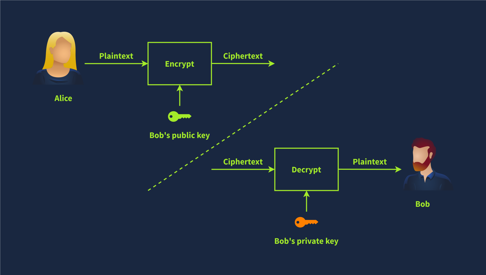
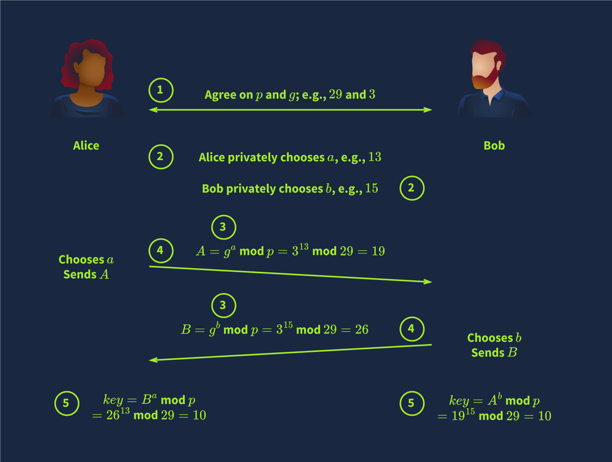

# Public Key Cryptography Basic
## Intro
* Activate attackerbox and labmachine
* ping from attackerbox to labmachine
* login ssh user@labmachineIP

IP, User and Password are given by THM

## Common Use of Asymmetric Encryption
| Analogy |	Cryptographic System |
|---------|----------------------|
| Secret Code |	Symmetric Encryption Cipher and Key |
| Lock |	Public Key |
| Lock’s Key |	Private Key |

## RSA
RSA is a public-key encryption algorithm that enables secure data transmission over insecure channels. With an insecure channel, we expect adversaries to eavesdrop on it.
### The Math That Makes RSA Secure

RSA is based on the mathematically difficult problem of factoring a large number. Multiplying two large prime numbers is a straightforward operation; however, finding the factors of a huge number takes much more computing power.

### Numerical Example

* Bob chooses two prime numbers: p = 157 and q = 199. He calculates n = p × q = 31243.
* With ϕ(n) = n − p − q + 1 = 31243 − 157 − 199 + 1 = 30888, Bob selects e = 163 such that e is relatively prime to ϕ(n); moreover, he selects d = 379, where e × d = 1 mod ϕ(n), i.e., e × d = 163 × 379 = 61777 and 61777 mod 30888 = 1. The public key is (n,e), i.e., (31243,163) and the private key is $(n,d), i.e., (31243,379).
* Let’s say that the value they want to encrypt is x = 13, then Alice would calculate and send y = xe mod n = 13163 mod 31243 = 16341.
* Bob will decrypt the received value by calculating x = yd mod n = 16341379 mod 31243 = 13. This way, Bob recovers the value that Alice sent.

## Diffie-Hellman Key Exchange


Diffie-Hellman Key Exchange is often used alongside RSA public key cryptography. Diffie-Hellman is used for key agreement, while RSA is used for digital signatures, key transport, and authentication, among many others.

## SSH
* Done the server auth from intro

### The Manual
```bash
man ssh-keygen
```
* ```ssh-keygen``` is the program usually used to generate key pairs. It supports various algorithms, as shown on its manual page below.

```bash
user@ipmachine ssh-keygen -t ed25519
Generating public/private ed25519 key pair.
Enter file in which to save the key (/home/user/.ssh/id_ed25519): id_ed25519.pub
Enter passphrase (empty for no passphrase): 
Enter same passphrase again: 
Your identification has been saved in id_ed25519.pub
Your public key has been saved in id_ed25519.pub.pub
The key fingerprint is:
SHA256:VoyoCtGH63SpYBmmG4DovpaEAv/YVrjtrgOEoj9Zf0g user@ip-10-48-136-157
The key's randomart image is:
+--[ED25519 256]--+
|                 |
|o. .   . o       |
|=+o . . . o      |
|O.+o o   .       |
|X*o +.  S        |
|*Oo+o E.         |
|+o=B * .         |
| o* * + .        |
|.. o.=o.         |
+----[SHA256]-----+

```
* Purpose: Generates a highly secure, modern SSH key pair (public and private keys) using the Ed25519 Elliptic Curve Digital Signature Algorithm (EdDSA).
* **Key Flag:**
    * -t (Type): Specifies the cryptographic algorithm to use for the key pair.
    * ed25519: Instructs the tool to use the Ed25519 algorithm, which offers faster signing speeds, smaller key sizes, and superior security compared to legacy RSA algorithms.
* Use Case: Creating a secure authentication key pair

### SSH Private Keys
As just mentioned, you should treat your private SSH keys like passwords. Never share them under any circumstances; they’re called private keys for a reason. Someone with your private key can log in to servers that accept it, i.e., include it among the authorised keys, unless the key is encrypted with a passphrase.


### Using SSH Keys to Get a “Better Shell”
During CTFs, penetration testing, and red teaming exercises, SSH keys are an excellent way to “upgrade” a reverse shell, assuming the user has login enabled. Note that www-data usually does not allow this, but regular users and root will work. Leaving an SSH key in the authorized_keys file on a machine can be a useful backdoor, and you don’t need to deal with any of the issues of unstabilised reverse shells like Control-C or lack of tab completion.

There will be question about SSH using attacker box.

## Digital Signatures and Certificate
Digital signatures provide a way to verify the authenticity and integrity of a digital message or document. 


> [!TIP]
> Certificates: Prove Who You Are!

free TLS certificate for website
https://letsencrypt.org/
## PGP and GPG
```bash
gpg --import backup.key
```
* **Purpose:** Imports the key from file to local keyring
* **Key Flag:**
    * `gpg`	: GNU Privacy Guard tool executable.
    * `--import`:	The action flag instructing GPG to read and parse the input file to add new keys or update existing keys in your local keyring.
    * `backup.key`: The path to the file containing the exported key data (can be .key, .asc, or .gpg).
* **Key Use Cases**
    * Disaster Recovery: Restoring your private and public keys after setting up a fresh operating system, replacing a device, or recovering from hardware failure.
    * Key Migration: Moving your encryption/signing identity from one workspace or machine to another.
    * Adding Peer Keys: Importing public keys provided by collaborators, team members, or open-source software providers to verify their signatures or send them encrypted data.
    * Updating Expiration/Subkeys: Refreshing an existing key in your local database with new subkeys or updated expiration dates exported from another location.

```bash
gpg --decrypt confidential_message.gpg
```
* **Purpose** Decrypts an OpenPGP-encrypted file (confidential_message.gpg) using GnuPG (GPG) and outputs the original unencrypted contents to the terminal or a file.
* **Key Flag**
    * --decrypt (or -d): Instructs GPG to perform a decryption operation on the specified encrypted input file.
* **Use Case** Accessing sensitive, encrypted files—such as secret keys, confidential reports, or private messages—sent securely by a colleague or stored safely on a system.