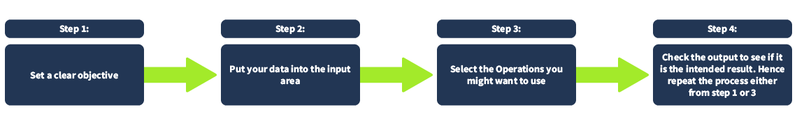
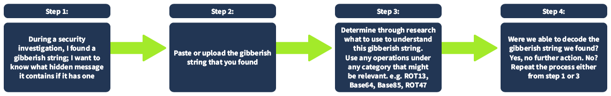

# CyberChef: The Basics
## Intro
* **Overview:** Introduces CyberChef as a versatile, intuitive web-based application—often called a "Swiss Army knife" for data—that allows cybersecurity professionals to perform various data operations directly in the browser.
* **Capabilities:** Includes a wide range of tools for tasks starting from simple data encodings (like XOR and Base64) to complex cryptographic functions (like AES encryption and RSA decryption).
* **Core Mechanism:** Operates using recipes, which are simply a series of operations structured and executed in a specific order to process data.
* **Learning Objectives:** The room will cover what CyberChef is, how to navigate its interface, common data operations, and how to create data-processing recipes.
* **Prerequisites:** Recommends completing the Hashing Basics and Cryptography Basics rooms prior to starting, though they are not strictly mandatory.

## Accessing the Tool
* **Overview:** Explains the two most convenient methods for accessing and running the CyberChef application.
* **Access Methods:**
    * **Online Access:** CyberChef can be accessed directly within a web browser, requiring only an active internet connection. [Online Link](https://gchq.github.io/CyberChef/)
    * **Offline or Local Copy:** A release file can be downloaded to run the tool locally on both Windows and Linux machines without an internet connection. It is recommended to always download the most stable version. [Offline Link](https://github.com/gchq/CyberChef/releases)

## Navigating the Interface
* **Overview:** Breaks down the CyberChef interface into four primary, interconnected areas used to process and manipulate data.
* **The Four Main Areas:**
    * **Operations Area:** A searchable, comprehensive repository of all data transformation functions (such as URL Encode, To Base64, ROT13, To Hex). Hovering over an operation displays a description, sample use case, and a relevant Wikipedia link.
    * **Recipe Area:** Considered the "heart of the tool," this is where users drag, drop, and arrange selected operations into a sequence. You can define arguments, save/load/clear recipes, and execute the process using the BAKE! button (or enable "Auto Bake" for real-time processing).
    * **Input Area:** The space to supply raw data by typing, pasting, or uploading files/folders. It supports creating multiple input tabs to manage different data sets seamlessly.
    * **Output Area:** Displays the final results after the input data has passed through the recipe. It includes utility features to save the output as a `.dat` file, copy the raw output to the clipboard, or instantly replace the original input with the new output for further processing.

## Before Anything Else
* **Overview:** Details a fundamental four-step strategic thought process to follow before diving into data manipulation with CyberChef.

* **The Four Steps:**
    * **Step 1: Set a clear objective:** Define specific and achievable goals by asking, "What do I want to accomplish?" (e.g., decoding a specific gibberish string found during an investigation).
    * **Step 2: Input your data:** Paste or upload your target data into CyberChef's input area.
    * **Step 3: Select the Operations:** Determine which operations are needed based on your objective. This may require some research (e.g., if you suspect encryption, you might select `Base64`, `ROT13`, or `ROT47` from the Encryption/Encoding category).
    * **Step 4: Check the output:** Evaluate the final result to see if it meets your original objective. If the output isn't what you expected, you may need to repeat the process starting from step 1 or 3.

## Practice, Practice, Practice
* **Overview:** Explores commonly used operation categories in CyberChef to prepare for practical application, including Extractors, Date/Time, and Data Formatting tools.
* **Extractors:** Used to pull specific data types from raw input:
    * **Extract IP addresses:** Finds valid IPv4 and IPv6 addresses.
    * **Extract URLs:** Pulls Uniform Resource Locators (requires a protocol like HTTP or FTP to avoid false positives).
    * **Extract email addresses:** Extracts strings following the standard `anything@domain.com` format.
* **Date and Time:** Covers converting between human-readable datetime strings and UNIX timestamps (a 32-bit value representing the number of seconds since January 1, 1970, UTC).
* **Data Format (Base Encodings & Decoding):**
    * Explains various data encoding notations like Base64, Base85, Base58, and Base62, which transform binary data into text-based ASCII formats.
    * Explains URL Decoding, which converts percent-encoded characters (e.g., `%3A` for `:`, `%2F` for `/`) back to their raw values.
    * Provides a manual, step-by-step breakdown of how Base64 encoding works under the hood by converting ASCII characters to 8-bit binary, splitting them into 6-bit chunks, converting those to decimal, and mapping them to a Base64 index table.
* **Practical Exercise:** Requires downloading a task file and applying the learned extractors and decoders within CyberChef to uncover specific hidden values.

## Your First Official Cook
* **Overview:** Provides a practical, hands-on opportunity to apply the data extraction, encoding, and conversion concepts learned in the previous tasks.
* **Workflow:** Users must leverage CyberChef's various operations to process raw strings and uncover the correct flags. This includes extracting specific IP addresses from a file, encoding plaintext to Base64, reverting URL-encoded strings back to standard URLs, converting UNIX timestamps into human-readable datetime formats, and decoding Base85 strings.