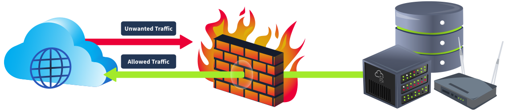

# Firewall Fundamentals
## What Is the Purpose of a Firewall
* **Overview:** Introduces the core concept of a firewall by comparing it to a physical security guard at a building entrance, explaining how it acts as a digital barrier to protect networks and systems.

* **Core Function:** Inspects all incoming and outgoing data traffic passing between a digital device and the internet, allowing or blocking traffic based on a predefined set of rules to prevent unauthorized access.
* **Learning Objectives:** Outlines the room's core goals, including understanding different firewall types, analyzing rule components, and completing hands-on labs with built-in Windows and Linux firewalls.

## Types of Firewalls
* **Overview:** Explores how different categories of firewalls operate across various OSI model layers to filter network traffic and provide distinct layers of security.

* **Common Types of Firewalls:**
    * **Stateless Firewall:** Operates at OSI Layers 3 and 4, filtering packets purely based on predetermined rules without keeping track of previous connections. While fast and efficient for high-speed networks, it treats every packet independently and cannot apply contextual policies.
    * **Stateful Firewall:** Also operates at OSI Layers 3 and 4, but maintains a state table to track previous connection states. This adds security by automatically allowing or blocking subsequent packets belonging to an established connection without re-inspecting each one individually.
    * **Proxy Firewall (Application-Level Gateway):** Operates at OSI Layer 7, acting as an intermediary between the private network and the internet. It inspects the actual content inside packets, enforces content-filtering policies, and masks internal IP addresses to ensure anonymity.
    * **Next-Generation Firewall (NGFW):** The most advanced type, operating from Layer 3 to Layer 7. It provides deep packet inspection, real-time threat blocking via an integrated Intrusion Prevention System (IPS), heuristic analysis to catch attack patterns, and SSL/TLS decryption and inspection capabilities.

## Rules in Firewalls
* **Overview:** Explores how firewalls use structured rules to control, filter, and inspect incoming and outgoing network traffic based on customized organizational requirements.
* **Core Components of a Firewall Rule:**
    * **Source Address:** The IP address of the machine originating the traffic.
    * **Destination Address:** The IP address of the machine receiving the data.
    * **Port:** The specific port number associated with the traffic.
    * **Protocol:** The communication protocol utilized (such as TCP).
    * **Action:** The step taken when traffic matches the rule's criteria.
    * **Direction:** Whether the rule applies to incoming or outgoing traffic.
* **Types of Actions:**
    * **Allow:** Permits the specified traffic to pass (e.g., allowing outgoing HTTP traffic on port 80).
    * **Deny:** Blocks and rejects the specified traffic (e.g., blocking incoming SSH traffic on port 21/22 from unauthorized sources).
    * **Forward:** Redirects incoming traffic to a different internal network segment or destination (e.g., routing incoming port 80 traffic to a specific web server).
    * **Rule Directionality:** Categorizes rules into Inbound (applied to incoming traffic), Outbound (applied to outgoing traffic), and Forward (applied to internal routing).

## Windows Defender Firewall
* **Overview:** Explores the built-in Windows Defender Firewall utility within the Windows operating system, covering how it manages network profiles and custom rule configurations to filter incoming and outgoing traffic.
* **Network Profiles:**
    * **Private Networks:** Tailored settings for trusted home environments.
    * **Guest or Public Networks:** Restrictive settings applied on untrusted public networks (such as coffee shops or restaurants) to block all incoming connections and only allow essential outbound traffic.
* **Custom Rules Configuration:**
    * Demonstrates how to use the Advanced Settings dashboard to configure granular Inbound and Outbound rules.
    * Walks through the rule wizard steps: selecting a Custom rule type, targeting All programs, defining protocols (such as TCP) and specific ports (like 80 and 443), configuring scopes, selecting actions like Block the connection, applying profiles, and naming the rule.

## Linux iptables Firewall
* **Overview:** Explores how Linux operating systems manage network traffic using the Netfilter framework and its associated management utilities.
* **Netfilter Framework Utilities:**
    * **iptables:** The traditional and most widely used utility across many Linux distributions to interact with Netfilter.
    * **nftables:** The modern successor to `iptables` featuring enhanced packet filtering and NAT capabilities.
    * **firewalld:** An alternative utility utilizing pre-built network zone configurations.
* **Using UFW (Uncomplicated Firewall):** A user-friendly frontend interface designed to simplify rule creation without dealing with complex `iptables` syntax.
    * **Checking Status:** `sudo ufw status`
    * **Enabling/Disabling:** `sudo ufw enable` or `sudo ufw disable`
    * **Managing Default Policies:** Setting default behaviors for traffic (e.g., `sudo ufw default allow outgoing`).
    * **Adding/Blocking Rules:** Blocking specific traffic types, such as denying incoming SSH connections using `sudo ufw deny 22/tcp`.
    * **Listing and Deleting Rules:** Inspecting active rules in a numbered sequence (`sudo ufw status numbered`) and removing unwanted rules (`sudo ufw delete <rule_number>`).