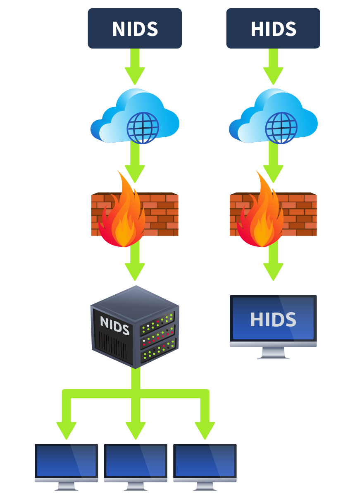

# IDS Fundamentals
# What Is an IDS
* **Overview:** Explores how an Intrusion Detection System (IDS) acts as an internal network surveillance mechanism to detect unauthorized or malicious activities that have successfully bypassed the perimeter firewall.
* **Core Function:** Continuously monitors network traffic using signature-based and anomaly-based detection methods, triggering real-time alerts for security administrators upon identifying abnormal behavior (without taking blocking or preventive actions itself).

## Types of IDS
* **Overview:** Explores how Intrusion Detection Systems are categorized based on two primary factors: how they are deployed within an environment and the methods they use to detect threats.

* **Deployment Modes:**
    * **Host Intrusion Detection System (HIDS):** Installed individually on specific devices (hosts). It provides detailed visibility into that specific machine's activities but is highly resource-intensive to manage across large networks.
    * **Network Intrusion Detection System (NIDS):** Monitors traffic across the entire network rather than focusing on specific hosts. It provides a centralized view of potential threats and malicious activities throughout the network.
* **Detection Modes:**
    * **Signature-Based IDS:** Detects threats by comparing traffic against a database of known attack patterns (signatures). While efficient for known attacks, it cannot detect new, unknown (zero-day) attacks.
    * **Anomaly-Based IDS:** Establishes a baseline of "normal" network behavior and alerts on any deviations. It can detect zero-day attacks but often generates false positives by flagging unusual but benign activity.
    * **Hybrid IDS:** Combines both signature and anomaly-based detection to leverage the speed of signature detection for known threats and the behavioral analysis of anomaly detection for novel attacks.

## IDS Example: Snort
* **Overview:** Introduces Snort, a widely used open-source IDS developed in 1998 that utilizes both signature-based and anomaly-based detection methods. It relies on rule files containing known attack patterns, allowing administrators to use built-in rules or configure custom ones for specific network traffic.
* **Modes of Snort:**
    * **Packet Sniffer Mode:** Reads and displays network packets without performing any threat analysis. It is highly useful for system administrators diagnosing issues or conducting general network monitoring and troubleshooting.
    * **Packet Logging Mode:** Logs raw network traffic and detections into a PCAP (packet capture) file instead of just displaying them in real-time. This is crucial for forensic investigators performing root cause analysis on past network attacks.
    * **Network Intrusion Detection System (NIDS) Mode:** The primary functional mode that proactively monitors network traffic in real-time, matching traffic against its rule files (signatures) to identify known attack patterns and generate alerts.

## Snort Usage
* **Overview:** Provides a practical guide on configuring, creating rules for, and running the Snort IDS against both live network traffic and historical packet captures.
* **Snort Directory Structure:**
    * The primary directory storing Snort's built-in rules, configuration files, and maps is `/etc/snort`.
    * The main configuration file where network ranges and settings are defined is `snort.lua`.
    * Custom rules are typically added to the `local.rules` file located within the `rules` folder.
* **Anatomy of a Snort Rule:** Rules dictate how Snort analyzes traffic and what triggers an alert.
    * **Action:** What to do when triggered (e.g., `alert`).
    * **Protocol:** The targeted protocol (e.g., `icmp`, `tcp`).
    * **Source / Destination:** Defines the origin and target IP addresses and ports (e.g., `any any -> $HOME_NET any`).
    * **Metadata:** Enclosed in parentheses, providing details like the alert message (`msg`), unique signature ID (`sid`), and rule revision number (`rev`).
* **Testing and Execution:**
    * **Live Traffic:** Run Snort targeting a specific interface using flags to define logging directories, interface names, alert modes, and the config file (e.g., `sudo snort -q -l /var/log/snort -i lo -A alert_fast -c /etc/snort/snort.lua`).
    * **PCAP Analysis:** Snort can also perform forensic analysis on historical network traffic saved in `.pcap` files by using the `-r` flag instead of specifying a live interface.

## Practical Lab
* **Overview:** Provides a hands-on forensic scenario where the user acts as a third-party investigator analyzing network traffic from a recent attack to identify malicious activity.
* **Lab Execution & Workflow:**
    * **Environment:** The user interacts with an isolated lab machine containing a packet capture file named `Intro_to_IDS.pcap` located in the `/etc/snort/` directory.
    * **PCAP Analysis:** Requires executing a Snort command against the provided PCAP file (using the read flag `-r` and pointing to the configuration file) to process the historical traffic against Snort's rule base.
    * **Log Investigation:** The user must review the generated alerts to identify the origin IP of an SSH brute-force attempt, discover other scanning activities happening simultaneously, and extract specific rule metadata (Signature IDs) that flagged the attack.

