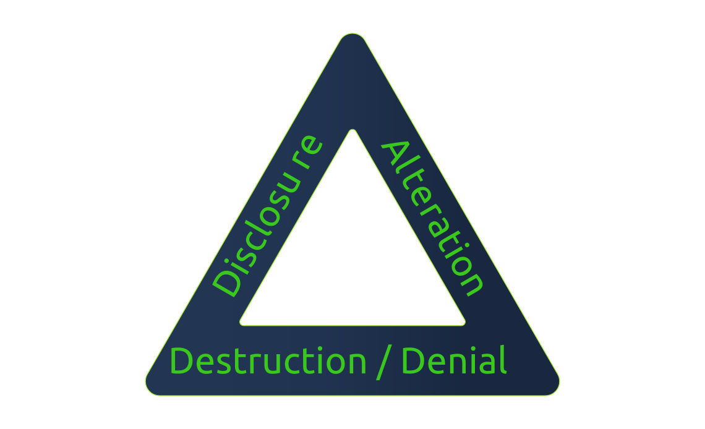
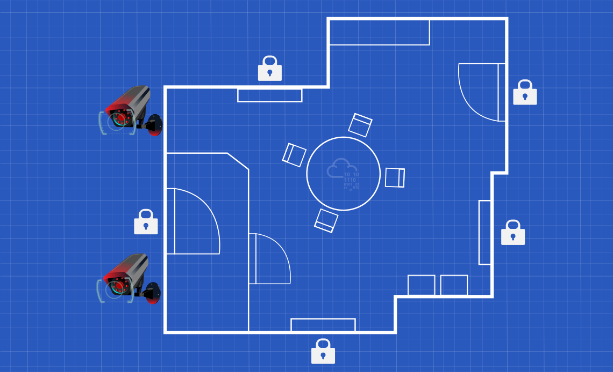

# Security Principles
## Intro
* **Overview:** Introduces the fundamental mindset required for cybersecurity, emphasizing that true "perfect security" does not exist.
* **Knowing the Adversary:** Highlights the importance of tailoring your protection mechanisms to fit the actual threat. For instance, defending a laptop against a toddler requires vastly different controls than protecting intellectual property worth millions against industrial espionage.
* **Room Objectives:** The Security Principles room covers the following core topics:
    * **CIA Triad:** Confidentiality, Integrity, and Availability.
    * **DAD Triad:** Disclosure, Alteration, and Destruction/Denial (the opposite of CIA).
    * **Security Models:** Fundamental concepts like the Bell-LaPadula model.
    * **Security Principles:** Defence-in-Depth, Zero Trust, Trust but Verify, and ISO/IEC 19249.
    * **Risk Terminology:** The distinctions between Vulnerability, Threat, and Risk.

## CIA Triad
* **Overview:** Explores the foundational CIA Triad (Confidentiality, Integrity, and Availability) in depth, detailing how each core security principle functions across various real-world scenarios like online shopping and healthcare data management.
* **The CIA Components:**
    * **Confidentiality:** Ensures that sensitive data (such as personal credentials, financial records, or military locations) is accessible only to authorized individuals or intended recipients.
    * **Integrity:** Guarantees that data remains accurate and unaltered during transit or storage, and that any unauthorized modifications can be successfully detected.
    * **Availability:** Ensures that critical systems, networks, and services are accessible and fully operational whenever users need them.
* **Beyond CIA (Authenticity & Nonrepudiation):** Extends the security triad to include requirements for verifying that data originates from its claimed source (Authenticity) and preventing the sender from denying their involvement (Nonrepudiation), which are essential attributes for valid business and legal transactions.
* **Parkerian Hexad:** Introduced by Donn Parker in 1998, this model expands the traditional triad into six security elements by adding Utility (usefulness of the data) and Possession (control over the physical or digital medium storing the data).

## DAD
* **Overview:** Introduces the DAD Triad (Disclosure, Alteration, and Destruction/Denial), which serves as the exact inverse of the CIA Triad and represents the three main categories of security attacks.

* **The DAD Components:**
    * **Disclosure:** The direct opposite of Confidentiality. It occurs when unauthorized individuals gain access to and expose secret or sensitive data (e.g., leaking stolen customer records online).
    * **Alteration:** The direct opposite of Integrity. It involves modifying, tampering with, or corrupting data so it is no longer accurate or trustworthy (e.g., altering medical records or financial cheques, which can have life-threatening or severe legal consequences).
    * **Destruction / Denial:** The direct opposite of Availability. It involves wiping data, taking systems offline, or blocking access to essential services so that legitimate users cannot utilize them (e.g., shutting down power supplies to crash a network).
* **The Security Balance:** Achieving good security requires balancing these competing priorities, as hardening a system too heavily against disclosure and alteration can restrict availability, while maximizing availability can expose systems to disclosure and alteration vulnerabilities.

## Fundamental Concepts of Security Models
* **Overview:** Explores foundational security models designed to enforce specific security functions like confidentiality and integrity within systems.
* **Bell-LaPadula Model:** Focuses on achieving confidentiality through three primary rules:
    * **Simple Security Property ("no read up"):** Subjects cannot read objects at a higher security level.
    * **Star Security Property ("no write down"):** Subjects at a higher security level cannot write to objects at a lower security level (summarized as "write up, read down").
    * **Discretionary-Security Property:** Uses an access matrix to control read and write operations.
    * **Limitations:** Not designed to handle file-sharing effectively.
* **Biba Integrity Model:** Focuses on achieving integrity (acting as the inverse of Bell-LaPadula) through two main rules:
    * **Simple Integrity Property ("no read down"):** Higher-integrity subjects cannot read lower-integrity objects.
    * **Star Integrity Property ("no write up"):** Lower-integrity subjects cannot write to higher-integrity objects (summarized as "read up, write down").
    * **Limitations:** Does not handle internal/insider threats well.
* **Clark-Wilson Model:** Also focuses on integrity by utilizing specific concepts to maintain data validity:
    * **Constrained Data Item (CDI):** Data whose integrity must be preserved.
    * **Unconstrained Data Item (UDI):** Data outside CDI control, such as raw user or system inputs.
    * **Transformation Procedures (TPs):** Programmed operations that maintain the integrity of CDIs.
    * **Integrity Verification Procedures (IVPs):** Procedures that check and ensure the validity of CDIs.
* **Other Security Models:** Mentions alternative models for further exploration, including the Brewer and Nash, Goguen-Meseguer, Sutherland, Graham-Denning, and Harrison-Ruzzo-Ullman models.

## Defence-in-Depth
* **Overview:** Explores the strategy of Defence-in-Depth (also known as Multi-Level Security), which relies on layering multiple independent defensive controls to protect assets rather than depending on a single security barrier.

* **The Blueprint Analogy:** Compares digital security to protecting physical valuables—instead of just locking a desk drawer, a robust system secures the drawer, locks the office room, secures the building entrance, and implements security cameras at the gates.
* **Purpose:** While multiple layers cannot entirely stop every sophisticated attacker, they successfully block casual intruders, slow down advanced threats, and buy valuable time for security teams to detect and respond to breaches.

## ISO/IEC 19249
* **Overview:** Explores ISO/IEC 19249:2017, an international standard providing a comprehensive catalogue of architectural and design principles for secure products, systems, and applications.
* **Architectural Principles:** Focuses on structural system design:
    * **Domain Separation:** Isolating related components (applications, data, resources) into distinct security domains (e.g., x86 ring privilege levels).
    * **Layering:** Structuring systems into abstract levels or layers to enforce and validate security policies (e.g., the OSI model).
    * **Encapsulation:** Hiding low-level implementations and preventing direct data manipulation through strict interfaces or methods.
    * **Redundancy:** Ensuring availability and integrity through duplicated components (e.g., redundant power supplies, RAID configurations).
    * **Virtualization:** Sharing physical hardware among multiple isolated operating systems to provide sandboxing and secure detonation.
* **Design Principles:** Focuses on secure operational implementation:
    * **Least Privilege:** Granting users or processes only the minimum access necessary to perform their tasks.
    * **Attack Surface Minimisation:** Reducing vulnerabilities by disabling unneeded services and shrinking the system's overall footprint.
    * **Centralized Parameter Validation:** Consolidating input checking into a single library or service to prevent exploitation (like injection or remote code execution).
    * **Centralized General Security Services:** Centralizing security functions, such as authentication, while avoiding single points of failure.
    * **Preparing for Error and Exception Handling:** Designing systems to fail safe (e.g., a crashed firewall blocking all traffic) without leaking confidential information in error messages.

## Zero Trust versus Trust but Verify
* **Overview:** Explores the contrasting philosophies of managing trust within enterprise security architectures: Trust but Verify versus Zero Trust.
* **Trust but Verify:**
    * Teaches that entities (users or systems) can be trusted but their behavior must still be actively monitored and checked.
    * Relies heavily on proper logging and automated security mechanisms like proxy services, intrusion detection systems (IDS), and intrusion prevention systems (IPS) because manual review is impractical.
* **Zero Trust:**
    * Treats trust itself as a vulnerability and seeks to eliminate it entirely, following the premise of "never trust, always verify."
    * Assumes every entity is adversarial until proven otherwise, granting no implicit trust based on network location, device ownership, or corporate network boundaries.
    * Requires strict authentication and authorization for every single resource access attempt, minimizing lateral movement if a breach occurs.
* **Microsegmentation:** A key implementation of zero trust architecture where network segments can be as small as a single host, requiring authentication, access control list checks, and security validation for all inter-segment communications.

## Threat versus Risk
* **Overview:** Explores the distinctions between three critical security concepts: Vulnerabilities, Threats, and Risks.
* **Core Definitions:**
    * **Vulnerability:** A weakness or flaw in a system, application, network, or physical environment that makes it susceptible to attack or damage.
    * **Threat:** A potential danger or malicious actor associated with exploiting a specific vulnerability.
    * **Risk:** The combined measure of the likelihood that a threat actor will successfully exploit a vulnerability, and the resulting impact on the business or organization.
* **Practical Analogy:** Compares a glass-walled car showroom to an enterprise IT environment. Standard glass represents a vulnerability, the possibility of someone breaking the glass represents a threat, and evaluating the likelihood of a break-in alongside the financial or operational impact determines the overall risk.
