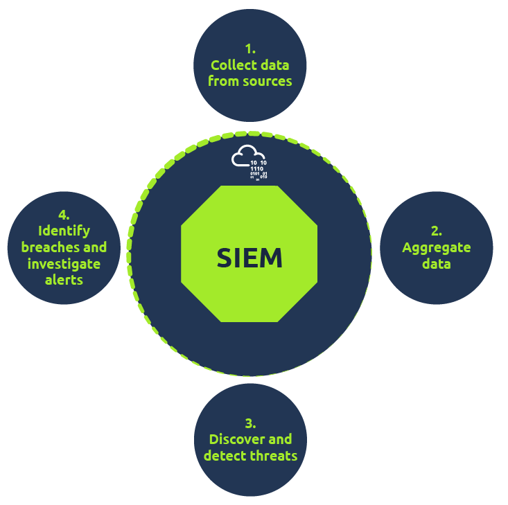
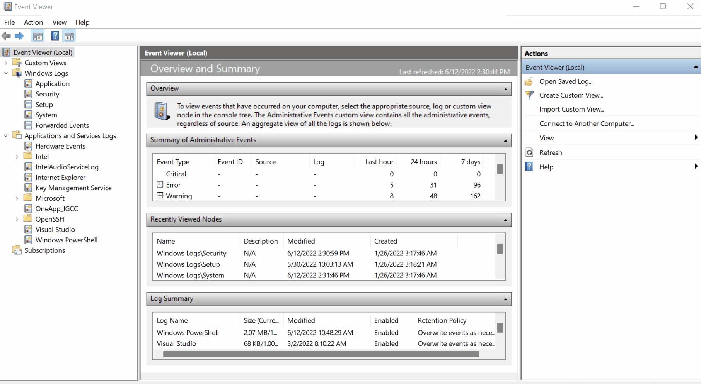

# Introduction to SIEM
## Intro
* **Overview:** Introduces Security Information and Event Management (SIEM) as the core security solution utilized by SOC analysts within a Security Operations Center to centralize log data.
* **Core Concepts:** Explains how diverse devices across a corporate network continuously generate logs, and why having a centralized platform is crucial to collect, normalize, and correlate these records efficiently.
* **Learning Objectives:** Outlines the room's core goals, including understanding log source types, recognizing the limitations of isolated logs, exploring SIEM features, and studying alerting and alert analysis workflows.

## Logs Everywhere, Answers Nowhere
* **Overview:** Explores how devices across a network constantly generate massive streams of logs and outlines the critical challenges analysts face when dealing with them in isolation.
* **Log Source Categories:**
    * **Host-Centric Log Sources:** Capture events occurring within or related to specific hosts (Windows, Linux, servers), such as file access, authentication attempts, process executions, registry modifications, and PowerShell commands.
    * **Network-Centric Log Sources:** Generated when hosts communicate with each other or access the internet via firewalls, IDS / IPS, and routers, capturing activities like SSH connections, FTP file transfers, web traffic, VPN access, and network sharing.
* **Challenges of Decentralized Log Analysis:**
    * **Numerous Log Sources:** Networks generate hundreds of events per second across scattered devices.
    * **No Centralization:** Manually connecting to individual machines via RDP or SSH to inspect logs is tedious and inefficient.
    * **Limited Context:** Individual logs look harmless on their own, but correlating multiple sources reveals the full story of an attack (such as tracing lateral movement).
    * **Limited Analysis:** The sheer volume of logs makes manual analysis impossible, causing analysts to miss critical indicators.
    * **Format Issues:** Different devices produce logs in varied formats, requiring analysts to understand numerous structures.

## Why SIEM?
* **Overview:** Explores how a Security Information and Event Management (SIEM) solution efficiently manages the flood of decentralized logs and provides robust operational features to enhance security.

* **Core Features of SIEM:**
    * **Centralized Log Collection:** Gathers logs from diverse network sources (endpoints, servers, firewalls) into a single platform using lightweight agents or APIs, eliminating the need to manually check individual machines.
    * **Normalization of Logs:** Breaks down raw logs into specific fields (parsing) and converts various log formats into a single consistent structure (normalization).
    * **Correlation of Logs:** Links independent events across different sources to uncover complex attack patterns (such as combining a new VPN login IP, shared drive document access, and an outbound connection to detect potential data exfiltration).
    * **Real-time Alerting:** Triggers alerts based on default or custom detection rules when malicious conditions are met, notifying analysts for immediate investigation.
    * **Dashboards and Reporting:** Summarizes analyzed data into actionable visual insights, displaying metrics like alert highlights, system health, failed login counts, triggered rules, and top domains visited (such as in Splunk).
* **Additional Capabilities:** Includes threat intelligence feed integration, extensive data retention, and powerful searching tools.

## Log Sources and Ingestion
* **Overview:** Explores where common network devices generate logs and details how those diverse log streams are ingested into a central SIEM platform.

* **Common Log Sources:**
    * **Windows Machine:** Records activity through the Event Viewer using unique Event IDs for each type of action (such as logins, process creations, and system warnings).
    * **Linux Machine:** Stores system logs in standard directories, including `/var/log/httpd` (HTTP requests/responses and errors), `/var/log/cron` (cron job events), `/var/log/auth.log` or `/var/log/secure` (authentication logs), and `/var/log/kern` (kernel events).
    * **Web Server:** Captures all incoming and outgoing client requests and server responses to identify potential web attacks. In Linux environments, Apache-related logs are commonly found in `/var/log/apache` or `/var/log/httpd`.
* **Log Ingestion Methods:**
    * **Agent / Forwarder:** Lightweight tools installed on endpoints (such as Splunk forwarders) to capture and forward logs to the SIEM server.
    * **Syslog:** A standard protocol used to collect and stream real-time data from web servers, databases, and other systems to a central collector.
    * **Manual Upload:** Ingesting offline data files into platforms like Splunk or ELK for retroactive analysis.
    * **Port-Forwarding:** Configuring SIEM solutions to listen on specific ports where endpoints can push their logs directly.

## Alerting Process and Analysis
* **Overview:** Explores how SIEM solutions use detection rules (logical expressions) to catch threats and trigger alerts, enabling analysts to respond in a timely manner.
* **How Detection Rules Work:**
    * Monitor specific field-value pairs in normalized logs (such as tracking failed login counts, USB connections, or data exfiltration thresholds).
* **Use-Case 1 (Log Clearing):** Triggers an alert when a user attempts to clear event logs (e.g., matching Windows Event ID 104).
* **Use-Case 2 (Suspicious Process Execution):** Triggers an alert when a specific command like whoami is executed (e.g., matching process creation Event ID 4688 combined with the process name).
* **Alert Investigation & Triage Workflow:**
    * Analysts examine dashboards, associated events, flows, and the rules triggered to evaluate validity.
    * **False Positives:** May require tuning the detection rule to prevent future recurrences.
    * **True Positives:** Trigger further investigation, contacting asset owners, isolating infected hosts, or blocking suspicious IPs.

## Lab Work
* **Overview:** Provides a hands-on interactive lab simulating a SIEM dashboard environment to investigate alerts and trace malicious activities within a network.
* **Lab Investigation Workflow:**
    * **Simulate Activity:** Triggers simulated suspicious events using the lab interface to observe how detection rules catch threats in real time.
    * **Process Analysis:** Identifies the specific malicious or suspicious process execution that tripped the SIEM alert.
    * **User and Host Tracking:** Pinpoints the user account responsible for running the process and identifies the affected host's hostname.
    * **Rule Matching:** Examines the triggered alert's underlying rule definition to discover which exact term or parameter matched the malicious activity.
    * **Triage and Response:** Evaluates whether the alert is a true positive or false positive, and executes the proper response action to resolve the incident and reveal the final exercise flag.

