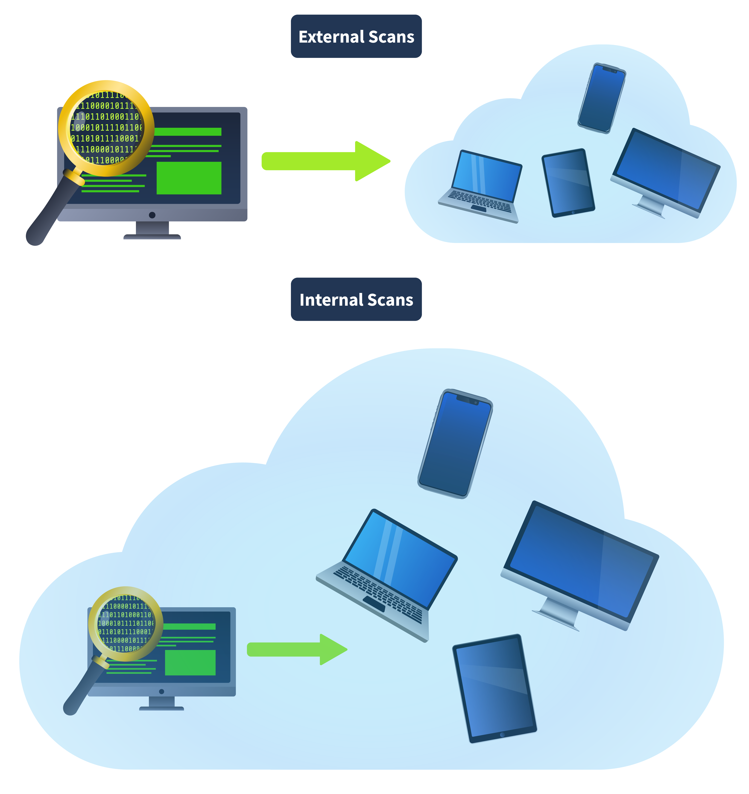

# Vulnerability Scanner Overview
## What Are Vulnerabilities?
* **Overview:** Introduces the concept of digital vulnerabilities using a real-world analogy of a leaky roof, explaining how weaknesses in systems can be exploited by attackers if left unaddressed.
* **Core Concepts:**
    * **Vulnerabilities:** Weaknesses in software programs or hardware that hackers can leverage to compromise a digital device. Unlike physical holes, these digital weaknesses are often hidden and require dedicated hunting to discover.
    * **Patching:** The process of repairing and applying fixes to these discovered vulnerabilities to protect the system and prevent potential compromises.
* **Learning Objectives:** Outlines the room's goals, which include understanding vulnerability scanning types, exploring scanning tools, and practically demonstrating the OpenVAS vulnerability scanner.

## Vulnerability Scanning
* **Overview:** Explains the necessity of automated vulnerability scanning to efficiently inspect digital systems and networks for weaknesses, helping organizations apply patches, prevent compromises, and meet regulatory compliance.

* **Authenticated vs. Unauthenticated Scans:**
    * **Authenticated Scans:** Require target host credentials to provide deep visibility into configurations and installed applications. They identify vulnerabilities from the perspective of an attacker who already has access to the host.
    * **Unauthenticated Scans:** Only require an IP address (no credentials). They are less resource-intensive and identify surface-level vulnerabilities that an external attacker without system access could exploit.
* **Internal vs. External Scans:**
    * **Internal Scans:** Conducted from within the network to find weaknesses exposed to attackers who have already breached the network perimeter.
    * **External Scans:** Conducted from outside the network to identify vulnerabilities on public-facing assets that can be exploited externally.

## Tools for Vulnerability Scanning
* **Overview:** Explores several popular automated vulnerability scanning tools, highlighting their unique features, deployment methods, and reporting capabilities.
* **Widely Used Vulnerability Scanners:**
    * **Nessus:** Originally open-source in 1998, but acquired by Tenable in 2005 and is now proprietary. It requires on-premises deployment and offers both a limited free version and a comprehensive commercial version for large enterprises.
    * **Qualys:** A cloud-based, subscription-based solution introduced in 1999. It eliminates physical hardware management costs and provides continuous scanning, asset management, and automated alerts.
    * **Nexpose:** Developed by Rapid7 in 2005, this subscription-based tool offers continuous asset discovery and vulnerability risk scoring based on asset value and impact. It supports both on-premises and hybrid deployments.
    * **OpenVAS (Open Vulnerability Assessment System):** A fully open-source scanner developed by Greenbone Security. While it offers more basic features compared to commercial counterparts, it is highly effective for small organizations and individual systems.
* **Reporting Capabilities:** All mentioned scanners generate detailed reports containing discovered vulnerabilities, risk scores, and descriptions. Advanced tools also provide specific remediation methods and various export formats.

## CVE & CVSS
* **Overview:** Explores how security professionals track, identify, and prioritize discovered vulnerabilities using standardized naming and scoring frameworks.
* **CVE (Common Vulnerabilities and Exposures):** Functions as a unique tracking identifier for newly discovered software vulnerabilities, making it easy to reference and find remediation details in public databases.
    * Developed and maintained by the MITRE Corporation.
    * **Naming Convention:** Consists of the prefix "CVE", the year it was discovered, and four or more arbitrary digits (e.g., CVE-2024-9374).
* **CVSS (Common Vulnerability Scoring System):** A numerical score ranging from 0 to 10 that dictates the severity of a vulnerability, helping IT teams prioritize which issues to patch first based on impact and exploitability.
    * **Severity Levels:**
        * 0.0 - 3.9: **Low**
        * 4.0 - 6.9: **Medium**
        * 7.0 - 8.9: **High**
        * 9.0 - 10.0: **Critical**

## OpenVAS
* **Overview:** Explores the practical application of OpenVAS, a comprehensive open-source vulnerability scanner, covering its installation process and dashboard navigation to execute network scans.
* **Installation & Access:**
    * **Docker Deployment:** Because installing OpenVAS natively on Linux can be complex due to numerous dependencies, it is highly recommended to use Docker. Deploying a pre-configured image (such as the one by immauss) ensures all dependencies are packed into a single container using the command: `sudo docker run -d -p 443:443 --name openvas immauss/openvas`.
    * **Web Interface:** Once the container is running, the OpenVAS graphical dashboard can be accessed locally via a web browser at [https://127.0.0.1](https://127.0.0.1).
* **Performing a Scan:**
    * **Creating a Task:** To initiate a scan, navigate to Scans > Tasks, click the star icon, and select "New Task".
    * **Target Configuration:** Enter a task name and define the Scan Targets by supplying the target machine's IP address. After selecting the desired scan options and scope, create the task.
    * **Execution:** Start the task using the "play" button located under the Actions column. The dashboard will update the status to "Done" once finished and generate visualizations reflecting the severity of the findings.
    * **Reviewing Results:** By clicking the task name and the number indicating the vulnerability count, analysts can view a detailed list of all discovered weaknesses, examine specific severity details, and export the findings into standardized reports.

## Practical Exercise
* **Overview:** A hands-on scenario where the user acts as an information security engineer tasked with reviewing an OpenVAS vulnerability scan report for a critical server.
* **Workflow & Lab Execution:**
    * **Access the Environment:** Connect to the provided virtual machine.
    * **Reviewing the Report:** The most direct method is to open and analyze the pre-generated vulnerability scan report placed on the lab machine's desktop.
    * **Running a Manual Scan (Optional):** Alternatively, start the OpenVAS Docker container via the terminal (`docker start openvas`), log into the local web interface ([https://127.0.0.1](https://127.0.0.1) using `admin`:`admin`), and manually perform the scan to generate the results.
    * **Analysis:** Review the findings to identify high-severity vulnerabilities, note their severity scores, and extract the tool's suggested remediation steps.