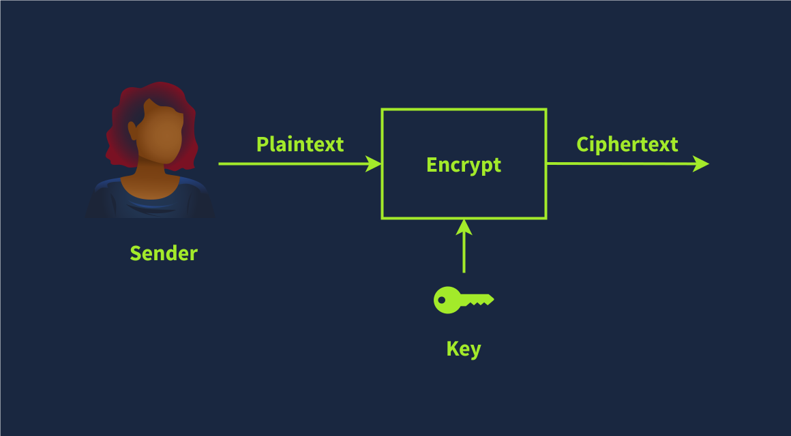

# Introduction to Cryptography
## Task 1: Intro
* **Overview:** Introduces basic cryptographic concepts in the Introduction to Cryptography room on TryHackMeTask 6, titled PKI and SSL/TLS, covers the foundational systems that secure modern web traffic and verify digital identities.
* **Public Key Infrastructure (PKI):** A comprehensive framework consisting of hardware, software, policies, and procedures needed to create, manage, distribute, use, store, and revoke digital certificates. It relies on a hierarchy of Certificate Authorities (CAs) that issue digital certificates to bind a public key to a specific entity (such as a website owner).
* **Digital Certificates:** Electronic documents used to prove the ownership of a public key. They typically include information about the key holder, the expiration date, and the digital signature of the issuing CA, allowing users to trust that they are communicating with the legitimate server.
* **Secure Sockets Layer (SSL) and Transport Layer Security (TLS):** Cryptographic protocols designed to provide secure communications over a computer network. TLS is the modern successor to SSL. They use a TLS Handshake process—combining asymmetric encryption for secure key exchange and symmetric encryption for fast data transfer—to ensure confidentiality, integrity, and authentication for web browsing, email, and other traffic.

## Task 2: Symmetric Encryption
* **Overview:** Explores symmetric encryption principles, where a single shared secret key is used for both encrypting and decrypting data to achieve confidentiality, integrity, and authenticity.

* **Key Concepts & Terminology:**
    * **Plaintext & Ciphertext:** Original unencrypted data versus its encoded, encrypted form.
    * **Block vs. Stream Ciphers:** Block ciphers (such as AES and DES) process data in fixed-size blocks (typically 128 bits), while stream ciphers encrypt data byte by byte.
* **Historical & Modern Algorithms:**
    * **DES:** Published by NIST in 1977 with a 56-bit key, now insecure due to rapid brute-force capabilities.
    * **AES:** Published in 2001 utilizing 128, 192, or 256-bit key lengths, serving as the modern standard.
    * **Other Supported Ciphers:** Includes IDEA, 3DES (deprecated), Blowfish, Twofish, and Camellia.
* **Key Distribution Challenge:** Explains that symmetric encryption scales poorly as user numbers grow because every pair of communicating users requires a unique shared key (e.g., 100 users require nearly 5,000 distinct keys).
* **Practical Tools:** Demonstrates how to encrypt and decrypt files using command-line utilities like GPG (gpg --symmetric) and OpenSSL (openssl aes-256-cbc) with password-based key derivation functions (PBKDF2).

## Task 3: Asymmetric Encryption
* **Overview:** Explores asymmetric encryption (public-key cryptography), which solves the key exchange problem of symmetric cryptography by utilizing a mathematically linked key pair: a public key shared with the world and a private key kept strictly secret.
* **Core Security Objectives:**
    * **Confidentiality:** Achieved by encrypting a message using the recipient's public key so only their private key can decrypt it.
    * **Integrity, Authenticity, and Nonrepudiation:** Achieved when the sender encrypts a message hash using their private key; because anyone can decrypt it with the sender's public key, it proves the message was unmodified, genuinely originated from that specific sender, and cannot be repudiated.
* **The RSA Algorithm:** Operates on the mathematical difficulty of factoring the product of two large prime numbers (p and q). It generates a public modulus (N) along with public and private exponents (e and d) to handle encryption and decryption.
* **OpenSSL Practical Operations:** Demonstrates how to generate an RSA private key (`openssl genrsa`), extract the public key (`openssl rsa -pubout`), inspect internal prime components (`-text -noout`), and perform encryption or decryption (`openssl pkeyutl`).

## Task 4: Diffie-Hellman Key Exchange
* **Overview:** Explores the Diffie-Hellman Key Exchange protocol, an asymmetric method that allows two parties (historically named Alice and Bob) to securely establish a shared secret key over an insecure, public communication channel without transmitting the secret itself.
* **Core Mechanics & Workflow:**
    * **Public Parameters:** Both parties agree on a large prime number ($q$) and a generator ($g$).
    * **Private Keys:** Each party independently generates a random secret number ($a$ for Alice, $b$ for Bob) smaller than $q$.
    * **Public Values:** They compute their public values ($A = g^a \pmod q$ and $B = g^b \pmod q$) and exchange them over the public channel.
    * **Shared Secret Calculation:** Alice receives $B$ and computes $\text{key} = B^a \pmod q$; Bob receives $A$ and computes $\text{key} = A^b \pmod q$, resulting in the exact same shared secret key.
* **Security & Vulnerability:**
    * Relies on the discrete logarithm problem, making it computationally infeasible for an eavesdropper to compute the private keys or the shared secret even when knowing $q$, $g$, $A$, and $B$ (especially with large 256-bit or 2048-bit primes).
    * **MitM Risk Warning:** By default, the basic Diffie-Hellman key exchange is vulnerable to Man-in-the-Middle (MitM) attacks because it lacks built-in authentication, requiring additional mechanisms (like digital certificates) to verify identities.
* **OpenSSL Practical Operations:** Demonstrates how to generate and inspect Diffie-Hellman parameter files (`dhparam.pem`) using commands like `openssl dhparam -out dhparams.pem 2048` and `openssl dhparam -in dhparams.pem -text -noout`.

## Task 5: Hashing
* **Overview:** Explores cryptographic hash functions and Hash-based Message Authentication Codes (HMAC), which play a vital role in ensuring data integrity and secure password storage.
* **Key Concepts & Properties:**
    * **Message Digest / Checksum:** An algorithm (like SHA256) that takes data of any size and transforms it into a fixed-size value represented as hexadecimal digits.
    * **The Avalanche Effect:** Even a single bit change in the input file drastically changes the entire resulting hash value, making it easy to detect intentional tampering or file corruption.
    * **Password Storage & Integrity:** Hashes allow systems to verify passwords securely without storing plaintext values, while also enabling immediate file verification.
    * **Hash Collisions:** Older hash functions like MD5 and SHA-1 are cryptographically broken because attackers can generate different files that produce the exact same checksum.
    * **Hash-Based Message Authentication Code (HMAC):** Combines a cryptographic hash function with a secret key to provide both data integrity and authentication.
* **Terminal Utilities:** Demonstrates how to generate checksums and compute HMACs using commands like `sha256sum`, `hmac256`, and `sha256hmac`.

## Task 6: PKI and SSL/TLS
* **Overview:** Explores Public Key Infrastructure (PKI) and SSL/TLS protocols, which establish trust, data confidentiality, and integrity across the internet through cryptographic certificates and secure handshakes.
* **The Man-in-the-Middle (MitM) Vulnerability:** Highlights that basic Diffie-Hellman key exchanges are vulnerable to MitM attacks because participants cannot inherently verify each other's identities over public channels, necessitating digital identity verification frameworks.
* **Public Key Infrastructure (PKI) & Certificates:**
    * Relies on a hierarchy of trusted Certificate Authorities (CAs) to bind public keys to specific organizational identities via digital certificates.
    * To obtain a certificate, an entity generates a Certificate Signing Request (CSR) containing its public key and submits it to a trusted CA for validation and signature.
    * Self-signed certificates can be generated for testing using OpenSSL (`openssl req -x509`), but are untrusted by browsers by default.
* **SSL/TLS Handshake:** Once a trusted certificate is presented and validated by the client browser, an SSL/TLS handshake takes place to securely negotiate encryption algorithms and establish session keys for protected data transmission.

## Task 7: Authenticating with Passwords
* **Overview:** Explores how cryptographic principles are applied to secure passwords at rest in databases, transitioning from plaintext storage to modern robust practices.
* **Evolution of Password Storage & Risks:**
    * **Plaintext Storage:** Storing raw passwords in a database is completely insecure, as any data breach instantly exposes user credentials.
    * **Basic Hashing:** Using fast hash functions like MD5 or SHA-256 prevents plaintext storage, but remains vulnerable to attacks using precomputed hash lookup tables known as rainbow tables.
    * **Salting:** Appending a random value (a salt) to the password before hashing prevents rainbow table attacks, ensuring identical passwords yield different hash outputs.
    * **Key Derivation Functions (KDFs):** Advanced mechanisms like PBKDF2 apply salts alongside hundreds of thousands of hashing iterations to intentionally slow down brute-force and cracking attempts.
* **Practical Investigation:** Demonstrates how unslung or poorly secured hashes (such as unsalted MD5 sums) can be reversed using online cracking databases or rainbow tables.

## Task 8: Cryptography and Data - Example
* **Overview:** Integrates the concepts covered throughout the Introduction to Cryptography room by tracing a comprehensive, end-to-end scenario of what happens when a user securely logs into a web application over HTTPS.
* **Step-by-Step Security Flow:**
    * **Certificate Exchange & Validation:** The client requests the server's SSL/TLS certificate, and the server replies. The client verifies the certificate by using a trusted third party's public key to decrypt the signed hash appended to it.
    * **TLS Handshake:** Once the certificate is confirmed valid, a TLS handshake takes place to establish agreed-upon encryption algorithms and negotiate a secure session key.
    * **Symmetric Session Encryption:** All ongoing session communication from this point forward is encrypted efficiently using symmetric encryption.
    * **Secure Credential Transmission:** The user submits their login credentials through the protected HTTPS channel.
    * **Server-Side Hashing & Salting:** The server receives the credentials and validates them against stored database records that use secure password hashing combined with a random salt to prevent unauthorized cracking if breached.