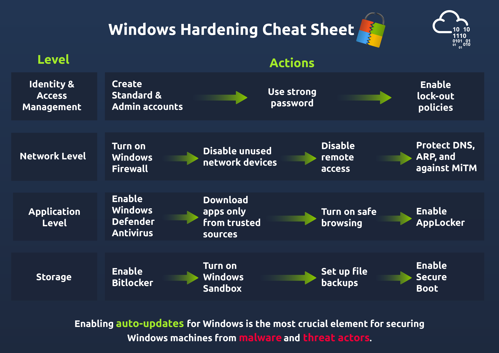

# Microsoft Windows Hardening
## Task 1: Introduction
* **Overview:** Introduces the fundamental concepts of Windows system hardening, emphasizing that out-of-the-box Windows operating systems prioritize user convenience and compatibility over strict security, leaving them vulnerable to standard exploitation techniques.
* **Core Objectives:**
    * **Understanding the goals of hardening a Windows environment** (reducing attack surface, limiting lateral movement, and enforcing least privilege).
    * **Preparing the environment to interact with the target machine using RDP** (xfreerdp from the AttackBox).

## Task 2: Understanding General Concepts
* **Overview:** Explores foundational security baselines, principles, and frameworks used to systematically secure Windows operating systems.
* **Key Concepts:**
    * **Defense in Depth:** Deploying multiple layers of overlapping security controls so that if one layer fails, others remain to block an attacker.
    * **CIS Benchmarks & STIGs:** Utilizing internationally recognized configuration guidelines (like the Center for Internet Security benchmarks) to audit and remediate insecure settings.
    * **Attack Surface Reduction (ASR):** Minimizing features, ports, accounts, and applications that are unnecessary for business operations to reduce potential entry points for malware.

## Task 3: Identity & Access Management
* **Overview:** Focuses on hardening user accounts, authentication mechanisms, and access privileges on Windows systems.
* **Key Concepts & Hardening Best Practices:**
    * **Password Policies:** Enforcing strong complexity requirements, rotation periods, and account lockout thresholds to stop brute-force and credential-stuffing attacks.
    * **User Rights Assignment:** Restricting sensitive user privileges (such as debugging programs, backing up files, or shutting down systems remotely) strictly to authorized administrative accounts.
    * **Disabling Unnecessary Accounts:** Disabling or renaming built-in default accounts (like the standard Administrator or Guest accounts) to eliminate predictable targets for attackers.

## Task 4: Network Management
* **Overview:** Covers securing network-facing configurations, protocols, and host-based firewalls on Windows machines.
* **Key Concepts & Best Practices:**
    * **Windows Defender Firewall:** Configuring strict inbound and outbound firewall rules to block unrequested traffic and restrict unnecessary listening ports.
    * **Disabling Insecure Protocols:** Turning off legacy, unencrypted protocols (such as SMBv1, LLMNR, and NetBIOS) that are frequently targeted for credential harvesting and relay attacks.
    * **Remote Management Security:** Ensuring remote access channels (like RDP or WinRM) are locked down with Network Level Authentication (NLA) and restricted source IP addresses.

## Task 5: Application Management
* **Overview:** Focuses on securing and controlling the applications allowed to run on a Windows system to prevent malicious execution and software-based exploits.
* **Key Concepts & Best Practices:**
    * **AppLocker & Software Restriction Policies:** Restricting executable execution by enforcing allowlists (permitting only approved software to run based on publisher, path, or file hash).
    * **Disabling Unnecessary Features:** Removing or disabling legacy Windows features, optional components, and bloatware that are rarely used but expand the attack surface.
    * **Securing Scripting Engines:** Hardening PowerShell and Command Prompt configurations (e.g., enabling constrained language mode or script block logging) to prevent malicious script-based attacks.

## Task 6: Storage Management
* **Overview:** Explores securing local storage, file permissions, and data-at-rest against unauthorized access, tampering, and theft.
* **Key Concepts & Best Practices:**
    * **NTFS and Share Permissions:** Applying the principle of least privilege to files and folders, ensuring users and groups only have the specific access levels required for their roles.
    * **BitLocker Drive Encryption:** Utilizing full-disk encryption to protect sensitive data stored on hard drives if the physical machine is lost, stolen, or accessed offline.
    * **Restricting Removable Media:** Configuring group policies to disable or restrict the use of unauthorized USB flash drives, external hard drives, and optical media to prevent data exfiltration and malware introduction.

## Task 7: Updating Windows
* **Overview:** Focuses on patch management and keeping the operating system and installed software protected against newly discovered vulnerabilities.
* **Key Concepts & Best Practices:**
    * **Windows Update Configuration:** Ensuring systems are configured to receive regular security updates, critical patches, and feature updates in a timely manner.
    * **Third-Party Patch Management:** Managing updates for external software libraries and applications installed on the system, which are frequently targeted by threat actors.
    * **Staging and Testing:** Balancing the need for rapid security patches with controlled testing in staging environments to prevent faulty updates from causing system downtime.

## Task 8: Cheatsheet for Hardening Windows
* **Overview:** Provides a practical summary and reference guide compiling key hardening commands, configuration paths, and security settings covered throughout the room.
* **Key Takeaways:**
    * Serves as a quick checklist for auditing identity settings, firewall configurations, application policies, and system updates.
    * Reinforces that Windows hardening is an ongoing operational checklist rather than a one-time configuration task.
    * **Cheat Sheet:**

