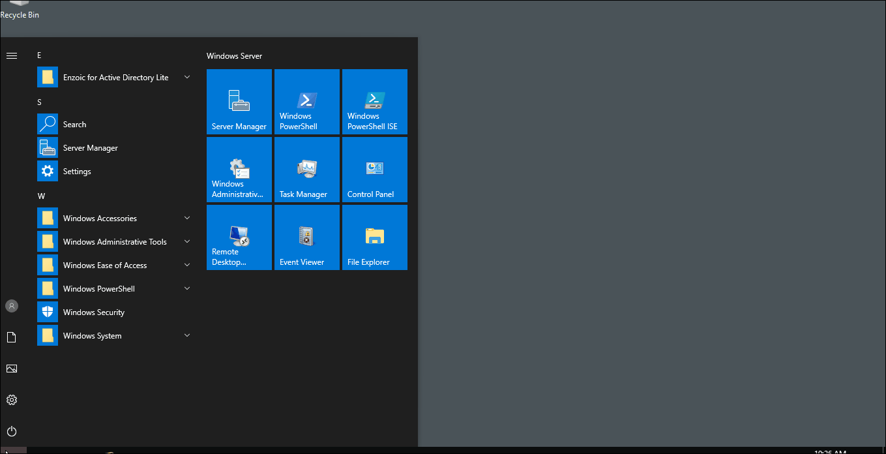
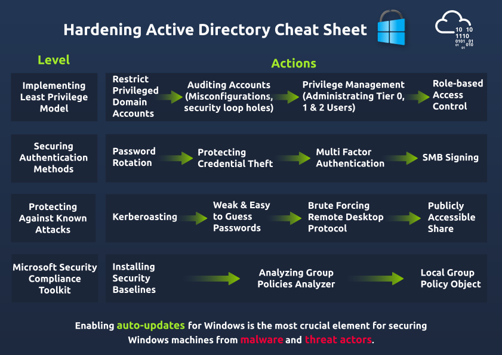

# Active Directory Hardening
## Task 1: Introduction
* **Overview:** Introduces the fundamental concepts of Active Directory (AD) hardening, focusing on securing enterprise identity management systems against modern attack vectors.
* **Key Learning Objectives:**
    * Implementing secure authentication methods and least privilege models.
    * Securing hosts via Group Policies (GPOs) and mitigating common AD attacks.
    * Managing post-compromise scenarios and recovery plans.
* **Lab Access:** Outlines environment setup using a Windows Server 2019 virtual machine with designated administrative credentials.
* **Task Answers:**
    * I can successfully connect with the AD machine. No answer needed

## Task 2: Understanding General Active Directory Concepts
* **Overview:** Explores the architectural core of Active Directory, covering how objects, domains, trees, and forests are structured and why structural misconfigurations create significant enterprise risk.

* **Key Concepts:**
    * **Trust Relationships:** Examining how domain and forest trusts can be leveraged by attackers for lateral movement if not properly restricted.
    * **Administrative Tiering:** Enforcing administrative separation (Tier 0, Tier 1, and Tier 2) to ensure high-privilege credentials (like Domain Admins) are never exposed on lower-security workstations or member servers.
    * **Attack Surface Reduction:** Minimizing unnecessary domain controllers, disabling legacy protocols, and enforcing rigorous auditing policies across the directory.

## Task 3: Securing Authentication Methods
* **Overview:** Focuses on hardening authentication protocols and credential hygiene within an Active Directory environment to thwart credential theft and relay attacks.
* **Key Concepts & Hardening Best Practices:**
    * **Disabling NTLM:** Migrating away from legacy NTLM authentication where possible to prevent pass-the-hash and NTLM relay attacks, favoring modern protocols like Kerberos.
    * **Kerberos Hardening:** Enforcing strong encryption types (AES-128 and AES-256) instead of legacy RC4, and securing service accounts against Kerberoasting and AS-REP roasting.
    * **Multi-Factor Authentication (MFA):** Implementing phishing-resistant MFA across all administrative and standard user accounts to protect against credential stuffing and brute-force attempts.

## Task 4: Implementing Least Privilege Model
* **Overview:** Focuses on eliminating standing privileges and enforcing the principle of least privilege across Active Directory environments.
* **Key Concepts & Best Practices:**
    * **Administrative Segmentation:** Ensuring that domain admins and high-privilege users only log into designated tier-0 assets to prevent credential theft via memory dumping tools like Mimikatz.
    * **Privileged Access Workstations (PAWs):** Using dedicated, hardened machines for performing administrative tasks, keeping them completely separate from daily email, browsing, and standard office applications.
    * **Limiting Membership:** Routinely auditing sensitive groups (such as Domain Admins, Enterprise Admins, and Administrators) to ensure accounts are only added on a temporary, need-to-know basis.

## Task 5: Microsoft Security Compliance Toolkit
* **Overview:** Explores how to leverage official Microsoft tools to baseline and audit security configurations against recommended enterprise standards.
* **Key Concepts:**
    * **Security Compliance Toolkit (SCT):** A free suite of tools from Microsoft that allows administrators to download, analyze, test, and apply pre-configured baseline group policies for Windows and Active Directory.
    * **Policy Analyzer:** A tool used to compare different sets of Group Policy Objects (GPOs) to detect policy conflicts, drift, or gaps against baseline security recommendations.
    * **Deployment:** Exporting policies as Group Policy Objects (GPOs) or Local Group Policy to enforce secure configurations at scale across enterprise domains.

## Task 6: Protecting Against Known Attacks
* **Overview:** Covers mitigation strategies against prevalent Active Directory attack vectors and lateral movement techniques.
* **Key Concepts & Mitigations:**
    * **Kerberoasting & AS-REP Roasting:** Mitigated by enforcing strong, complex passwords for service accounts, transitioning to Group Managed Service Accounts (gMSAs), and using modern AES encryption instead of legacy RC4.
    * **BloodHound & ACL Abuse:** Hardening Access Control Lists (ACLs) to prevent standard users from modifying group memberships, resetting passwords, or reading sensitive domain objects.
    * **LLMNR/NBT-NS Poisoning:** Disabling legacy name-resolution protocols via Group Policy to prevent attackers from capturing and relaying network credentials.

## Task 7: Windows Active Directory Hardening Cheat Sheet
* **Overview:** Serves as a quick-reference guide summarizing critical registry keys, group policy paths, and auditing controls discussed throughout the room.
* **Key Takeaways:**
    * Highlights commands and paths for verifying SMB signing, LDAP signing, and password policy constraints.
    * Reinforces that maintaining a secure Active Directory requires continuous monitoring, regular auditing, and proactive vulnerability management.

