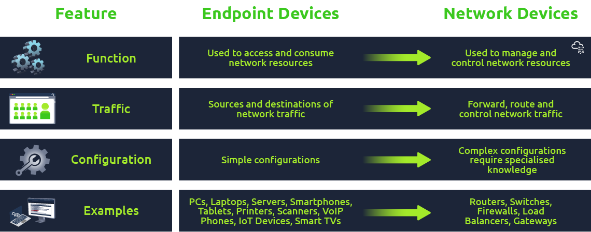

# Network Device Hardening
## Task 1: Introduction
* **Overview:** Introduces the fundamental role of network devices (from layer-one repeaters and layer-two switches to routers, firewalls, and VPNs) as the backbone of modern enterprise infrastructure, emphasizing the critical need to secure them against cyber threats.
* **Key Learning Objectives:**
    * Identifying and mitigating security vulnerabilities in network configurations.
    * Applying industry security best practices to harden core network architecture.
    * Enhancing overall network resilience against sophisticated attacks.

## Task 2: Common Threat and Attack Vectors
* **Overview:** Explores the primary security threats, vulnerabilities, and attack surfaces targeting enterprise network hardware and infrastructure.



* **Key Concepts:**
    * **Default Credentials & Misconfigurations:** Highlighting how factory-default passwords, open management ports (like Telnet or HTTP), and unpatched firmware leave devices exposed.
    * **Man-in-the-Middle (MitM) & Sniffing:** Intercepting unencrypted administrative traffic and routing protocols.
    * **Denial of Service (DoS):** Overwhelming control planes or management interfaces of network devices to cause widespread outages.

## Task 3: Common Hardening Techniques
* **Overview:** Covers baseline hardening practices applicable across most network operating systems and devices.
* **Key Concepts & Best Practices:**
    * **Secure Management Access:** Disabling unencrypted protocols like Telnet and HTTP entirely, replacing them with SSH, HTTPS, and SSH keys.
    * **Access Control Lists (ACLs):** Restricting management plane access so that only trusted administrator IP addresses can communicate with router or switch consoles.
    * **Banner Warnings:** Implementing legal and warning banners on login interfaces to deter unauthorized access attempts.

## Task 4: Hardening Virtual Private Networks
* **Overview:** Focuses on securing Virtual Private Networks (VPNs) used to establish encrypted remote access channels and site-to-site tunnels.
```bash
sudo nano /etc/openvpn/server/server.conf
```
* Once you made the desired changes in the file, press `Ctrl+O` and hit Enter, then press `Ctrl+X` to exit.
* The command `sudo systemctl restart openvpn-server@server.service` can restart the OpenVPN service. 

* **Key Concepts & Hardening Best Practices:**
    * **Strong Cryptographic Protocols:** Moving away from outdated, vulnerable protocols (such as PPTP or weak IKEv1 configurations) and enforcing modern standards like IPsec with strong encryption or WireGuard.
    * **Multi-Factor Authentication (MFA):** Mandating robust MFA for all VPN users to prevent compromised user credentials from granting unauthorized internal network access.
    * **Split-Tunneling Policies:** Restricting split-tunneling where appropriate to prevent endpoints from bypassing corporate security controls while connected to the VPN.

## Task 5: Hardening Routers, Switches & Firewalls
* **Overview:** Focuses on device-specific configuration hardening for core infrastructure components (routers, switches, and firewalls) to prevent unauthorized access and control-plane compromise.
* **Key Concepts & Best Practices:**
    * **Management Plane Protection:** Isolating device management traffic to dedicated management VLANs or out-of-band management networks, and blocking management access from standard user segments.
    * **Port Security & Access Controls:** Configuring switch port security (such as limiting MAC address counts and enabling sticky learning) to prevent unauthorized endpoint connections.
    * **Firewall Rule Hygiene:** Regularly auditing firewall rulebases to eliminate shadowed rules, overly permissive rules (like `any-any` allows), and unused legacy policies.

## Task 6: Hardening Routers, Switches & Firewalls - More Techniques
* **Overview:** Explores advanced configuration practices to secure routing protocols, device features, and resilience mechanisms against sophisticated attacks.
* **Key Concepts & Best Practices:**
    * **Routing Protocol Authentication:** Securing routing protocols (like OSPF, BGP, or EIGRP) with cryptographic authentication (e.g., MD5 or SHA) to prevent route poisoning and spoofing attacks.
    * **Disabling Dangerous Features:** Turning off unnecessary network services and broadcast protocols—such as Proxy ARP, CDP (Cisco Discovery Protocol), LLDP, and IP directed broadcasts—that could leak network topology information.
    * **Control Plane Policing (CoPP):** Implementing rate-limiting and traffic filtering controls on network devices to protect the router or switch CPU from Denial of Service (DoS) attacks.

## Task 7: Important Tools for Network Monitoring
* **Overview:** Explores the software utilities and tools used by security and network engineers to monitor device health, inspect traffic, and audit configurations.
* **Key Tools Covered:**
    * **Wireshark / Tcpdump:** Essential packet analysis tools for capturing and inspecting live network traffic down to the payload level during troubleshooting or incident investigation.
    * **Nmap:** Used for network discovery, port scanning, and auditing which services and ports are actively listening on network devices.
    * **SIEM & Log Management Tools:** Platforms that aggregate Syslog feeds, SNMP traps, and NetFlow data to provide real-time visibility and anomaly detection across enterprise infrastructure.

## Task 8: Conclusion
* **Overview:** Wraps up the Network Device Hardening room with a final review of core principles.
* **Key Takeaways:**
    * **Hardening network devices** is an ongoing lifecycle that requires continuous patch management, strong authentication, protocol encryption, and proactive log monitoring.
    * **Securing routers, switches, and firewalls** forms the bedrock of a resilient defense-in-depth enterprise architecture.