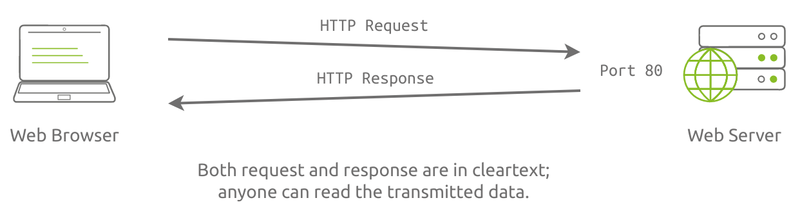
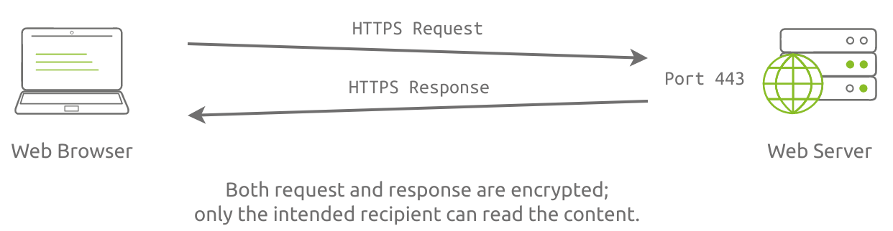

# Network Security Protocols
## Task 1: Introduction
* **Overview:** Introduces the Network Security Protocols room, highlighting the core objective of learning about secure networking protocols operating across the different layers of the OSI model.

## Task 2: Application Layer
* **Overview:** Explores application-layer security mechanisms by studying how standard unencrypted protocols are enhanced with TLS/SSL encryption.
* **Protocols Covered:**
    * **HTTP (Hypertext Transfer Protocol):** The foundational protocol for the World Wide Web, used for transmitting web pages and resources between clients (browsers) and servers over the internet. It relies on a request-response model (e.g., GET, POST) and operates primarily over TCP port 80.
    
    * **HTTPS (Hypertext Transfer Protocol Secure):** Combines standard HTTP with SSL/TLS encryption on TCP port 443 to protect sensitive client-server data exchange (such as credentials and financial info) from interception and tampering.
    
    * **FTPS (File Transfer Protocol Secure):** Extends legacy FTP by adding secure TLS encryption channels. It operates via either Implicit Connection (using port 990) or Explicit Connection (negotiating over port 21), supporting both active and passive data transfer modes.
    * **SMTPS (Simple Mail Transfer Protocol Secure):** Encapsulates standard SMTP mail-push traffic (used for sending emails across or within organizations) inside TLS using the STARTTLS command on ports like 587 and 465.
    * **POP3S (Post Office Protocol Secure):** Secures the retrieval of email messages from a server to a client by wrapping POP3 communications inside TLS (using STARTTLS on port 995 instead of unencrypted port 110).

## Task 3: Application Layer - More Secure Protocols
* **Overview:** Explores advanced application-layer protocols and cryptographic tools used to protect data integrity, authenticity, and confidentiality.
* **Key Protocols & Concepts:**
    * **DNSSEC (Domain Name System Security Extensions):** Prevents DNS spoofing and cache poisoning by using digital signatures. Zone owners sign their DNS records with private keys, allowing resolvers to verify authenticity and integrity.
    * **OpenPGP & GnuPG (GPG):** An open standard for encrypting and signing files and emails. Unlike transport-layer encryption (like SMTPS) where mail servers can read messages, OpenPGP provides end-to-end encryption so only the intended recipient can decrypt the contents using asymmetric key pairs.
    * **SSH (Secure Shell):** Replaces legacy insecure remote management protocols (like Telnet and rlogin) by providing strong cryptographic authentication and encrypted communication tunnels for executing remote commands.

## Task 4: Presentation and Session Layers
* **Overview:** Examines protocols operating at the presentation and session layers of the OSI model, focusing on secure communication channels, session establishment, and encryption management.
* **Key Concepts:**
    * **Transport Layer Security (TLS):** While traditionally bridging transport and application layers, it establishes secure, encrypted presentation/session contexts (such as encrypting data streams before application-layer processing).
    * **Session Resumption and Handshaking:** Ensuring secure key exchanges, cipher negotiations, and mutual authentication to maintain continuous data integrity and session privacy.

## Task 5: Network Layer
* **Overview:** Focuses on securing communications at Layer 3 (Network Layer) of the OSI model, protecting data packets independently of specific application protocols.
* **Key Protocols & Concepts:**
    * **IPsec (Internet Protocol Security):** A framework of open standards used to secure internet protocol communications by authenticating and encrypting each IP packet of a communication session.
    * **Modes of Operation:**
        * **Transport Mode:** Encrypts only the payload of the IP packet (typically used for host-to-host communications).
        * **Tunnel Mode:** Encrypts both the header and the payload, encapsulating the entire packet inside a new IP packet (commonly used for Virtual Private Network / VPN site-to-site tunnels).
    * **Core Protocols:** Utilizes AH (Authentication Header) for integrity and authenticity without confidentiality, and ESP (Encapsulating Security Payload) for full encryption, integrity, and authenticity.

## Task 6: Conclusion
* **Overview:** This final task wraps up the room by summarizing the core concepts of implementing security across different levels of the OSI model.
* **Key Takeaways:**
    * **Network security is not limited to a single layer.** Different protocols are required to protect data depending on where it sits in the OSI model.
    * **Upgrading from legacy plaintext protocols** (like HTTP, Telnet, FTP, and basic SMTP) to encrypted alternatives (like HTTPS, SSH, FTPS/SFTP, and IPsec) is critical for protecting data confidentiality, integrity, and authenticity.
    * **A defense-in-depth approach** ensures that even if one layer is compromised, underlying layers still provide cryptographic protection.