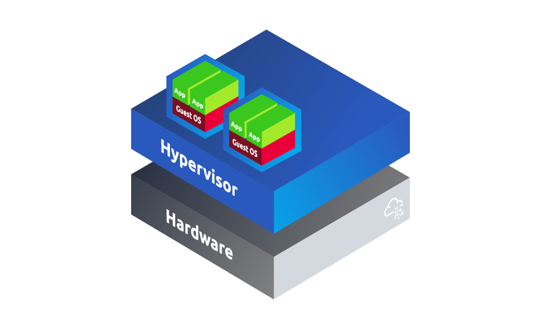
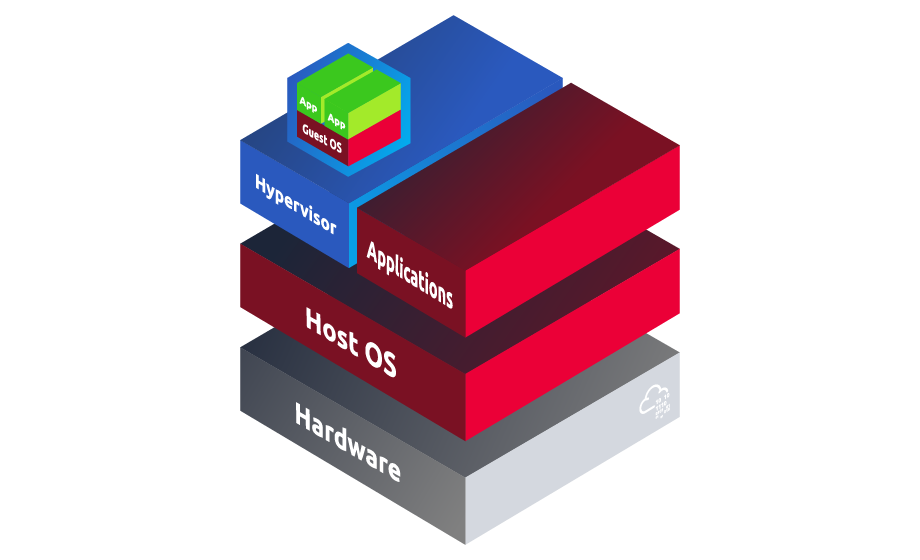

# Virtualization and Containers
## Task 1: Introduction
* **Overview:** Introduces the fundamental concepts of the room, focusing on teaching the core virtualization technologies and container applications used in modern IT and DevOps environments.

## Task 2: What is Virtualization
* **Overview:** Defines virtualization as the process of creating an abstraction layer over physical computer hardware. This allows a single physical device to be divided into multiple logical virtual computers, often called lab machines or Virtual Machines (VMs).
* **Key Benefits:**
    * **Decrease expenses:** Reduces or eliminates the need to purchase dedicated physical servers for every task.
    * **Scale:** Allows organizations to easily allocate more resources to VMs as server usage increases.
    * **Efficiency:** Makes it easy to decrease resource allocation when usage drops, optimizing hardware use.
    * **Virtualization Structure:** Operates using an engine-machine format. The virtualization engine runs on the underlying hardware/OS (the Host OS), while the virtualized machine runs its own independent operating system (the Guest OS).

## Task 3: Hypervisors
* **Overview:** Explores the software that makes traditional virtualization possible—the hypervisor (the virtualization engine).
* **Key Concepts:**
    * **Type 1 Hypervisors (Bare-Metal):** Installed directly onto the physical hardware without a traditional host OS underneath (e.g., Proxmox, VMware ESXi). These are highly efficient and standard for enterprise data centers.
    
    * **Type 2 Hypervisors (Hosted):** Installed as an application on top of a standard host OS like Windows or Linux (e.g., VirtualBox, VMware Workstation). These are typically used for personal labs, malware analysis, or local development.
    

## Task 4: Containers
* **Overview:** Introduces containerization as a modern, lightweight alternative to traditional hypervisor-based Virtual Machines.
* **Key Concepts:**
    * Unlike VMs, which require a complete, resource-heavy Guest OS for every instance, containers share the host system's OS kernel.
    * Containers only package the specific application code, libraries, and dependencies needed to run. This makes them incredibly fast to start, highly portable across different environments, and much more resource-efficient than traditional VMs.

## Task 5: Docker
* **Overview:** Introduces Docker, the most widely used container platform and engine, which packages applications and their dependencies into lightweight, executable "images."
* **Key Concepts:**
    * **Docker Images & Dockerfiles:** Images are built from minimal base operating systems (like Alpine or Ubuntu) using a Dockerfile, which defines the environment and startup commands.
    * **Docker Hub:** A centralized remote repository (similar to GitHub) where users can pull existing public images or push their own custom containers.
    * **Essential Commands:**
        * `docker pull <user>/<image>`: Downloads an image to the local cache.
        * `docker run <user>/<image>`: Starts a container from an image.
        * `docker ps`: Lists all currently running containers, showing their assigned IDs, IP addresses, and active network ports.
    * **Hands-On Application:** Demonstrates deploying a Flask web server by using specific flags: -d (detach, to run in the background) and -p (publish, to map internal container ports to external host ports, e.g., -p 5000:5000).

## Task 6: Kubernetes
* **Overview:** Explores container orchestration. While Docker is excellent for creating and running individual containers, Kubernetes (often abbreviated as K8s) is the industry standard for managing them at scale.
* **Key Concepts:**
    * **Orchestration:** Automates the deployment, management, and scaling of thousands of containers across clusters of multiple physical or virtual servers.
    * **High Availability:** Automatically monitors container health, restarting or replacing containers that crash (self-healing) and balancing network traffic loads to ensure applications remain accessible.

## Task 7: Conclusion
* **Overview:** Wraps up the room by summarizing the evolution of infrastructure.
* **Key Takeaways:**
    * The IT landscape has shifted from resource-heavy physical servers to hypervisor-based Virtual Machines, and now to highly efficient, portable containers.
    * Understanding the differences between VMs (which virtualize hardware to run full OSs) and containers (which share the host OS kernel to run lightweight apps) is essential for modern DevOps and cloud security.