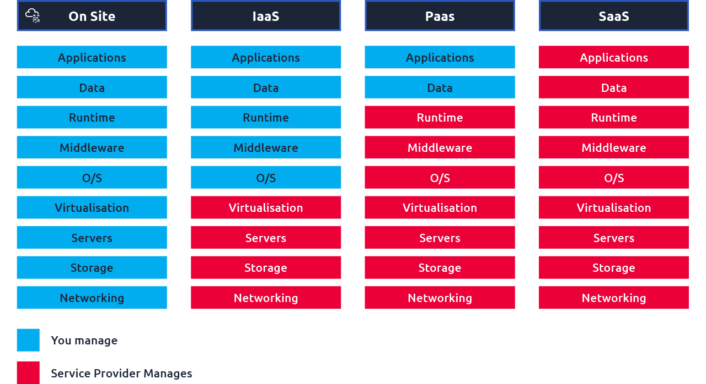
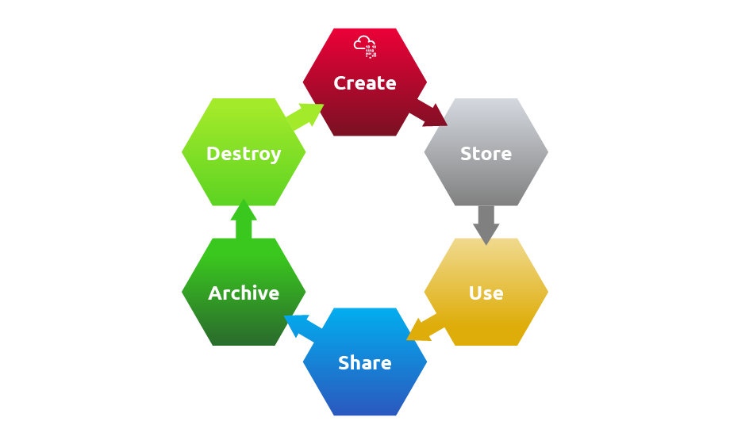
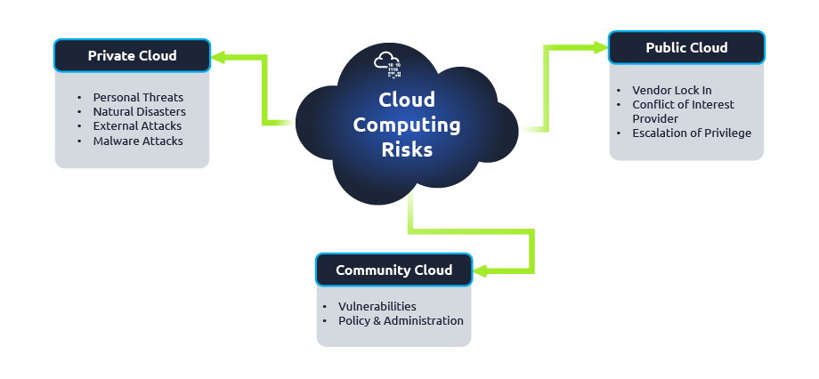

# Intro to Cloud Security
## Task 1: Introduction
* **Overview:** Introduces the fundamental concepts of the room, focusing on teaching the baseline knowledge required for securing a cloud environment.

## Task 2: Architectural Concepts of Cloud
* **Overview:** Explores the core characteristics, service models, and deployment strategies that define modern cloud computing.
* **Key Concepts:**
    * **Characteristics of Cloud:** Cloud environments offer Scalability (buying/adjusting resources upon need), Simplicity (easy configuration), Cost Effectiveness (pay-as-you-go), and Enhanced Automation (limited human administration required).
    * **Service Models:**
    
        * **IaaS (Infrastructure as a Service):** Vendor manages physical hardware (racks, machines, cables); customer manages the OS, software, and logical resources.
        * **PaaS (Platform as a Service):** Vendor manages infrastructure and the OS/platform; customer manages and installs their own applications.
        * **SaaS (Software as a Service):** Vendor manages everything (infrastructure, OS, and software); the customer simply pays to use the service.
    * **Deployment Models:**
        * **Public Cloud:** Resources (like AWS or Azure) are shared among multiple organizations.
        * **Private Cloud:** Hardware and software resources are entirely dedicated to a single customer.
        * **Hybrid Cloud:** A mix of public and private clouds (e.g., keeping production data on a private cloud while using a public cloud for testing).
    * **Core Terminologies:** Virtualisation, Compute (processing power), Storage, and Networking.

## Task 3: Cloud Security Concepts
* **Overview:** Focuses on identifying what needs protecting in the cloud (primarily data) and explores how to secure that data throughout its entire lifespan while mitigating common cloud vulnerabilities.

* **Key Concepts:**
    * **Data Classification:** Data must be categorized to apply appropriate security controls. The main classes are Confidential (critical/high-risk), Internal (moderate risk), and Public (no risk if exposed).
    * **Cloud Data Lifecycle:** The sequence of phases data goes through, each requiring specific security measures:
        * **Create/Update:** Initial generation/import (Secured via SSL/TLS and encryption).
        * **Store:** Saving in databases (Secured via encryption at rest and backups).
        * **Use:** Decrypting for application processing (Secured via platform authentication and restricted permissions).
        * **Share:** Distributing data (Requires attention to Jurisdiction laws and Data Loss Prevention (DLP)).
        * **Archive:** Long-term storage (Secured via physical security and environmental location factors).
        * **Destroy:** Rendering data permanently inaccessible, often using Crypto shredding (destroying the decryption keys).
    * **Security Issues & Solutions:** Highlights major cloud threats, including insecure APIs, account hijacking, malicious insiders, virtualization isolation failures in multi-tenant environments, and the need for rigorous Access Control Mechanisms (ACM).

## Task 4: Cloud Security Risks Concerning Deployment Models
* **Overview:** Discusses the specific security risks associated with different cloud deployment models.

* **Key Deployment Models & Risks:**
    * **Private Cloud:** Infrastructure dedicated to a single customer. Risks include personnel (insider) threats, natural disasters affecting the physical data center, and external attacks (like DDoS or Man-in-the-Middle).
    * **Public Cloud:** Resources shared among multiple users via virtualization. Risks include Vendor Lock-In (becoming entirely dependent on one provider), conflicts of interest (the provider also servicing competitors), and unauthorized privilege escalation across the shared environment.
    * **Community Cloud:** Infrastructure shared among a specific community or group of organizations. Risks include shared vulnerabilities (one compromised node affecting the others) and difficulties in enforcing unified administrative policies across different organizations.

## Task 5: Security Through Access Management
* **Overview:** Explores how Identity and Access Management (IAM) controls ensure the "right people" perform the "right job" with the "right set of permissions" in cloud environments.
* **Key Concepts:**
    * **Digital Identities & Roles:** Cloud systems create unique digital identities for users, services, or APIs, assigning specific roles that define what domain or resources they can operate within.
    * **Authentication Factors:** Characteristics used to confirm an identity, including usernames, passwords, PINs, certificates, biometrics, and FaceID.
    * **AWS IAM Capabilities:** Manages fine-grained access policies, enables Multi-Factor Authentication (MFA), grants role-based resource permissions without sharing account credentials, and defines key entities like Principals, Identities, and Resources.
* **Practical Exercise:** Guides creating an administrative IAM user in AWS and adding them to an AdministratorAccess group.

## Task 6: Security Through Policies
* **Overview:** Focuses on establishing administrative controls, organizational policies, and compliance governance to maintain a secure cloud infrastructure.
* **Key Concepts:**
    * **Security Policies:** Rules and guidelines that dictate how cloud resources should be configured, accessed, and maintained.
    * **Governance & Compliance:** Ensuring organizational cloud practices adhere to industry standards, legal regulations (e.g., GDPR, HIPAA), and Acceptable Use Policies (AUP).
    * **Administrative Enforcement:** Implementing standardized operational guidelines for data protection, password management, and incident response across the environment.

## Task 7: Security Through Network Management
* **Overview:** Explores protecting cloud infrastructure from network-based intruders through a layered security approach using cloud-native firewall components.
* **Key Security Layers:**
    * **Layer 1 – Security Groups:** Function as stateful firewalls operating on a "deny all unless allowed explicitly" principle using allow-only rules.
    * **Layer 2 – Network Access Control Lists (NACLs):** Operate at the Virtual Private Cloud (VPC) subnet level. Unlike Security Groups, NACLs support explicit deny rules (e.g., blocking specific malicious IP addresses or ports like SSH on Port 22).
    * **Layer 3 – Vendor-Specific Solutions:** Advanced managed security features offered by cloud providers, such as AWS DNS Firewall and AWS Network Firewall.
* **Practical Exercise:** Covers creating a custom NACL in AWS to block inbound traffic on Port 22 (SSH).

## Task 8: Security Through Storage Management
* **Overview:** Covers securing cloud storage repositories (such as AWS S3 buckets or blob storage) against data breaches, unauthorized access, and public leakage.
* **Key Concepts & Hardening Best Practices:**
    * **Access Control & Bucket Policies:** Restricting public read/write permissions by default and enforcing granular access policies via IAM.
    * **Encryption at Rest & In Transit:** Protecting stored data using server-side encryption (e.g., AWS KMS) and securing data transport using HTTPS/TLS.
    * **Lifecycle Management & Versioning:** Enabling object versioning to protect against accidental deletion or ransomware encryption, along with automated lifecycle rules for secure archiving.

## Task 9: Cloud Security - Some Additional Concepts
* **Overview:** Introduces complementary security monitoring and threat detection services essential for maintaining operational awareness in cloud environments.
* **Key Concepts:**
    * **Logging & Auditing:** Centralizing activity logs (such as AWS CloudTrail) to record API calls, configuration changes, and user actions for forensic analysis.
    * **Security Information and Event Management (SIEM):** Aggregating cloud event logs into SIEM solutions for real-time threat analysis and automated alerting.
* **Shared Responsibility Reminder:** Re-emphasizes that regardless of additional security tooling, cloud security remains a shared obligation between the cloud service provider and the customer.

## Task 10: Conclusion
* **Overview:** Summarizes the entire ecosystem of cloud security and reviews the core pillars covered throughout the room.
* **Core Cloud Security Pillars:**
    * **Access Management:** Ensuring proper permissions so the right identities perform the right jobs.
    * **Policies:** Defining strict governance guidelines and operational conditions for users and resources.
    * **Networking:** Protecting instances from network-oriented threats using firewalls and segmentations.
    * **Storage Management:** Safeguarding sensitive data through encryption, lifecycle policies, and geographical configurations.
    * **Logging & Operational Resilience:** Leveraging auditing, disaster recovery, backups, and routine patch updates.
* **Key Takeaway:** Cloud security is made resilient and manageable by deploying the robust, ready-to-use security controls offered directly by cloud service providers.