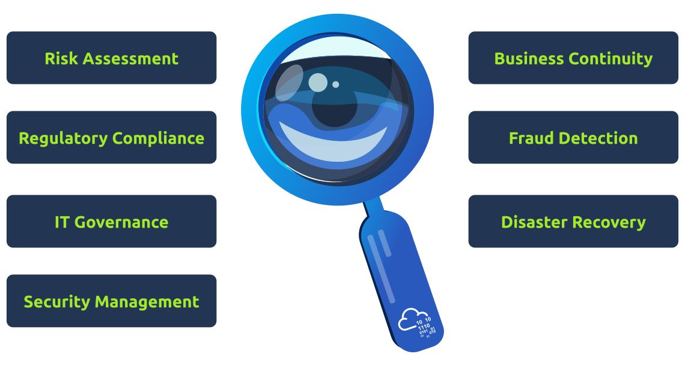
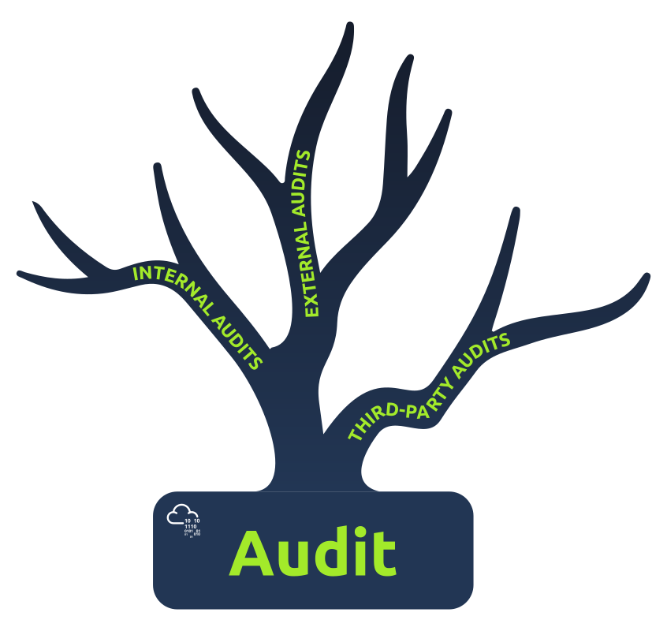
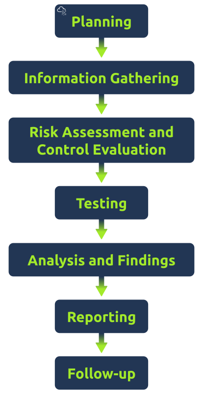
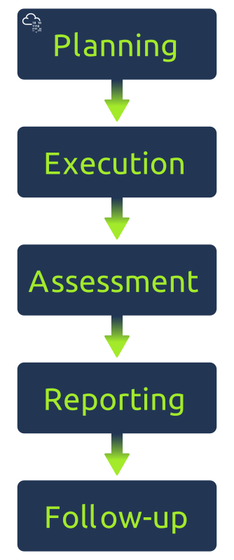
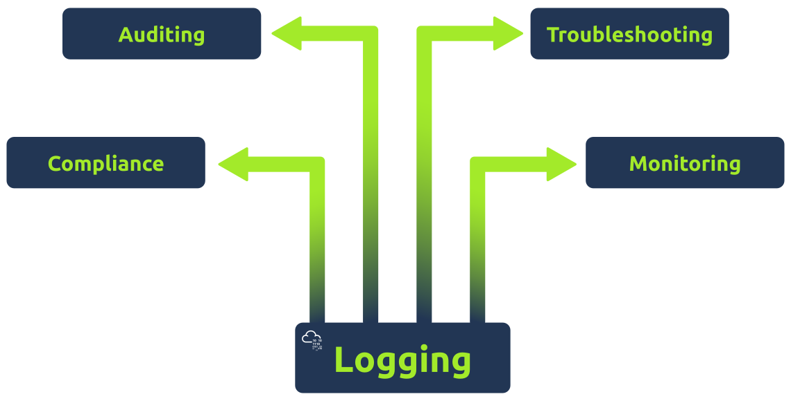
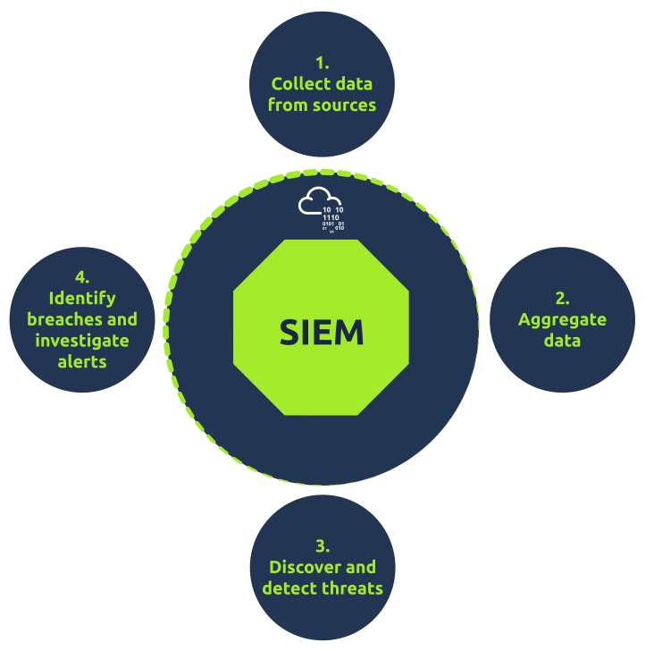

# Auditing and Monitoring
## Task 1: Introduction
* **Overview:** Introduces the fundamental concepts of IT auditing, logging, and monitoring as essential components of security operations and governance.
* **Core Focus:** Explains how tracking system activities helps organizations detect unauthorized actions, ensure compliance with regulatory standards, and maintain overall security posture.

## Task 2: Audit Objectives and Types
* **Overview:** Explores the underlying goals of performing IT security audits and distinguishes between the different types of audits conducted within an enterprise.
* **Key Concepts:**
    * **Audit Objectives:** Assessing the effectiveness of internal controls, ensuring compliance with legal and regulatory requirements, and identifying operational inefficiencies or security risks.
    
    * **Internal Audits:** Conducted by an organization's own internal audit team to evaluate internal controls, identify vulnerabilities, and prepare for external reviews.
    * **External Audits:** Performed by an independent third-party firm to provide unbiased assurance to stakeholders, regulators, or customers (e.g., SOC 2, ISO 27001 certifications).
    * **Third-Party / Vendor Audits:** Assessing the security controls and compliance posture of external suppliers, service providers, and vendors.
    

## Task 3: Audit Frameworks
* **Overview:** Covers widely recognized frameworks and standards that guide organizations in structuring, conducting, and measuring IT audits effectively.
* **Key Frameworks:**
    * **COBIT (Control Objectives for Information and Related Technologies):** A framework created by ISACA focusing on IT governance, management, and aligning IT goals with business objectives.
    * **ISO/IEC 27001 & 27002:** International standards providing specifications for establishing, implementing, operating, and auditing an Information Security Management System (ISMS).
    * **NIST Cybersecurity Framework (CSF):** Guidelines structured around five core functions (Identify, Protect, Detect, Respond, Recover) used to audit and improve an organization's cybersecurity risk management.
    * **PCI-DSS:** Strict security standards required for organizations that store, process, or transmit payment cardholder data.

## Task 4: Auditing IT Infrastructure and Operations
* **Overview:** Focuses on practical methods for evaluating an organization's physical and digital technology assets, configurations, and operational workflows.

| Audit Process | Audit Areas |
| :---: | :---: |
|  |  |

* **Key Areas Audited:**
    * **Hardware & Inventory:** Accounting for server assets, network equipment, and user endpoints to eliminate unauthorized or unmanaged devices.
    * **Configurations & Baselines:** Reviewing system settings, patch levels, and firewall rules against established security baselines to prevent drift and misconfigurations.
    * **Access Control Lists (ACLs):** Auditing user privileges, group memberships, and administrative rights to enforce least privilege.

## Task 5: Logs
* **Overview:** Explores the role of logs as the primary source of truth for both auditing and real-time monitoring.

* **Key Concepts:**
    * **Definition & Value:** Logs are chronological records of system events, user actions, and network transactions used for troubleshooting, compliance reporting, and threat investigation.
    * **Types of Logs:** Includes application logs, operating system event logs, firewall/network traffic logs, and authentication logs.
    * **Log Integrity & Retention:** Securing logs against unauthorized modification or deletion and maintaining retention policies required by industry standards.

## Task 6: Log Management on Linux
* **Overview:** Focuses on the tools, configurations, and directory structures used to collect and manage log data on Linux operating systems.
* **Key Systems & Tools:**
    * **Location (/var/log):** The primary directory where standard Linux log files (such as syslog, auth.log, kern.log, and boot.log) are stored.
    * **Log Daemons (rsyslog / syslog-ng):** Background services responsible for filtering, formatting, and routing local log messages to designated files or remote log collectors.
    * **systemd-journald & journalctl:** Modern Linux logging architecture that captures structured binary logs, queried using the journalctl utility.
    * **Log Rotation (logrotate):** Managing disk usage by automatically compressing, archiving, and deleting old log files according to pre-set schedules.

## Task 7: Log Management on MS Windows
* **Overview:** Covers the mechanisms, event logs, and tools used to collect, inspect, and manage system activity on Windows operating systems.
* **Key Components & Utilities:**
    * **Windows Event Viewer (eventvwr.msc):** The built-in graphical interface used to browse and filter local Windows event logs.
    * **Core Log Categories:**
        * **Application:** Events logged by programs or applications.
        * **Security:** Audit events such as valid and invalid logon attempts, file access, and resource usage.
        * **System:** Events logged by Windows system components and drivers.
        * **Sysmon (System Monitor):** An advanced system service and device driver that monitors and logs detailed system activity (like process creation, network connections, and file creation changes) to the Windows Event Log for threat detection.

## Task 8: Monitoring
* **Overview:** Focuses on the continuous observation of system performance, network health, and security events to detect operational issues and unauthorized activities in real-time.
* **Key Concepts:**
    * **Continuous Visibility:** Unlike periodic audits, monitoring operates in real-time or near-real-time to maintain constant situational awareness.
    * **Metrics vs. Security Events:** Tracking resource utilization (CPU, memory, disk usage, bandwidth) alongside security events (failed login spikes, abnormal privilege usage).
    * **Alerting Mechanisms:** Setting baselines and thresholds to generate automated notifications for administrators when anomalous activity or performance degradation occurs.

## Task 9: SIEM Basics
* **Overview:** Introduces Security Information and Event Management (SIEM) systems as the central hub for security operations centers (SOCs).

* **Key Functions of a SIEM:**
    * **Aggregation & Centralization:** Collecting logs and event data from disparate sources across the enterprise (endpoints, network devices, servers, firewalls).
    * **Normalization & Correlation:** Standardizing different log formats into a single readable structure and linking events together to detect complex multi-stage attacks.
    * **Real-Time Analysis & Response:** Running correlation rules against incoming data streams to trigger alerts and initiate automated incident response playbooks.

## Task 10: Conclusion
* **Overview:** Concludes the Auditing and Monitoring room by summarizing how auditing, logging, monitoring, and SIEM work together.
* **Key Takeaways:**
    * Logging provides the foundational raw data; monitoring supplies real-time visibility; auditing delivers periodic assessment and compliance checks; and SIEM automates large-scale analysis.
    * Combining all four elements creates a comprehensive defense-in-depth framework necessary for modern enterprise security and regulatory compliance.