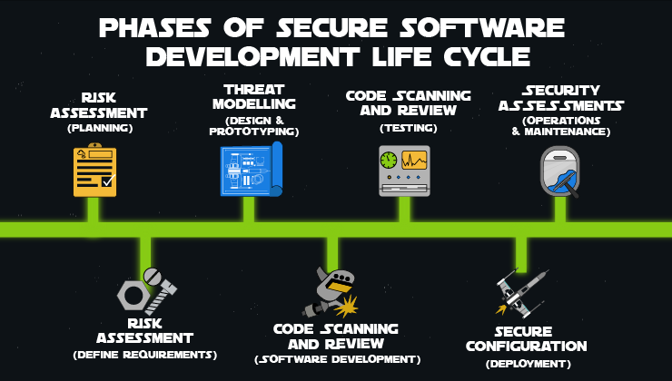
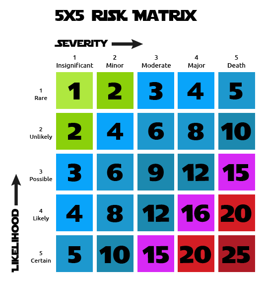
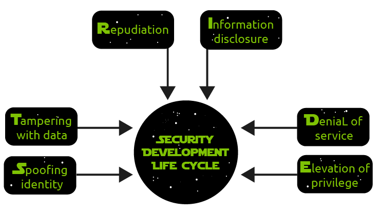
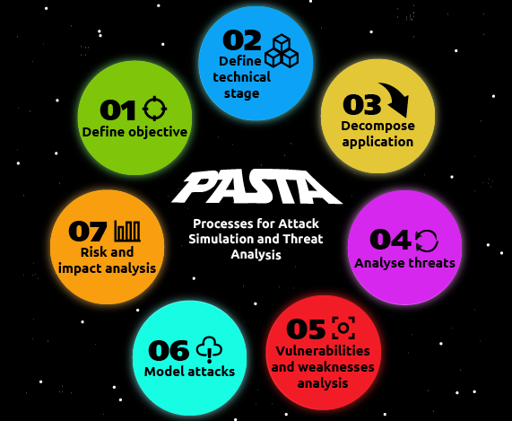
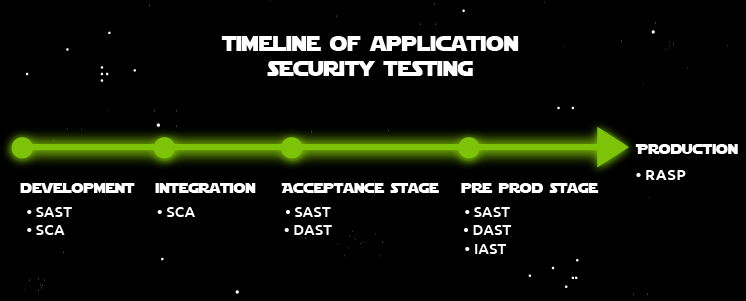
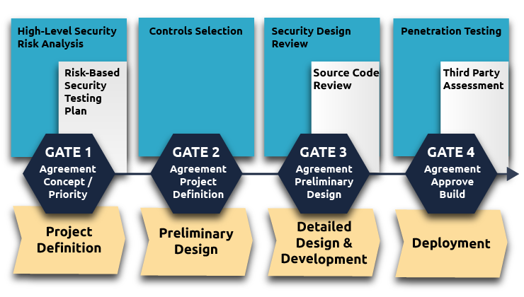

# SSDLC

## Task 1: Introduction
* **Overview:** Introduces the Secure Software Development Lifecycle (SSDLC) room, which focuses on embedding security processes, tools, and requirements throughout every phase of software development.

## Task 2: What is SSDLC?
* **Overview:** Defines the core principles of an SSDLC compared to a traditional Software Development Lifecycle (SDLC).
* **Key Concepts:**
    * **Shift-Left Security:** Moving security controls to the earliest phases of development (planning and design) rather than treating security as an afterthought right before deployment.
    * **Cost Efficiency:** Identifying and fixing security flaws during design or coding is significantly cheaper and less risky than remediating vulnerabilities in production.

## Task 3: Implementing SSDLC
* **Overview:** Explores how to evaluate an organization's existing readiness and systematically integrate security activities into everyday development workflows.

  

* **Understanding Security Posture:**
    * **Gap Analysis:** Performing evaluations to measure current policies against practical procedures.
    * **Software Security Initiatives (SSI):** Establishing actionable goals (e.g., secure coding standards, data playbooks).
* **Formalizing Processes & Training:** Giving engineering teams an operational period to adapt to new standards and investing early in security training and tools.
* **Core SSDLC Processes across Phases:**
    * **Risk Assessment:** Carried out during the Planning and Requirements stages.
    * **Threat Modelling:** Performed during the Design & Prototyping phase to focus on potential attack paths.
    * **Code Scanning / Review (SAST/DAST):** Implemented during the Software Development stage.
    * **Security Assessments (Penetration Testing & Vulnerability Audits):** Executed during the Operations & Maintenance phase on working prototypes or deployed systems.

## Task 4: Risk Assessment
* **Overview:** Explores evaluating potential threats and their impact early in the SDLC (planning/requirements phases) to prioritize security spending and controls.
* **Steps in Risk Assessment:**
    * **Consider Threat Motivations:** Analyze data value, dependency security, client scope, and distribution to define acceptable risk levels vs. business costs.
    * **Risk Evaluation:** Simulate worst-case scenarios (e.g., ransomware), evaluate target accessibility, and determine data value and attack complexity.
    * **Scope & Reach:** Evaluate how many users or systems would be impacted by an exploit (e.g., Denial of Service vs. single-user bug).

  

* **Types of Risk Assessments:**
    * **Qualitative Risk Assessment:** Classifies risks into thresholds ("Low", "Medium", "High") using the formula: Risk = Severity x Likelihood.
    * **Quantitative Risk Assessment:** Assigns numerical/financial values to risk (e.g., using Annual Loss Expectancy: ALE=Single Loss Expectancy×Annual Rate of Occurrence).

## Task 5: Threat Modelling
* **Overview:** Focuses on systematically identifying potential security flaws and attack vectors during the design phase before code is written.
* **Key Frameworks & Concepts:**
    * **STRIDE Framework:** Categorizes threats into Spoofing, Tampering, Repudiation, Information Disclosure, Denial of Service, and Elevation of Privilege.

    

        
    

    * **DREAD Framework:** Damage, Reproducibility, Exploitability, Affected users, Discoverability.
    
    * **PASTA Framework:** A risk-centric methodology that aligns security requirements with business objectives and risk appetite.

    

        
    

    * **Data Flow Diagrams (DFDs):** Mapping data flows, trust boundaries, and processes across the system architecture to locate vulnerable interfaces.
    * **Mitigation Strategy:** Assigning appropriate controls (e.g., authentication, encryption, logging) to mitigate identified architectural threats.

## Task 6: Secure Coding
* **Overview:** Covers practices and automated tooling used during the active software development phase to keep vulnerabilities out of source code.

    

* **Key Concepts:**
    * **Secure Coding Standards:** Establishing guidelines for input validation, output encoding, parameterization, and secure memory management.
    * **SAST (Static Application Security Testing):** Analyzing source code or binaries offline to find syntax and structural flaws without executing the code.
    * **DAST (Dynamic Application Security Testing):** Evaluating running applications from an external perspective ("black-box" or "grey-box" testing) to find operational vulnerabilities such as XSS, authentication bypasses, or server misconfigurations.
    * **IAST (Interactive Application Security Testing):** Combining SAST and DAST approaches using embedded instrumentation agents inside the application runtime to monitor behavior and detect vulnerabilities in real-time.
    * **SCA (Software Composition Analysis):** Scanning third-party dependencies and open-source libraries for known vulnerabilities (CVEs) and license compliance issues.

## Task 7: Security Assessments
* **Overview:** Security assessments evaluate systems, software, or web applications for vulnerabilities and attack vectors. Because they assess the application holistically, they are typically executed during the Operations and Maintenance phase once all components are functional.

* **Core Assessment Types:**
    * **Vulnerability Assessment:**
        * **Focus:** Quickly identifies potential security flaws across network hosts, ports, and services using automated scanning tools (e.g., OpenVAS, Nessus).
        * **Characteristics:** Generates threat severity reports (High/Medium/Low or CVSS scores) without verifying if the vulnerabilities can be exploited in reality.
        * **Pros & Cons:** Cheaper and faster to run, but can produce large report volumes, heavily depends on tool quality, and does not test real-life attack scenarios or chained exploits.
    * **Penetration Testing:**
        * **Focus:** Goes beyond identification to validate vulnerabilities by attempting active exploitation (e.g., privilege escalation, password recovery).
        * **Characteristics:** Demonstrates actual risk levels to stakeholders and provides tailored remediation strategies based on realistic attack paths.
        * **Pros & Cons:** Clearly illustrates what an attacker could achieve, but is very expensive and requires extensive planning and execution time.

## Task 8: SSDLC Methodologies
* **Overview:** Covers industry-standard frameworks used to integrate security practices into modern software development workflows (such as Agile, DevOps, or Waterfall).
* **Key Frameworks:**
    * **OWASP SAMM (Software Assurance Maturity Model):** A flexible, measurable framework that helps organizations formulate and analyze their software security posture across governance, design, implementation, verification, and operations.

    

        
    

    * **BSIMM (Building Security In Maturity Model):** A data-driven model based on observing real-world software security initiatives across major enterprise organizations to help benchmark security practices against industry peers.
    * **NIST SSDF (Secure Software Development Framework):** A set of fundamental, sound secure software development practices defined by NIST to reduce the number of vulnerabilities in released software.

## Task 9: Practical - Secure Space Lifecycle
* **Overview:** A hands-on practical task where you apply the SSDLC principles learned throughout the room to a simulated software development scenario.
* **Key Activities:**
    * Navigating through a simulated software project lifecycle (from requirement gathering to deployment).
    * Making security-focused decisions at each phase—including conducting risk assessments, selecting threat mitigations, analyzing code scan findings, and verifying remediation before final release.