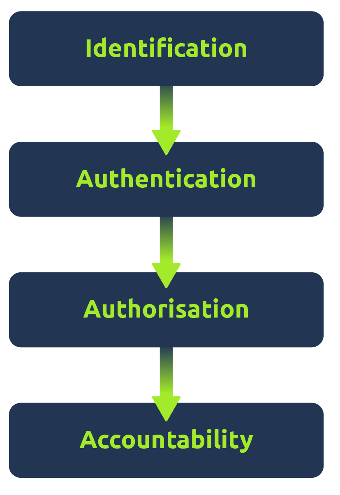
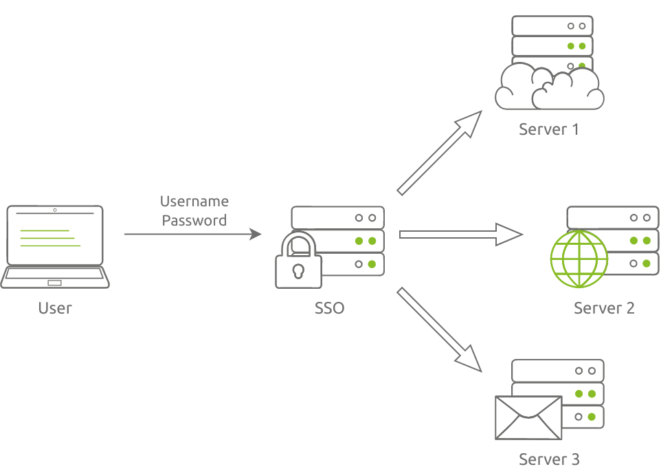

# Identity and Access Management
## Task 1: Introduction
* **Overview:** Introduces the Identity and Access Management room on TryHackMe, which covers core cybersecurity concepts surrounding user identity, proof of identity, permissions, and accountability.
* **Key Security Questions Addressed:**
    * How can we uniquely identify different system users?
    * How can a user prove who they are?
    * How can we prevent attackers from impersonating legitimate users?
    * How do we decide and enforce what a user can access?
    * How do we track user actions to maintain accountability?
* **Core Concepts Covered:**
    * Identification and Authentication (including strong passwords and Multi-Factor Authentication).
    * Authorization and Access Control.
    * Logging and Auditing (Accountability).
    * Identity Management and Single Sign-On (SSO).
* **Prerequisites:** Recommends completing the Security Principles room before starting.

## Task 2: IAAA Model
* **Overview:** Introduces the foundational four pillars of information security known as the IAAA Model, which protects the confidentiality, integrity, and availability of sensitive systems and resources.

* **The Four Pillars of IAAA:**
    1. **Identification:** The initial step where a user claims a specific identity using a unique identifier (such as an email address, username, or ID number).
    2. **Authentication:** The process of confirming that the user is who they claim to be (e.g., providing a correct password, biometric scan, or an email verification code).
    3. **Authorisation:** Determining and enforcing what operations, files, or resources a user is allowed to access based on their assigned roles, permissions, or level of clearance.
    4. **Accountability:** Tracking and logging user activity in a centralized location to ensure everyone is responsible for their actions, providing crucial forensic evidence during security incidents.

## Task 3: Identification
* **Overview:** Explores Identification, the foundational first step of the IAAA model where a user, process, or system claims a specific identity to gain access to a resource or environment.
* **Key Concepts & Methods:**
    * **Claiming Identity:** Unlike authentication (which proves who you are), identification is simply stating who you are—such as telling someone your name at a casual social event.
    * **Usernames:** Can take various forms depending on platform conventions (e.g., tanderson, thomasa, neo).
    * **Unique Identifiers / Numbers:** Often relies on unique numbers to prevent conflicts, including:
        * National ID numbers
        * Student ID numbers
        * Passport numbers
        * Mobile phone numbers
    * **Email Addresses:** Frequently used by modern websites for registration because email addresses are guaranteed to be unique per user.
    * **Unique Identifiers / Numbers:** Often relies on unique numbers to prevent conflicts, including:
        * National ID numbers
        * Student ID numbers
        * Passport numbers
        * Mobile phone numbers
        * Email Addresses: Frequently used by modern websites for registration because email addresses are guaranteed to be unique per user.
    * **Why It Matters:** Without proper identification, systems cannot distinguish users or track who is attempting to log in, authenticate, or access protected assets.

## Task 4: Authentication
* **Overview:** Explores Authentication, the process of proving the claimed identity of a user, system, or process to ensure only authorized entities gain access.
* **The Three Core Authentication Factors:**
    1. **Something You Know:** Credentials memorized by the user, such as passwords, passphrases, or Personal Identification Numbers (PINs).
    2. **Something You Have:** A physical or digital object in the user's possession, such as a hardware security key (e.g., Yubico), smartphone, or an OTP sent via SMS.
    3. **Something You Are:** Biometric traits verified via physical scanners, such as fingerprints, facial recognition, or retina scans.
* **Secondary Authentication Methods:** Includes location-based verification ("somewhere you are") and behavioral biometrics ("something you do").
* **Multi-Factor Authentication (MFA & 2FA):** Combines two or more distinct authentication factors (e.g., combining something you know with something you have) to significantly enhance security and protect against compromised passwords.

## Task 5: Authorisation and Access Control
* **Overview:** Explores Authorisation (determining what an authenticated user is allowed to do or access) and Access Control (the technical or physical mechanisms that enforce those authorization policies).
* **Key Distinctions:**
    * **Authorisation:** Dictates the rules and permissions (e.g., specifying that a secretary can send emails on behalf of a manager, or that cleaning staff require access to all hotel rooms).
    * **Access Control:** Enforces those rules (e.g., using file permissions, locks and keys, or electronic card readers to ensure a user cannot modify protected files or enter unauthorized rooms).

## Task 6: Accountability and Logging
* **Overview:** Explores Accountability, the final pillar of the IAAA model, which ensures that individuals can be held responsible for their actions within a system.
* **Key Concepts & Mechanisms:**
    * **The Role of Logging:** Accountability relies heavily on system logs, audit trails, and event monitors that record who performed an action, what action was taken, and when it occurred.
    * **Non-Repudiation:** Ensuring that a user cannot deny having performed an action (often achieved using digital signatures, secure timestamps, and user-specific credentials).
    * **Security Incident Forensics:** When a breach occurs, administrators look to logs and audit trails to trace the attacker's steps, assess the scope of damage, and patch vulnerabilities.

## Task 7: Identity Management
* **Overview:** Explores Identity Management (IdM), the overarching framework, policies, and technologies used to manage digital identities, user accounts, lifecycles, and access privileges across an organization.
* **Key Concepts & Lifecycle Management:**
    * **Identity Lifecycle:** Covers the complete journey of a digital identity from creation (onboarding/provisioning when an employee joins) to modification (role or department changes) and ultimate deletion/deactivation (offboarding/deprovisioning when they leave).
    * **Centralized Identity Stores:** Utilizing directory services (such as Active Directory or LDAP) to maintain a single source of truth for user identities, credentials, and attributes.
    * **Self-Service Portals:** Enabling users to manage password resets, update contact information, or request access to specific tools without requiring constant IT intervention.
* **Why It Matters:** Effective identity management prevents orphaned accounts, reduces administrative overhead, minimizes security risks from stale credentials, and ensures regulatory compliance.

## Task 8: Attacks Against Authentication
* **Overview:** Explores common vulnerabilities and attack techniques targeting authentication mechanisms, highlighting how poorly designed systems can be compromised.
* **Common Authentication Attacks:**
    * **Brute-Force & Credential Stuffing:** Systematically guessing passwords or testing lists of leaked credentials against login portals.
    * **Session Hijacking & Fixation:** Intercepting or manipulating valid session identifiers (such as cookies or tokens) to impersonate legitimate users.
    * **Bypass Flaws:** Exploiting logic errors in authentication flows, default credentials, or misconfigured multi-factor authentication steps.
* **Prevention Strategies:**
    * Enforce strong password complexity rules and account lockout policies.
    * Implement robust Multi-Factor Authentication (MFA) across all user and administrative portals.
    * Use secure session management practices, including short session timeouts, HTTP-only flags, and secure cookie attributes.

## Task 9: Access Control Models
* **Overview:** Explores the foundational system models used to implement and enforce access control policies across operating systems and enterprise applications.
* **Key Access Control Models:**
    * **Discretionary Access Control (DAC):** The resource owner has full control to grant or revoke access permissions to other users (common in standard file systems like Windows NTFS or Linux).
    * **Mandatory Access Control (MAC):** A centralized, strict security model where access is regulated by system-wide security policies and labels (classifications and clearances), meaning users cannot alter permissions (used in military or high-security environments).
    * **Role-Based Access Control (RBAC):** Assigns permissions to specific organizational roles (e.g., Manager, HR, Engineer) rather than individual users, simplifying administrative overhead.
    * **Attribute-Based Access Control (ABAC):** Evaluates dynamic attributes and contextual conditions—such as user clearance, resource sensitivity, current time, and physical location—before granting access.

## Task 10: Single Sign-On (SSO)
* **Overview:** Explores Single Sign-On (SSO), a centralized session and user authentication service that allows a user to use a single set of credentials (username and password) to securely access multiple distinct applications and websites without needing to log in again.

* **Key Concepts & Benefits:**
    * **Centralized Authentication:** Relies on a dedicated identity provider (IdP) to authenticate users and issue secure tokens to service providers (SPs).
    * **Reduced Password Fatigue:** Eliminates the need for users to remember dozens of different passwords, which drastically reduces poor password habits like reuse or writing them down.
    * **Enhanced Security & Management:** Centralizes account provisioning and deprovisioning, making it significantly easier for IT administrators to revoke access across all enterprise applications instantly when an employee leaves.
* **Common Protocols:** Utilizes standards like SAML (Security Assertion Markup Language), OAuth, and OpenID Connect (OIDC) to securely pass authentication tokens between domains.

## Task 11: Scenarios
* **Overview:** Applies the concepts learned throughout the room—including the IAAA model, authentication factors, access control models, and identity management—to real-world enterprise and administrative scenarios.
* **Practical Focus Areas:**
    * Evaluating access control decisions (choosing between DAC, RBAC, and MAC based on organizational needs).
    * Troubleshooting broken authentication flows or identifying improper privilege assignments.
    * Analyzing multi-factor authentication requirements for sensitive corporate assets.

