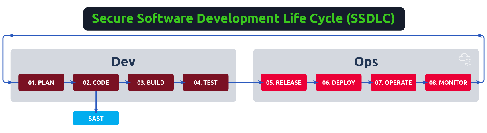

# SAST
## Task 1: Introduction
* **Overview:** Introduces Static Application Security Testing (SAST) as a core white-box methodology for evaluating source code for security vulnerabilities without executing the application.

## Task 2: Code Review
* **Overview:** Explores the code review process as a fundamental method for catching vulnerabilities early in the development lifecycle when they are cheapest to fix.

* **Key Concepts:**

* **White-Box Approach:** Reviewing source code directly gives the reviewer complete visibility into the application's internal structure and logic.
    * **Manual vs. Automated Code Review:**
        * **Manual Review:** A human reviewer thoroughly analyzes logic flaws and complex edge cases, but the process is slow, expensive, and prone to fatigue over large codebases.
        * **Automated Review:** Fast, consistent, and cost-effective at finding low-hanging fruits and common vulnerabilities instantly using predefined rules.
    * **Best Practice Strategy:** Run automated reviews early and continuously during development, reserved alongside periodic manual reviews for complex business logic.

## Task 3: Manual Code Review   
* **Overview:** Covers techniques and methodologies for manually auditing source code for security vulnerabilities.

* **Key Concepts:**
    * **Source-to-Sink Analysis:** Tracing untrusted user inputs (sources) as they flow through the application logic to critical endpoints (sinks, such as database queries or system command calls).
    * **Logic & Context Awareness:** Identifying flaws that automated tools miss—such as broken access control, authorization bypasses, and business logic flaws.

## Task 4: Automated Code Review
* **Overview:** Introduces Static Application Security Testing (SAST) engines and the analysis techniques they use to analyze source code without executing the application.
* **Key Analysis Techniques:**
    * **Semantic Analysis:** Similar to grep, it searches code for predefined syntax patterns or specific unsafe functions.
    * **Structural Analysis:** Analyzes the physical structure and architecture of the code, commonly used to flag dead code or unused variables.
    * **Configuration Analysis:** Inspects project configuration files (e.g., XML, JSON, YAML) for security misconfigurations.
    * **Taint / Data Flow Analysis:** Traces data paths from untrusted inputs (sources) to execution points (sinks) to identify vulnerabilities.

## Task 5: Rechecking our Application with SAST Tools
* **Overview:** Demonstrates executing a SAST tool (such as Psalm for PHP) against a codebase and evaluating its output against real-world accuracy.
* **Key Concepts & Accuracy Limitations:**
    * **False Positives:** Occurs when a SAST scanner reports a vulnerability on safe code (e.g., flagging a query that is already properly sanitized).
    * **False Negatives:** Occurs when a scanner fails to detect an actual security flaw present in the source code.
    * **Code Annotations & Suppressions:** Developers can use inline comments/annotations to instruct SAST tools to ignore specific non-vulnerable lines or suppress false positives.

## Task 6: SAST in the Development Cycle
* **Overview:** Focuses on integrating SAST tooling into modern software development environments to enforce security continuously.

* **Key Integration Approaches:**
    * **IDE Integration:** Running real-time SAST extensions (such as Semgrep or Psalm) inside IDEs (like VS Code) to provide instant inline alerts as developers write code.
    * **CI/CD Pipeline Integration:** Automating SAST scans during pull requests or automated builds to catch vulnerabilities before code is merged into production branches.

## Task 7: Conclusion
* **Overview:** Wraps up the Static Application Security Testing (SAST) module by reviewing how automated source code auditing fits into the broader application security ecosystem.
* **Key Takeaways:**
    * SAST provides automated, rapid, and scalable source code analysis that pinpoints exact file locations and line numbers for security flaws.
    * SAST is most effective when combined with other security methodologies, such as Dynamic Application Security Testing (DAST) and Software Composition Analysis (SCA), to ensure comprehensive security coverage across the entire software development lifecycle.