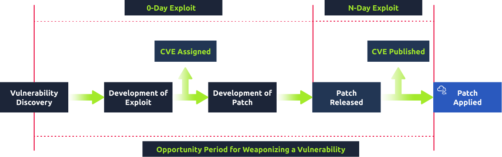
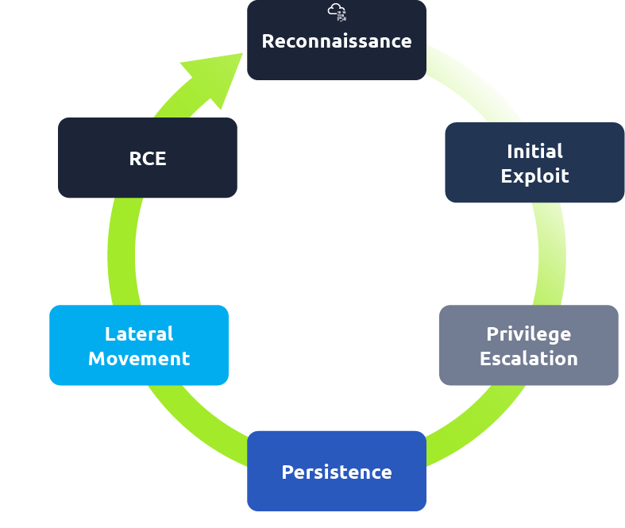

# Weaponizing Vulnerabilities
## Task 1: Introduction
* **Overview**: Introduces the concepts of vulnerability evolution and weaponization.
* **Key Learning Objectives**: Understand how security vulnerabilities transition from discovery to functional exploits, and explore techniques used to combine (chain) multiple lower-severity vulnerabilities to achieve Remote Code Execution (RCE).

## Task 2: What is an Exploit?
* **Overview**: Defines an exploit as a technical mechanism (script, binary, payload, or input sequence) designed to take advantage of a vulnerability to cause unintended behavior in software or hardware.
* **Key Concepts**:
    * **Local vs. Remote Exploits**:
        * **Local Exploits**: Require prior access to the target host to escalate privileges or access local resources.
    * **Remote Exploits**: Executed over a network or communication channel to gain control of a remote system without requiring initial interactive access.
* **Purpose**: An exploit is not the ultimate goal itself, but a catalyst used to deliver payloads, bypass security controls, steal data, or establish persistent access.

## Task 3: Vulnerability Lifecycle
* **Overview**: Traces the lifespan of a software security flaw from initial occurrence to final remediation.

* **Key Phases**:
    * **Product Launched:** A vendor in the public market launches an information technology product (hardware or software).
    * **Vulnerability Discovery (Public or Private):** Researchers working independently or sponsored by private/public organizations for various interests discover vulnerabilities in the product. A **0-day** vulnerability is one that has yet to be made public after being found. In any other case, when a vulnerability is found, it is made available to the general public via the internet or other special sources. Before the vulnerability is publicly disclosed online, the manufacturer typically has already developed a patch or update for the product at this stage.
    * **Development of a Proof of Concept (PoC) or Exploit:** A PoC proving the exploitability of the newly discovered vulnerability is prepared in-house by the vendor or received from bug bounty hunters/independent researchers. It is crucial at this stage to keep the vulnerability disclosure discrete as the PoC is typically the first stage in developing an exploit, and bad actors can use it in the wild.
    * **Patch Development or Update:** The product manufacturer creates a patch or update to prevent the known vulnerability from being exploited by adversaries.
    * **Patch Release:** The product manufacturer releases the patch for the vulnerability so the customers can apply it to the product in their environment.
    * **Patch Install:** The customer or end-users update or patch their systems, so the known vulnerability cannot be used against it.

## Task 4: Opportunity for Weaponizing Vulnerabilities
* **Overview**: Explores the window of vulnerability between the initial discovery or disclosure of a security flaw and the application of patches by organizations.

* **Key Concepts**:
    * **0-Day Vulnerabilities**: Flaws that are actively exploited in the wild before the software vendor is aware or has released a security patch.
    * **N-Day Vulnerabilities**: Flaws with publicly known details and available patches, but which remain dangerous because organizations take time to test and deploy updates ("patch window").
    * **Weaponization Process**: Transforming raw vulnerability research or basic PoCs into reliable, automated, and packaged exploit modules for operational use.

## Task 5: Exploit Chaining
* **Overview:** Explores the methodology of combining multiple lower-severity or non-critical security vulnerabilities to construct a full attack chain resulting in higher impact (such as Remote Code Execution).

* **Key Concepts:**
    * **Reconnaissance**: The attacker will gather information about the target system and its vulnerabilities. This can be done through various methods, such as network scanning, port scanning, and vulnerability scanning.
    * **Initial Exploit**: The attacker will use the information gathered during the reconnaissance phase to identify an initial vulnerability that can be exploited, which could be known and that has not been patched. The attacker will use an exploit that takes advantage of this vulnerability to gain access to the target system.
    * **Privilege Escalation**: This will allow them to access sensitive information, such as login credentials and system files, and execute code with higher privileges.
    * **Persistence**: The attacker will use other exploits to establish persistence on the target system, allowing them to maintain access even if the initial exploit is discovered and patched.
    * **Lateral Movement**: The attacker will then use additional exploits to move laterally through the target system's network and compromise other systems. This will allow them to gain access to additional sensitive information and resources.
    * **RCE**: Once the attacker has established persistence and moved laterally through the network, they will use the final exploit in the chain to gain RCE. This may include using malware to gain control of the target system or a privilege escalation exploit to gain access to the target system's kernel.

## Task 6: Chaining Multiple Vulnerabilities - A Case Study
* **Overview:** Demonstrates a practical walkthrough of chaining real-world web application flaws together to achieve full system compromise.
* **Key Walkthrough Steps:**
    * **Information Gathering**: Identifying application frameworks, exposed endpoints, and version information.
    * **Bypassing Authentication**: Utilizing a low-severity logic bug or information disclosure to bypass initial login controls or elevate privileges to an administrative context.
    * **Achieving RCE**: Leveraging administrative access (e.g., arbitrary file upload, template injection, or command injection) to execute system commands on the host server.

## Task 7: Automating Common Tasks
* **Overview:** Focuses on converting complex, multi-step manual exploit chains into repeatable automated scripts and tools.
* **Key Tools & Techniques:**
    * **Scripting Languages**: Using Python (requests library) or Bash to handle session cookies, automated token extraction, multi-stage HTTP requests, and payload generation.
    * **Exploit Frameworks**: Integrating custom exploit modules into frameworks like Metasploit to standardize payload delivery and session management.

## Task 8: Conclusion
* **Overview:** Summarizes the core lessons on vulnerability lifecycle, weaponization, and defense strategies.
* **Key Takeaways:**
    * **Defense-in-Depth**: Organizations must implement multiple layers of security controls, such as firewalls, intrusion detection systems, and access controls, to prevent unauthorized access to sensitive information.
    * **Robust Input Validation**: Applications should validate all user input to prevent injection attacks, such as SQL injection and cross-site scripting.
    * **Principle of Least Privilege**: Users should only be granted the minimum level of access necessary to perform their job functions.
    * **Prompt Patch Management**: Organizations should apply security patches to their systems as soon as they become available to prevent attackers from exploiting known vulnerabilities.