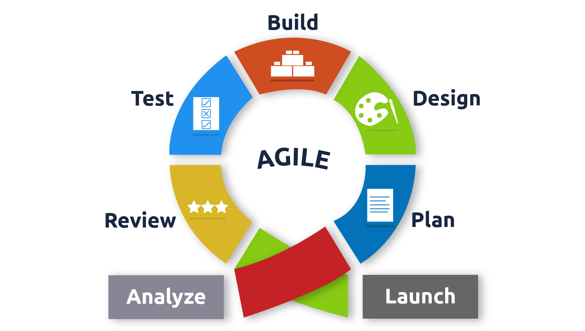
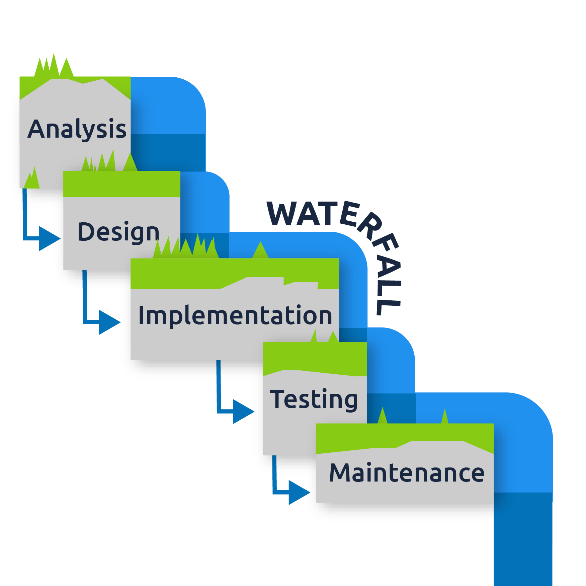
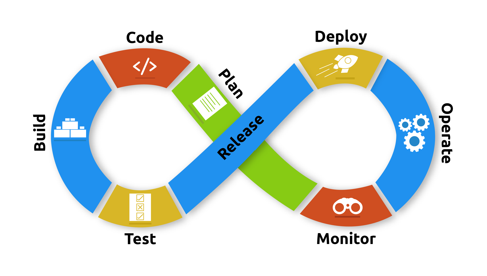

# Introduction to DevSecOps
## Task 1: Introduction
* **Overview**: Introduces the fundamental concepts of DevSecOps and outlines the evolution of software development styles.
* **Key Learning Objectives**:
    * Understand how development practices have improved over the years.
    * Learn the importance of DevSecOps culture, which integrates security as a core discipline.
    * Outlines the DevSecOps learning path (covering CI/CD, pipeline security, automated testing, and Infrastructure as Code).

## Task 2: DevOps: A New Hope
* **Overview**: Explores the transition from traditional project management models to modern methodologies.
* **Key Concepts**:
    * **Waterfall vs. Agile**: The strict, step-by-step Waterfall model often led to poor communication and silos, whereas Agile introduced self-organizing teams, flexibility, and customer-focused collaboration.
     
    * **DevOps**: Bridges the gap between Development and Operations. It relies heavily on automation and integration to unite teams, ultimately emphasizing that the core of DevOps is building trust.

## Task 3: The Infinite Loop
* **Overview**: Visualizes the DevOps methodology as a continuous, infinite loop where development, operations, and feedback never stop.

* **Key Concepts & Tools**:
    * **CI/CD**: Continuous Integration and Continuous Delivery help teams handle frequent code changes and add automated testing.
    * **IaC (Infrastructure as Code)**: Provisions and manages infrastructure through reusable and consistent pieces of code.
    * **Monitoring**: The process of collecting data to continuously analyze the performance, stability, and health of services.

## Task 4: Shifting Left
* **Overview**: Introduces the practice of moving security from the end of the development lifecycle to the very beginning.
* **Key Concepts**:
    * **"Shifting Left"**: Accounting for security from the earliest stages of development rather than treating it as a final hurdle before production.
    * **Benefits**: By integrating code analysis tools and automated tests early, teams can catch security flaws before they reach production. This reduces remediation costs, prevents last-minute rollbacks, and transforms security into a core design feature rather than an optional add-on.

## Task 5: DevSecOps: Security Strikes Back
* **Overview**: Introduces DevSecOps as the natural evolution of DevOps, seamlessly integrating security practices directly into the continuous integration and delivery pipelines.
* **Key Concepts**:
    * **Shared Responsibility**: Security is no longer siloed to a specific team at the end of the lifecycle; it becomes the responsibility of everyone involved (developers, operations, and security engineers).
    * **Automated Security**: Emphasizes using automated tooling—such as SAST, DAST, Software Composition Analysis (SCA), and Secrets Scanning—to continuously monitor and test code without slowing down release cycles.

## Task 6: DevSecOps Culture
* **Overview**: Focuses on the cultural transformation required to successfully adopt DevSecOps, highlighting that tools alone are not enough without the right mindset.
* **Key Concepts**:
    * **Breaking Silos**: Encourages open communication and collaboration across departments, eliminating the "blame game" that was common in traditional Waterfall models.
    * **Continuous Learning & Trust**: Promotes an environment where teams learn from security incidents rather than pointing fingers, building trust and a proactive approach to securing software architectures.

## Task 7: Exercise: Fuel Trouble
* **Overview**: A practical, interactive mini-game scenario where you apply the DevSecOps concepts learned throughout the room.
* **Key Objectives**:
    * **Pipeline Configuration**: You must help a space crew repair their deployment pipeline by dragging and dropping the correct automated security checks (like Code Review, SAST, DAST, and Infrastructure scanning) into their appropriate stages.
    * **Practical Application**: Successfully mapping the security tools to the correct pipeline phases secures the application, launches the rocket, and rewards you with the final flag.