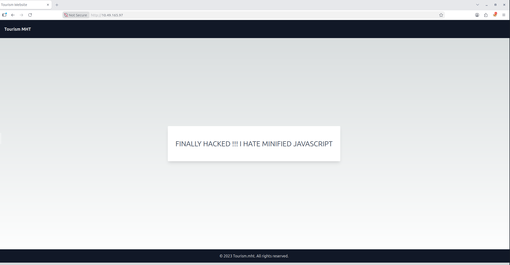
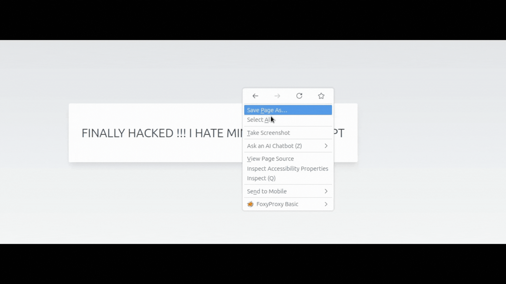
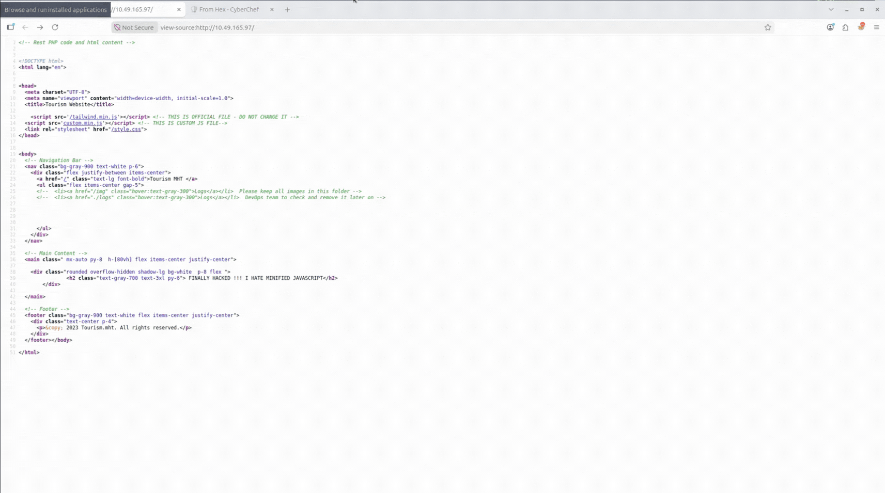
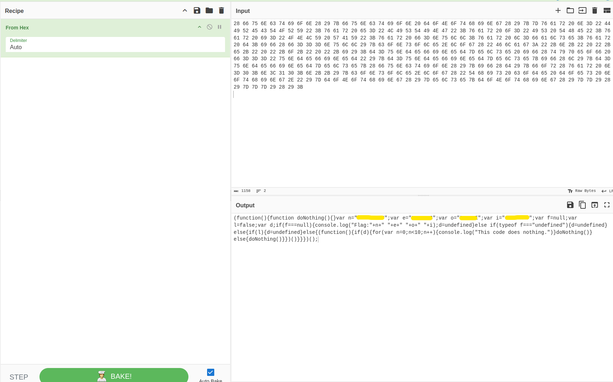
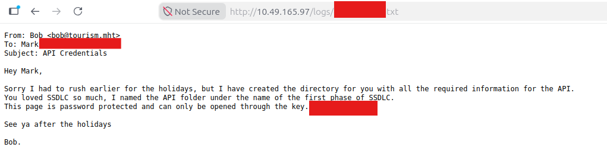
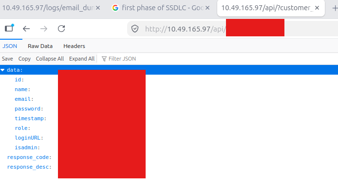
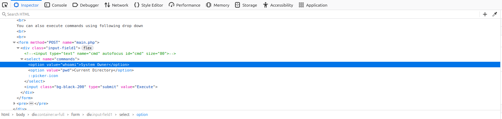
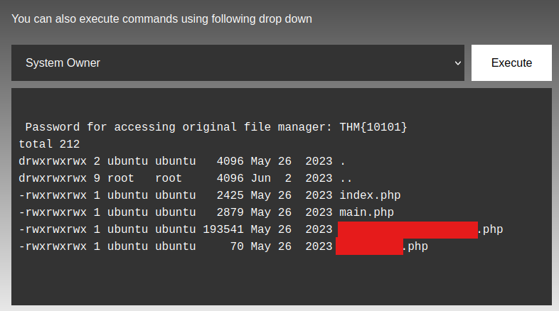
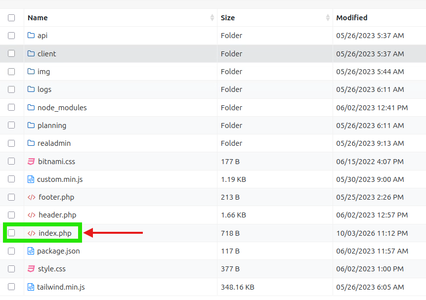
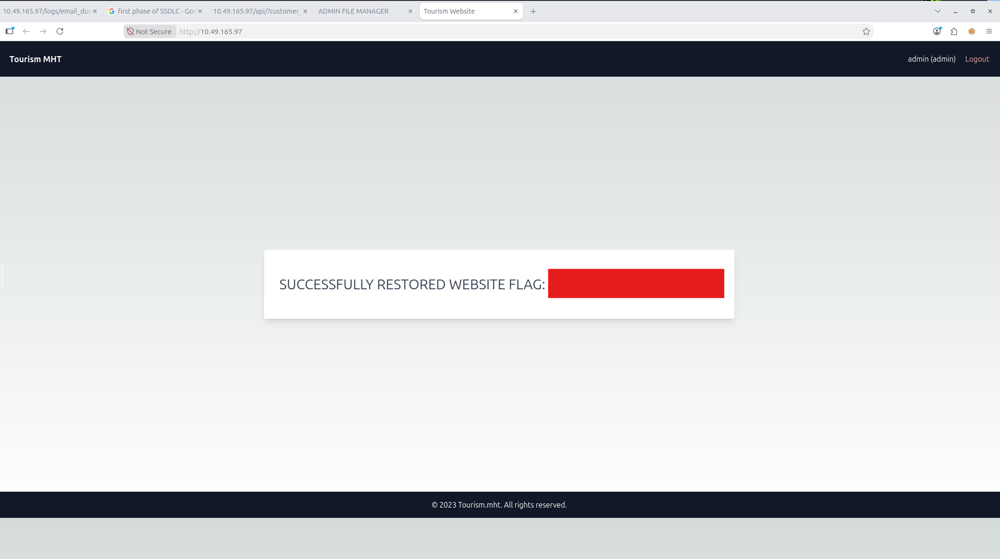

# Traverse (TryHackMe) - Challenge Walkthrough

| Room Details | Information |
| :--- | :--- |
| **Room Name** | [Traverse](https://tryhackme.com/room/traverse) |
| **Learning Path** | [Security Engineer](./0-README.md) |
| **Difficulty** | Easy / Medium |
| **Topics Covered** | Source Code Obfuscation, Directory Enumeration, IDOR, Command Injection, Web Shell Detection & Defacement Remediation |

---

## Overview & Scenario

The tourism application **Tourism MHT** has suffered a security breach and defacement. The homepage displays an attacker message: *"FINALLY HACKED !!! I HATE MINIFIED JAVASCRIPT"*.

As a Security Engineer, your objective is to investigate the incident end-to-end:
1. Deobfuscate client-side JavaScript to retrieve hidden hints and initial flags.
2. Enumerate hidden directories and analyze leaked email communications.
3. Exploit an Insecure Direct Object Reference (IDOR) vulnerability on the customer API to uncover administrative credentials and hidden portals.
4. Bypass client-side form controls to execute commands and locate uploaded web shells.
5. Access the genuine file manager, sanitize defaced files, and restore the website to recover the final flag.



---

## Phase 1: JavaScript Deobfuscation (Questions 1 & 2)

### 1. Locate the Obfuscated Script
* Navigate to the target web application at `http://[MACHINE_IP]`.
* Open the browser Developer Tools or press `Ctrl + U` to view the page source.
* In the `<head>` or at the bottom of the `<body>`, look for custom JavaScript files. You will identify an external script reference: `custom.min.js`.




### 2. Identify the Encoding Scheme
* Open `http://[MACHINE_IP]/custom.min.js`.
* At the top of the file, a developer comment reads: `// I WILL KEEP THE OBFUSCATED SO NO ONE CAN UNDERSTAND`.
* The content consists of hexadecimal byte sequences separated by spaces (e.g., `28 66 75 6e 63 74 69 6f 6e...`).

> [!NOTE]
> **Question 1:** What type of encoding is used by the hackers to obfuscate the JavaScript file?  
> **Answer:** `hex`

### 3. Deobfuscate for the Flag
* Copy the obfuscated hexadecimal string.
* Open [CyberChef](https://gchq.github.io/CyberChef/) and paste the text into the **Input** panel.
* Add the **From Hex** recipe (set delimiter to `Auto` or `Space`).
* The deobfuscated JavaScript code is revealed:

```javascript
(function(){
    function doNothing(){}
    var n="DIRECT";
    var e="ORY LISTING ";
    var o="IS THE ";
    var i="ONLY WAY";
    var f=null;
    var l=false;
    var d;
    if(f===null){
        console.log("Flag:"+n+""+e+""+o+""+i);
        d=undefined
    }else if(typeof f==="undefined"){
        d=undefined
    }else{
        if(l){
            d=undefined
        }else{
            (function(){
                if(d){
                    for(var n=0;n<10;n++){
                        console.log("This code does nothing.")
                    }
                    doNothing()
                }else{
                    doNothing()
                }
            })()
        }
    }
})();
```

* Concatenating `n + e + o + i` produces the flag: `DIRECTORY LISTING IS THE ONLY WAY`.



> [!IMPORTANT]
> **Question 2:** What is the flag value after deobfuscating the file?  
> **Answer:** `DIRECTORY LISTING IS THE ONLY WAY`  
> *Hint:* This flag provides an explicit clue for the next phase—directory enumeration.

---

## Phase 2: Log Enumeration & Directory Discovery (Questions 3, 4, & 5)

### 1. Directory Brute-Forcing
Using the hint obtained from the JavaScript flag, execute a directory brute-force scan against the web application using `gobuster`:

```bash
gobuster dir -u http://[MACHINE_IP] -w /usr/share/wordlists/dirb/common.txt -x txt,php,html
```

Gobuster uncovers several sensitive directories:
* `/logs` (Directory listing enabled)
* `/planning`
* `/api`

### 2. Examine Leaked Email Dumps
* Navigate to `http://[MACHINE_IP]/logs/` in your browser.
* Directory indexing reveals an email dump file: `email_dump.txt`.

> [!NOTE]
> **Question 3:** What is the name of the file containing email dumps?  
> **Answer:** `email_dump.txt`

### 3. Analyze Internal Communications
* Open `http://[MACHINE_IP]/logs/email_dump.txt`.
* The file contains an internal email exchange between Bob (`bob@tourism.mht`) and Mark:

```text
From: Bob <bob@tourism.mht>
To: Mark
Subject: API Credentials

Hey Mark,

Sorry I had to rush earlier for the holidays, but I have created the directory for you with all the required information for the API.
You loved SSDLC so much, I named the API folder under the name of the first phase of SSDLC.
This page is password protected and can only be opened through the key.

See ya after the holidays

Bob.
```



* Bob notes that he named the directory after the **first phase of SSDLC** (Secure Software Development Life Cycle), which is **`planning`** (see [SSDLC Guide](./19-ssdlc.md)).

> [!NOTE]
> **Question 4:** What is the name of the directory that Bob has created?  
> **Answer:** `planning`

### 4. Retrieve the Directory Access Key
* Accessing `http://[MACHINE_IP]/planning/` prompts for authentication or the key mentioned in Bob's email.
* Checking the associated directory or reading the conversation reveals the key string: `THM{100100111}`.

> [!NOTE]
> **Question 5:** What is the key file for opening the directory that Bob has created for Mark?  
> **Answer:** `THM{100100111}`

---

## Phase 3: API Exploitation & IDOR (Questions 6, 7, & 8)

### 1. Locate the API Endpoint
From the files inside `/planning` or initial reconnaissance, an API endpoint is exposed to query customer details:
```text
http://[MACHINE_IP]/api/?customer_id=1
```

The response returns a structured JSON payload:
```json
{
  "data": {
    "id": "1",
    "name": "...",
    "email": "...",
    "password": "...",
    "timestamp": "...",
    "role": "user",
    "loginURL": "...",
    "isadmin": false,
    "response_code": 200,
    "response_desc": "Success"
  }
}
```

### 2. Test for Insecure Direct Object Reference (IDOR)
The API lacks object-level authorization checks. Querying any arbitrary `customer_id` parameter returns that user's private data.

* Send a request for `customer_id=5`:
```text
http://[MACHINE_IP]/api/?customer_id=5
```
* The JSON response contains the user record for ID 5:
  * `email`: `john@traverse.com`

> [!NOTE]
> **Question 6:** What is the email address for ID 5 using the leaked API endpoint?  
> **Answer:** `john@traverse.com`

### 3. Enumerate Administrative Users
Iterate through sequential user IDs (`customer_id=1, 2, 3, 4...`) to inspect user roles.

* At `customer_id=3`, the JSON response exposes:
  * `"id": "3"`
  * `"role": "admin"`
  * `"isadmin": true`
  * `"loginURL": "/realadmin"`



> [!NOTE]
> **Question 7:** What is the ID for the user with admin privileges?  
> **Answer:** `3`

> [!NOTE]
> **Question 8:** What is the endpoint for logging in as the admin?  
> **Answer:** `/realadmin`

---

## Phase 4: Web Shell Discovery & Remediation (Questions 9, 10, & 11)

### 1. Inspect the Admin Command Execution Interface
* Navigate to the admin portal discovered in Phase 3: `http://[MACHINE_IP]/realadmin`.
* The interface features a dropdown menu providing limited commands:
  * `System Owner` (`whoami`)
  * `Current Directory` (`pwd`)
* Inspecting the DOM via DevTools (`F12`) reveals the underlying HTML structure:

```html
<form method="POST" name="main.php">
  <div class="input-field1">
    <!-- <input type="text" name="cmd" autofocus id="cmd" size="80"> -->
    <select name="commands">
      <option value="whoami">System Owner</option>
      <option value="pwd">Current Directory</option>
    </select>
    <input class="bg-black-200" type="submit" value="Execute">
  </div>
</form>
```



### 2. Bypass Client-Side Restrictions to Execute Arbitrary Commands
Because input filtering is only enforced on the client side via the `<select>` options:
1. Double-click the `value="whoami"` attribute in Developer Tools.
2. Modify the value to an arbitrary shell command: `ls -la ../`.
3. Select the modified option in the dropdown and click **Execute**.



The command execution output reveals:
```text
Password for accessing original file manager: THM{10101}
total 212
drwxrwxrwx 2 ubuntu ubuntu   4096 May 26  2023 .
drwxrwxrwx 9 root   root     4096 Jun  2  2023 ..
-rwxrwxrwx 1 ubuntu ubuntu   2425 May 26  2023 index.php
-rwxrwxrwx 1 ubuntu ubuntu   2879 May 26  2023 main.php
-rwxrwxrwx 1 ubuntu ubuntu 193541 May 26  2023 renamed_file_manager.php
-rwxrwxrwx 1 ubuntu ubuntu     70 May 26  2023 thm_shell.php
```

Two suspicious PHP files stand out:
1. `thm_shell.php`: A 70-byte malicious web shell uploaded by the attacker.
2. `renamed_file_manager.php`: A 193 KB file manager utility that the attacker renamed to conceal it from administrators.

> [!NOTE]
> **Question 9:** Can you find the name of the web shell that the attacker has uploaded?  
> **Answer:** `thm_shell.php`

> [!NOTE]
> **Question 10:** What is the name of the file renamed by the attacker for managing the web server?  
> **Answer:** `renamed_file_manager.php`

### 3. Access the Genuine File Manager
* Navigate to `http://[MACHINE_IP]/renamed_file_manager.php`.
* When prompted for credentials, submit the password discovered in the command output: `THM{10101}`.
* A full web-based File Manager dashboard opens, displaying the site's directory tree.



### 4. Restore the Website & Retrieve Final Flag
1. In the file manager, select `index.php` and click the **Edit** action.
2. Search for the defacement injection string added by the threat actor: `FINALLY HACKED !!! I HATE MINIFIED JAVASCRIPT` (or `FINALLY HACKED`).
3. Delete the defacement code, restore the clean HTML structure, and save the file.
4. Navigate back to the homepage `http://[MACHINE_IP]`.
5. The web server detects the remediation and renders the completion banner:



> [!NOTE]
> **Question 11:** What is the flag value after restoring the main website?  
> **Answer:** `THM{WEBSITE_RESTORED}`

---

## 📋 Questions & Answers Summary

| # | Question | Answer |
| :-: | :--- | :--- |
| **1** | What type of encoding is used by the hackers to obfuscate the JavaScript file? | `hex` |
| **2** | What is the flag value after deobfuscating the file? | `DIRECTORY LISTING IS THE ONLY WAY` |
| **3** | What is the name of the file containing email dumps? | `email_dump.txt` |
| **4** | What is the name of the directory that Bob has created? | `planning` |
| **5** | What is the key file for opening the directory that Bob has created for Mark? | `THM{100100111}` |
| **6** | What is the email address for ID 5 using the leaked API endpoint? | `john@traverse.com` |
| **7** | What is the ID for the user with admin privileges? | `3` |
| **8** | What is the endpoint for logging in as the admin? | `/realadmin` |
| **9** | Can you find the name of the web shell that the attacker has uploaded? | `thm_shell.php` |
| **10** | What is the name of the file renamed by the attacker for managing the web server? | `renamed_file_manager.php` |
| **11** | What is the flag value after restoring the main website? | `THM{WEBSITE_RESTORED}` |

---

## 🛡️ Security Engineering Lessons & Remediation

This challenge demonstrates a multi-stage attack chain and highlights critical defensive principles:

1. **Obfuscation is Not Security**:
   - Compressing or encoding client-side assets (Hex, Base64, JS minification) never protects sensitive logic or credentials. All client-side code must be considered fully public and untrusted.
2. **Disable Directory Indexing & Protect Logs**:
   - The web server permitted directory listings on `/logs`, exposing sensitive employee communications (`email_dump.txt`). Production web servers must enforce `Options -Indexes` (Apache) or `autoindex off;` (Nginx).
3. **Broken Object Level Authorization (BOLA / IDOR)**:
   - The `/api/?customer_id=` endpoint allowed unauthenticated, arbitrary user record lookups. APIs must validate that the requesting user's session token has authorization to view the requested resource.
4. **Never Rely on Client-Side Controls for Security**:
   - The command execution interface relied exclusively on an HTML `<select>` dropdown. Attackers can trivially modify form values via DevTools or send raw POST requests via `curl` / Burp Suite. All input must be strictly validated and whitelisted on the server.
5. **File Integrity Monitoring (FIM)**:
   - File Integrity Monitoring tools (such as OSSEC, Tripwire, or Wazuh) detect unauthorized modifications to critical application files (like `index.php`) and alert security operations teams when unexpected scripts (like `thm_shell.php`) are written to the web root.