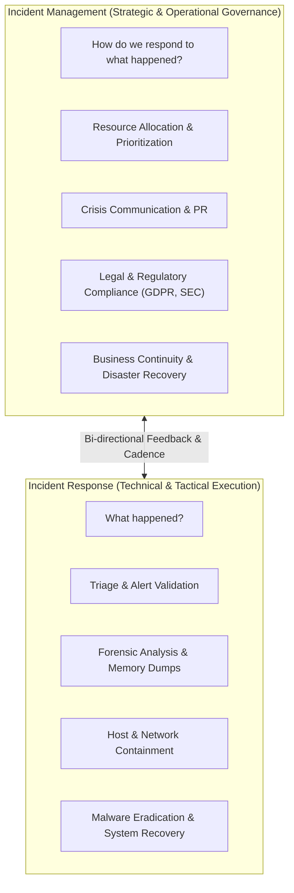
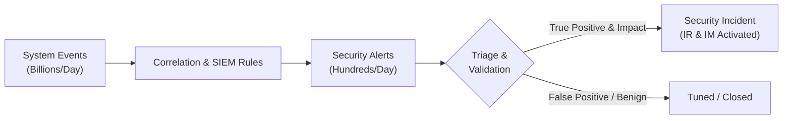
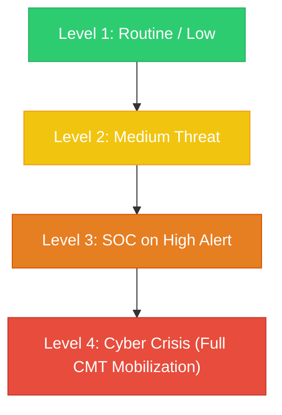
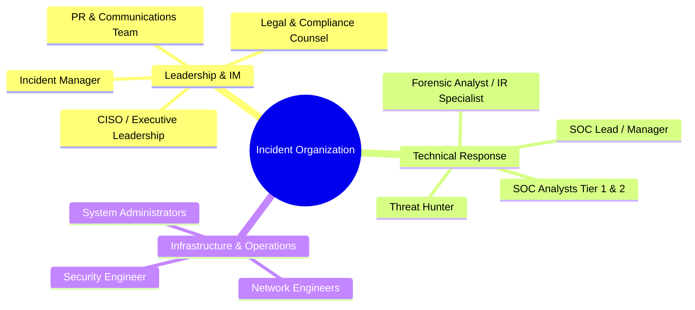
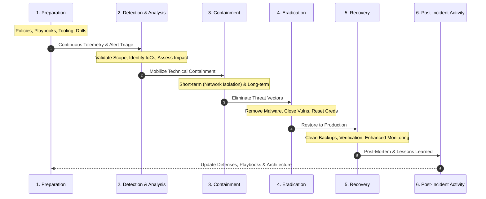
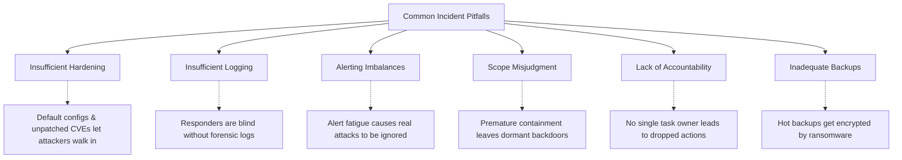

# Intro to IR and IM (TryHackMe) - Walkthrough

| Room Details | Information |
| :--- | :--- |
| **Room Name** | [Intro to IR and IM](https://tryhackme.com/room/introtoirandim) |
| **Learning Path** | [Security Engineer](./0-README.md) |
| **Module** | Module 05: Managing Incidents |
| **Difficulty** | Easy / Info |
| **Topics Covered** | Incident Response (IR) vs Incident Management (IM), Incident Severity Levels, Blue Team & IR Roles, NIST/SANS Incident Lifecycle, Common Incident Response Pitfalls |

---

## 📌 Overview & Core Concepts

In enterprise environments, security breaches are a matter of *when*, not *if*. Having robust preventive defenses is essential, but equally vital is the capacity to detect, triage, contain, and remediate adverse events systematically.

This room explores the fundamental concepts, organizational structures, standard lifecycles, and operational pitfalls involved in handling cybersecurity crises.

### Incident Response (IR) vs. Incident Management (IM)

Organizations frequently conflate **Incident Response** with **Incident Management**, but they represent two distinct operational dimensions:

* **Incident Response (IR):** The technical, hands-on activities executed by frontline analysts, engineers, and threat hunters. It focuses on the question: **"What happened?"** (e.g., analyzing malware, parsing memory dumps, isolating compromised endpoints, and extracting Indicators of Compromise).
* **Incident Management (IM):** The overarching strategic, logistical, and governance framework coordinating the organizational response. It focuses on the question: **"How do we respond to what happened?"** (e.g., crisis communication, resource allocation, stakeholder engagement, legal/regulatory compliance, and business continuity).

---

## Task 1: Introduction

Task 1 introduces the core rationale behind Incident Response and Management. As modern threat actors automate attacks and target critical infrastructure, organizations must move beyond purely defensive hardening and develop structured, repeatable incident handling workflows.

### Key Takeaways
* Security failures inevitably occur due to software bugs, configuration drift, or social engineering.
* Success during a breach is measured by how swiftly and effectively the organization minimizes blast radius, protects data integrity, and restores normal business operations.

> [!NOTE]
> *No answer is required for Task 1.*

---

## Task 2: What is Incident Response and Management

Task 2 establishes the definitions that distinguish events, alerts, and incidents, while introducing standardized severity classification levels.

### 1. Events, Alerts, and Incidents
* **Event:** Any observable occurrence within a computer system or network (e.g., file modification, user authentication, firewall packet drop).
* **Alert:** A notification generated when an event meets predefined threshold criteria or anomalous heuristics, signaling an analyst to perform triage.
* **Incident:** An adverse event (or pattern of events) that actually threatens or violates the confidentiality, integrity, or availability (CIA) of an organization's systems or data.

---

### 2. Incident Classification & Severity Levels

Organizations categorize incidents into numerical tiers to dictate escalation procedures, notification channels, and operational tempos:

| Level | Severity | Definition & Operational Impact | Action Taken |
| :---: | :---: | :--- | :--- |
| **Level 1** | **Low / Routine** | Minor localized anomalies or policy deviations with minimal to zero business impact (e.g., single blocked phishing email, isolated adware). | Managed via standard tickets and automated playbooks by Tier 1 analysts. |
| **Level 2** | **Medium** | Suspicious activity impacting non-critical assets (e.g., repeated unauthorized login attempts, malware caught on an isolated workstation). | Handled by Tier 2 analysts with localized investigation and routine containment. |
| **Level 3** | **High Alert** | Significant operational disruption or active adversary presence (e.g., privilege escalation, suspicious lateral movement, domain controller targeting). | **SOC placed on High Alert.** Dedicated incident response team mobilized; executive leadership briefed. |
| **Level 4** | **Cyber Crisis** | Severe enterprise-wide catastrophe (e.g., enterprise ransomware deployment, massive sensitive customer data exfiltration, total core service outage). | Classified as a **Cyber Crisis**. Crisis Management Team (CMT), C-suite, legal, law enforcement, and external PR activated. |

---

### Task 2 Questions & Answers

> [!NOTE]
> **Question 1:** At what level (number only) of an incident would the SOC be placed at high alert and to deal with an incident?  
> **Answer:** `3`

> [!NOTE]
> **Question 2:** At what level (number only) of an incident would it be classified as a cyber crisis?  
> **Answer:** `4`

> [!NOTE]
> **Question 3:** Which component (IR or IM) is responsible for trying to answer the question: How do we respond to what happened?  
> **Answer:** `IM`

> [!NOTE]
> **Question 4:** Which component (IR or IM) is responsible for trying to answer the question: What happened?  
> **Answer:** `IR`

---

## Task 3: The Different Roles During an Incident

During a cybersecurity incident, clear ownership of responsibilities prevents chaos, duplication of efforts, and critical omissions. Task 3 details the specialized roles that form an effective response team.

### Key Incident Roles & Responsibilities

1. **Incident Manager (Incident Commander):**
   * Acts as the single point of coordination and ultimate authority during the crisis.
   * Manages status briefings, removes operational bottlenecks, enforces response cadence, and shields technical responders from executive distractions.
2. **SOC Lead / SOC Manager:**
   * Oversees the monitoring queue, allocates analyst resources across shifts, and validates initial escalation determinations.
3. **SOC Analyst (Tier 1 / Tier 2):**
   * Conducts alert triage, initial log analysis, and determines whether an alert represents a true positive.
4. **Forensic Analyst & Incident Responder:**
   * Executes deep technical investigations, captures volatile memory, analyzes hard drive images, reverses malware binaries, and reconstructs adversary activity timelines.
5. **Security Engineer:**
   * Modifies security architectures on the fly: implements perimeter firewall blocks, writes custom EDR detection rules, updates WAF rules, and isolates compromised subnets.
6. **IT & System Administrator:**
   * Performs physical and OS-level operations: re-imaging endpoints, revoking compromised Active Directory accounts, rotating service keys, and restoring backups.
7. **Legal Counsel & Regulatory Compliance:**
   * Evaluates mandatory disclosure deadlines (e.g., GDPR 72-hour notification, SEC 4-day disclosure rule), guides evidentiary chain-of-custody, and maintains attorney-client privilege.
8. **Public Relations (PR) & Internal Communications:**
   * Prepares customer notices, press releases, and internal staff guidance to control narrative and mitigate reputational harm.

---

### Task 3 Interactive Challenge: Matching Roles & Responsibilities

In the static lab interface, match each role card with its respective operational responsibility:
* **Incident Manager:** Drives coordination, tracks actions, and liaises with executive leadership.
* **SOC Analyst:** Performs initial triage and alert investigation.
* **Forensic Investigator:** Reconstructs attack timelines and performs artifact extraction.
* **Security Engineer:** Adjusts defense configurations, firewalls, and detection telemetry.
* **Communications / PR:** Handles public disclosures and media messaging.

Upon correctly matching all roles, the challenge displays the flag:

> [!IMPORTANT]
> **Question:** What is the value of the flag you receive after matching the roles and responsibilities?  
> **Answer:** `THM{Roles.and.Responsibilities.of.IR.and>IM}`

---

## Task 4: The Process of Incident Management

Task 4 walks through the standard incident management lifecycle, harmonizing the **NIST SP 800-61 Rev. 2** (Computer Security Incident Handling Guide) and **SANS 6-Step** frameworks.

### Detailed Lifecycle Phases

#### 1. Preparation
* The single most critical phase—performed **before** an incident takes place.
* Entails establishing incident response plans, playbooks, communication channels (out-of-band communication), continuous employee training, and baseline asset hardening.

#### 2. Detection & Analysis (Triage)
* Ingesting alerts from SIEM, EDR, IDS/IPS, and threat intelligence feeds.
* Determining the attack vector, validating indicators of compromise (IoCs), and defining the initial incident scope.

#### 3. Containment
* Preventing the attacker from expanding access or inflicting further damage:
  * **Short-Term Containment:** Immediate actions like isolating an infected workstation from the network or revoking compromised credentials.
  * **Long-Term Containment:** Temporary workarounds that allow core business systems to continue operating while undergoing heightened scrutiny (e.g., segmenting subnets, routing through scrubbing proxies).

#### 4. Eradication
* Completely purging the adversary and all malicious artifacts from the environment:
  * Deleting persistence mechanisms (malicious services, scheduled tasks, registry run keys, web shells).
  * Patching the underlying vulnerabilities exploited for initial access.
  * Disabling and resetting compromised accounts and Kerberos tickets (e.g., double Krbtgt reset in Active Directory).

#### 5. Recovery
* Restoring affected systems to normal production operations:
  * Rebuilding hosts from pristine, trusted images or restoring clean offline backups.
  * Verifying service functionality and conducting vulnerability re-scans.
  * Implementing enhanced monitoring over affected subnets for potential reinfection.

#### 6. Post-Incident Activity (Lessons Learned)
* Conducting a formal post-mortem review with all stakeholders:
  * Documenting the incident timeline: what happened, when was it detected, and how long did containment take?
  * Identifying operational gaps: which playbooks or communication paths failed?
  * Feeding lessons learned directly back into the **Preparation** phase.

---

### Task 4 Interactive Challenge: The Incident Lifecycle

In the interactive browser module, drag and drop the lifecycle phases into their correct chronological sequence:
1. **Preparation**
2. **Detection & Analysis**
3. **Containment**
4. **Eradication**
5. **Recovery**
6. **Post-Incident Activity**

Once arranged correctly, the interface reveals the task flag:

> [!IMPORTANT]
> **Question:** What is the value of the flag you receive after matching the steps of the incident management process?  
> **Answer:** `THM{Preparation.is.Key.for.Incident.Management}`

---

## Task 5: Common Pitfalls During an Incident

Even experienced organizations encounter critical failure modes during high-pressure incidents. Task 5 examines the six most prevalent operational pitfalls and how security engineers prevent them:

### Detailed Breakdown of Incident Pitfalls

#### 1. Insufficient Hardening
* **The Pitfall:** Skipping security configurations, baselines (e.g., CIS Benchmarks), or disabling MFA to speed up deployment.
* **Consequence:** Eliminates defense-in-depth, allowing adversaries to achieve effortless initial compromise and lateral movement.

#### 2. Insufficient Logging
* **The Pitfall:** Disabling verbose logging (e.g., Sysmon, PowerShell script block logging, DNS queries, command-line auditing) to save on SIEM storage and license costs.
* **Consequence:** Responders are left forensic "blind spots," unable to determine how the breach occurred, what data was accessed, or how far the adversary moved.

#### 3. Alerting Imbalances (Fatigue vs. Under-Alerting)
* **The Pitfall:** Generating thousands of low-fidelity alerts ("crying wolf") without baseline tuning, or configuring rules so restrictively that subtle attacks evade detection.
* **Consequence:** Analysts suffer from alert fatigue and close true positives as noise, or miss multi-stage adversary tactics completely.

#### 4. Scope Misjudgment
* **The Pitfall:** Underestimating or overestimating the boundaries of an incident. 
  * Underestimating: Assuming an attack was isolated to a single laptop, containing only that machine while the adversary maintains persistent access elsewhere.
  * Overestimating: Overreacting and pulling the entire enterprise offline unnecessarily, causing devastating self-inflicted business downtime.

#### 5. Lack of Accountability
* **The Pitfall:** Assigning tasks to "the blue team" collectively rather than delegating specific containment items to named individuals with strict deadlines.
* **Consequence:** Critical containment steps (like isolating an infected jump box or resetting a service account) slip through the cracks.

#### 6. Inadequate Backups
* **The Pitfall:** Relying solely on High-Availability (HA) replication or online, connected network storage.
* **Consequence:** Modern ransomware adversaries deliberately discover and encrypt online backups before encrypting production, leaving organizations unable to recover without paying ransoms.

---

### Task 5 Interactive Challenge: Overcoming Pitfalls

In the interactive simulation, resolve each organizational challenge by selecting the appropriate defensive countermeasure:
1. Enforce strict configuration baselines and patch management (**Hardening**).
2. Centralize and protect forensic log telemetry (**Logging**).
3. Tune alert thresholds to prioritize high-fidelity detection (**Alert Management**).
4. Execute thorough threat hunting across endpoints to establish true blast radius (**Accurate Scoping**).
5. Establish a RACI matrix and assign dedicated action owners (**Accountability**).
6. Implement air-gapped, immutable offline backups adhering to the 3-2-1 rule (**Backups**).

Completing the simulation awards the task flag:

> [!IMPORTANT]
> **Question:** What is the value of the flag you receive when you overcome the common pitfalls of a cyber incident?  
> **Answer:** `THM{Avoiding.the.Common.IM.Mistakes}`

---

## Task 6: Conclusion

Task 6 summarizes the room's overarching themes:
* **Preparation is King:** When an incident strikes, you do not rise to the occasion; you sink to the level of your training and preparation.
* **Culture & Documentation:** Having clearly documented playbooks, updated asset inventories, and well-rehearsed cross-functional teams makes the difference between a contained security event and an existential cyber crisis.

> [!NOTE]
> *No answer is required for Task 6.*

---

## 📋 Questions & Answers Summary

| # | Task | Question | Answer / Flag |
| :-: | :--- | :--- | :--- |
| **1** | Task 1: Introduction | Complete the introductory reading | *No answer needed* |
| **2** | Task 2: Fundamentals | At what level (number only) of an incident would the SOC be placed at high alert and to deal with an incident? | `3` |
| **3** | Task 2: Fundamentals | At what level (number only) of an incident would it be classified as a cyber crisis? | `4` |
| **4** | Task 2: Fundamentals | Which component (IR or IM) is responsible for trying to answer the question: How do we respond to what happened? | `IM` |
| **5** | Task 2: Fundamentals | Which component (IR or IM) is responsible for trying to answer the question: What happened? | `IR` |
| **6** | Task 3: Roles | What is the value of the flag you receive after matching the roles and responsibilities? | `THM{Roles.and.Responsibilities.of.IR.and>IM}` |
| **7** | Task 4: The Process | What is the value of the flag you receive after matching the steps of the incident management process? | `THM{Preparation.is.Key.for.Incident.Management}` |
| **8** | Task 5: Common Pitfalls | What is the value of the flag you receive when you overcome the common pitfalls of a cyber incident? | `THM{Avoiding.the.Common.IM.Mistakes}` |
| **9** | Task 6: Conclusion | Complete the concluding review | *No answer needed* |

---

## 🛡️ Security Engineering & Defensive Best Practices

As a Security Engineer, your duties span both the technical architecture that enables rapid Incident Response and the procedural structures that govern Incident Management:

### 1. Architectural Readiness for Incident Response
* **Centralized Immutable Logging:** Deploy Write-Once-Read-Many (WORM) storage or forward logs to isolated cloud storage (e.g., AWS S3 with Object Lock) so attackers cannot tamper with their audit trails.
* **Endpoint Telemetry Coverage:** Enforce enterprise-wide EDR and Sysmon deployments with process lineage tracking, memory inspection, and network connection auditing.
* **Automated Micro-Segmentation:** Leverage software-defined networking (SDN) or host-based firewall policies to enable 1-click quarantine of compromised assets without interrupting core services.

### 2. Bulletproof Backup Architecture (The 3-2-1-1-0 Rule)
* **3** copies of critical data.
* **2** different storage media types.
* **1** copy stored offsite.
* **1** copy kept completely **offline, air-gapped, or immutable**.
* **0** errors during automated recovery drills.

### 3. Operationalizing Incident Management
* **RACI Matrix:** Implement a Responsible, Accountable, Consulted, and Informed (RACI) matrix for each incident severity level so every team member knows their exact mandate.
* **Out-of-Band (OOB) Communications:** Pre-configure separate, dedicated communication channels (e.g., Signal groups, separate hosted instances) to use when primary email or Slack/Teams servers may be compromised.
* **Regular Tabletop Exercises (TTX):** Run quarterly executive and technical simulations (e.g., ransomware outbreak, insider data exfiltration) to stress-test playbooks and validate team readiness.