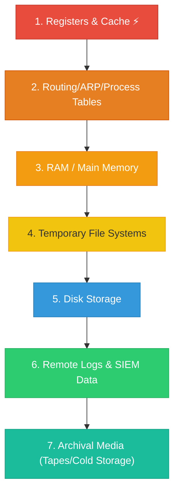
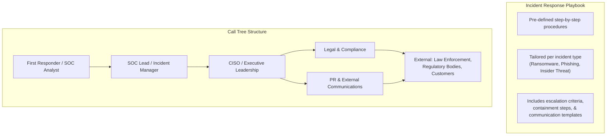
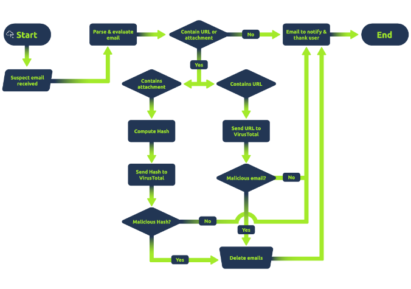
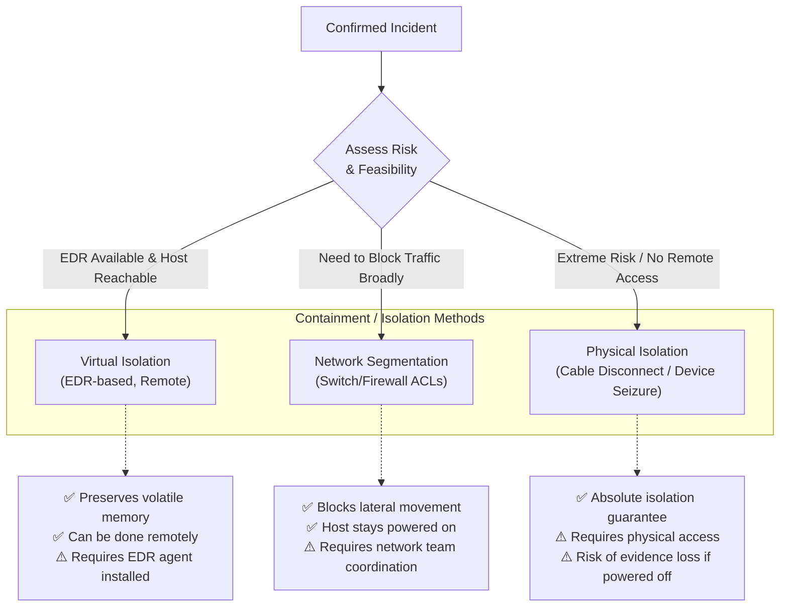
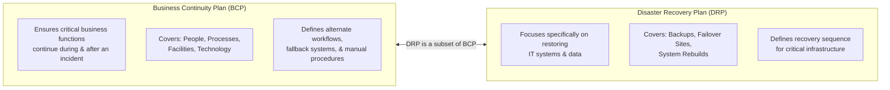
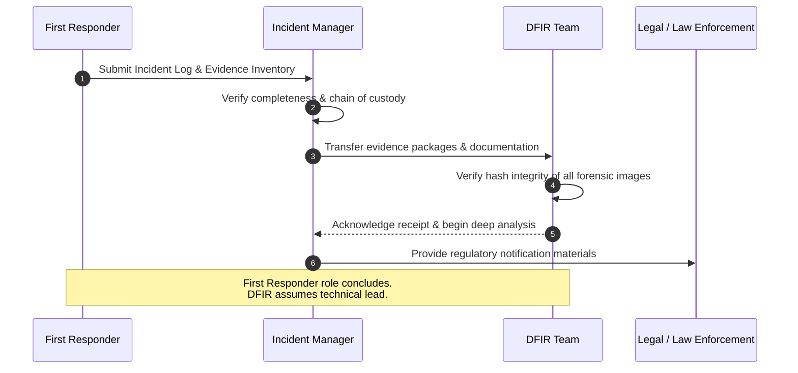

# Becoming a First Responder (TryHackMe) - Walkthrough

| Room Details | Information |
| :--- | :--- |
| **Room Name** | [Becoming a First Responder](https://tryhackme.com/room/becomingafirstresponder) |
| **Learning Path** | [Security Engineer](./0-README.md) |
| **Module** | Module 05: Managing Incidents |
| **Difficulty** | Easy / Info |
| **Topics Covered** | Evidence Volatility & Preservation (RFC 3227), Chain of Custody, Incident Stakeholder Communication, Containment & Isolation Methods, Business Continuity Planning (BCP/DRP), Incident Documentation, DFIR Handover |

---

## 📌 Overview & Core Concepts

When a security incident strikes—ransomware encrypting production servers, a compromised domain controller, or an active data exfiltration—the actions taken in the **first minutes and hours** determine whether the organization recovers cleanly or spirals into a prolonged crisis.

A **First Responder** is the designated individual (typically a SOC analyst, security engineer, or on-call blue team member) who executes the initial tactical steps before specialized Digital Forensics and Incident Response (DFIR) teams take over. Their priorities form a strict, sequential workflow:

The overriding principle throughout this entire lifecycle: **never destroy or contaminate evidence**. Every command executed, every cable unplugged, and every stakeholder notified must be deliberately chosen and meticulously recorded.

---

## Task 1: Introduction

Task 1 introduces the first responder role and sets the context for the room. When a cyber incident occurs, the initial response window is critical—evidence is volatile, attackers may still be active, and business operations are at risk.

### Key Takeaways
* A first responder is not necessarily a forensic specialist—they are the first trained person on the scene who stabilizes the situation.
* The room follows the chronological lifecycle: **Preserve → Alert → Isolate → Continuity → Document → Handover**.

> [!NOTE]
> *No answer is required for Task 1.*

---

## Task 2: Preservation of Evidence

The most critical and time-sensitive responsibility of a first responder is **preserving digital evidence** before it is lost, overwritten, or contaminated. Task 2 introduces the **IETF RFC 3227** ("Guidelines for Evidence Collection and Archiving"), which establishes the canonical **Order of Volatility** for digital evidence.

### The Order of Volatility (RFC 3227)

Data sources must be collected from **most volatile** (disappears fastest) to **least volatile** (persists longest). Collecting in the wrong order risks permanently destroying critical forensic artifacts:

| Priority | Data Source | Volatility | Rationale |
| :---: | :--- | :---: | :--- |
| **1** | **Registers & CPU Cache** | ⚡ Highest | Overwritten in nanoseconds during normal operation; contains live process state and cryptographic keys. |
| **2** | **Routing Table, ARP Cache, Process Table, Kernel Statistics** | ⚡ Very High | Stored in RAM; reflects active network connections, running processes, and kernel state at the moment of detection. |
| **3** | **RAM / Main Memory** | ⚡ High | Contains decrypted data, running malware, open network sessions, and clipboard contents. Lost on power-off. |
| **4** | **Temporary File Systems** | 🔥 Medium-High | `/tmp`, swap partitions, pagefile—often purged on reboot or by OS housekeeping. |
| **5** | **Disk Storage (HDD/SSD)** | 🟡 Medium | Persists across reboots but can be overwritten by continued system operation or anti-forensics. |
| **6** | **Remote Logging & Monitoring Data** | 🟢 Low | SIEM-ingested logs, centralized syslog servers—typically retained by policy but may have gaps. |
| **7** | **Archival Media** | 🟢 Lowest | Tape backups, offline cold storage—most durable but least current. |

### Chain of Custody

The **Chain of Custody** is the formal, chronological documentation trail that records every person who handled a piece of evidence, when they received it, what they did with it, and to whom they transferred it. Without an intact chain of custody, evidence becomes **inadmissible in legal proceedings** and unreliable for internal investigations.

Key requirements:
* **Who** collected the evidence and **when** (timestamp in UTC).
* **Where** it was stored (locked evidence room, encrypted container, tamper-evident bag).
* **What** was done to it (hashing for integrity verification, forensic imaging, analysis).
* **To whom** it was transferred and the receiving party's acknowledgment signature.

> [!TIP]
> Always compute and record cryptographic hashes (SHA-256) of forensic images immediately upon acquisition. Compare hashes at every custody transfer to prove the evidence was not altered.

---

### Task 2 Questions & Answers

> [!NOTE]
> **Question 1:** What priority order for preservation (number only) is given for the Disk?  
> **Answer:** `4`

> [!NOTE]
> **Question 2:** What priority order for preservation (number only) is given for Archival Media?  
> **Answer:** `7`

> [!NOTE]
> **Question 3:** What priority order for preservation (number only) is given for the Register and Cache?  
> **Answer:** `1`

> [!NOTE]
> **Question 4:** What is the term used to describe ensuring that evidence can be used in legal proceedings?  
> **Answer:** `Chain of Custody`

---

## Task 3: Alerting the Relevant Stakeholders

Once evidence preservation is underway, the first responder must immediately activate the organization's **communication and escalation plan**. Delayed or disorganized notification compounds incident damage—key decision-makers remain unaware, containment actions stall, and regulatory notification deadlines begin ticking.

### Playbooks & Call Trees

* **Playbook:** A pre-defined, documented process that the blue team follows during an incident. Different incident types (ransomware, data breach, insider threat, DDoS) typically have their own dedicated playbooks specifying exact containment steps, tool usage, and escalation criteria.

* **Call Tree:** A hierarchical communication structure that defines the **order and method** by which stakeholders are notified. The first responder contacts the SOC Lead or Incident Manager, who escalates upward to the CISO, Legal, PR, and ultimately to external parties (regulators, law enforcement, affected customers) as needed.

### Stakeholder Categories

| Stakeholder | Role During Incident | Notification Timing |
| :--- | :--- | :--- |
| **SOC Lead / Incident Manager** | Coordinates technical response, manages resource allocation | Immediate |
| **CISO / Security Leadership** | Authorizes major containment decisions (e.g., shutting down production) | Within minutes |
| **Legal & Compliance** | Advises on regulatory obligations (GDPR 72h, SEC 4-day) | Early — before any external disclosure |
| **HR / Internal Communications** | Manages insider threat scenarios, employee notifications | As needed per incident type |
| **PR / External Communications** | Controls media narrative, prepares customer notices | Before any public disclosure |
| **Law Enforcement / Regulators** | Formal reporting, potential criminal investigation | Per legal counsel's guidance |

---

### Task 3 Questions & Answers

> [!NOTE]
> **Question 1:** What is the term that describes a defined process that the blue team follows during an incident?  
> **Answer:** `Playbook`

> [!NOTE]
> **Question 2:** What is the term that describes the structure used to inform all the relevant parties about the incident?  
> **Answer:** `Call Tree`

---

## Task 4: Isolation of the Incident

After evidence preservation and stakeholder notification, the first responder must **contain the threat** to prevent lateral movement, further data exfiltration, or additional system compromise. The critical constraint: containment must **not destroy volatile evidence** (e.g., do not power off a machine before capturing RAM).

### Containment Methods

| Method | Description | When to Use |
| :--- | :--- | :--- |
| **Virtual Isolation** | Performed **remotely via EDR** (e.g., CrowdStrike, SentinelOne, Microsoft Defender for Endpoint). The agent blocks all network communication except the EDR management channel. | Default choice when EDR is deployed. Preserves volatile data and allows continued remote forensic collection. |
| **Network Segmentation** | Reconfiguring switches, VLAN assignments, or firewall ACLs to **block the infected host from communicating** with other systems on the network. | When EDR is unavailable or the host is a network appliance. Effective for isolating entire subnets. |
| **Physical Isolation** | Physically **disconnecting the network cable** or removing the device entirely. The blue team must physically collect the host. | Last resort when virtual/network isolation is impossible, or the host poses an extreme and immediate risk (e.g., actively encrypting file shares). |

> [!WARNING]
> **Never power off a compromised machine** during initial containment unless absolutely necessary. Powering off destroys volatile memory (RAM), active network connections, and running process state—all critical forensic evidence.

---

### Task 4 Questions & Answers

> [!NOTE]
> **Question 1:** What containment method can be performed remotely using the EDR?  
> **Answer:** `Virtual Isolation`

> [!NOTE]
> **Question 2:** What containment method requires the blue team to collect the infected host?  
> **Answer:** `Physical Isolation`

> [!NOTE]
> **Question 3:** What containment method aims to ensure that the infected host cannot communicate with other hosts?  
> **Answer:** `Network Segmentation`

---

## Task 5: Business Continuity Plan

While the technical team focuses on containment and eradication, the organization must maintain **essential business operations**. Task 5 introduces two complementary strategic frameworks:

### BCP vs. DRP

| Framework | Full Name | Focus | Scope |
| :--- | :--- | :--- | :--- |
| **BCP** | **Business Continuity Plan** | Maintaining all critical business operations during and after a disruptive event | Organization-wide: people, processes, physical facilities, technology |
| **DRP** | **Disaster Recovery Plan** | Restoring IT infrastructure, systems, and data to normal operation | IT-specific: servers, networks, databases, backups, failover sites |

### Key BCP/DRP Metrics

| Metric | Full Name | Definition |
| :--- | :--- | :--- |
| **RTO** | **Recovery Time Objective** | The maximum acceptable time to restore a system or service after a disruption. Answers: *"How quickly must we be back online?"* |
| **RPO** | **Recovery Point Objective** | The maximum acceptable amount of data loss measured in time. Answers: *"How much data can we afford to lose?"* (e.g., RPO of 1 hour = backups must be no older than 1 hour). |
| **MTTR** | **Mean Time to Repair** | The average time required to diagnose and repair a failed system component. A key operational metric for tracking team efficiency. |

> [!TIP]
> During a live incident, the first responder should reference the organization's BCP to identify which systems are classified as **mission-critical** and prioritize containment actions to protect those assets first.

---

### Task 5 Questions & Answers

> [!NOTE]
> **Question 1:** What does BCP stand for?  
> **Answer:** `Business Continuity Plan`

> [!NOTE]
> **Question 2:** What does DRP stand for?  
> **Answer:** `Disaster Recovery Plan`

> [!NOTE]
> **Question 3:** What BCP metric is used to describe the amount of time required to recover the hardware of our system?  
> **Answer:** `Recovery Time Objective`

> [!NOTE]
> **Question 4:** What BCP metric is used to describe the average amount of time required to recover our system?  
> **Answer:** `Mean Time to Repair`

---

## Task 6: Documentation of Actions

Throughout the entire incident lifecycle, the first responder must maintain a **real-time incident log** that captures every action taken, every decision made, and every piece of evidence collected. This documentation serves three critical purposes:

1. **Forensic Accuracy:** Provides DFIR teams with a precise timeline of what was done to compromised systems.
2. **Legal Admissibility:** Creates a defensible record for regulatory compliance and potential legal proceedings.
3. **Post-Incident Learning:** Enables the Lessons Learned phase to identify what worked and what failed.

### What to Document

| Category | Examples |
| :--- | :--- |
| **Timeline Events** | When the alert fired, when the first responder arrived, when containment began |
| **Commands Executed** | Every terminal command, script, or tool invoked on affected systems (with exact timestamps) |
| **Evidence Collected** | Forensic image filenames, hash values, memory dump locations, screenshot paths |
| **Decisions & Rationale** | Why a particular containment method was chosen, who authorized a system shutdown |
| **Communications** | Who was notified, at what time, via which channel, and their response |
| **Handover Details** | What was transferred to the next team, when, and the receiving party's acknowledgment |

> [!IMPORTANT]
> **All timestamps must be recorded in UTC** to avoid confusion across time zones, especially during incidents involving globally distributed teams or cross-border legal obligations.

---

### Task 6 Questions & Answers

> [!NOTE]
> **Question:** What time format should be used in our incident notes to ensure that all times match?  
> **Answer:** `UTC`

---

## Task 7: Handing Over

The final step in the first responder lifecycle is the formal **handover** of the incident—including all preserved evidence, documentation, and containment status—to a specialized **Digital Forensics and Incident Response (DFIR)** team or external authorities.

### The Handover Process

### Handover Checklist

- [ ] All forensic images acquired and SHA-256 hashes recorded
- [ ] RAM dumps captured from all affected hosts
- [ ] Network packet captures (PCAPs) preserved
- [ ] Complete incident log with UTC timestamps reviewed
- [ ] Chain of custody forms signed by all parties
- [ ] Containment status confirmed (which hosts are isolated, which are operational)
- [ ] BCP/DRP activation status communicated
- [ ] Outstanding action items and open questions documented

### Task 7 Interactive Challenge

The room concludes with an interactive scenario where you apply the complete first responder lifecycle—from evidence preservation through handover. Successfully completing the scenario awards the final flag:

> [!IMPORTANT]
> **Question:** What is the value of the flag you receive after responding to the incident?  
> **Answer:** `THM{I.am.ready.to.become.a.first.responder}`

---

## Task 8: Conclusion

Task 8 wraps up the room by reinforcing that the first responder role is the **critical bridge** between incident detection and deep forensic investigation. The effectiveness of the entire response chain depends on how well the first responder preserves evidence, communicates with stakeholders, and documents their actions.

> [!NOTE]
> *No answer is required for Task 8.*

---

## 📋 Questions & Answers Summary

| # | Task | Question | Answer / Flag |
| :-: | :--- | :--- | :--- |
| **1** | Task 1: Introduction | Read and complete | *No answer needed* |
| **2** | Task 2: Preservation | What priority order for preservation (number only) is given for the Disk? | `4` |
| **3** | Task 2: Preservation | What priority order for preservation (number only) is given for Archival Media? | `7` |
| **4** | Task 2: Preservation | What priority order for preservation (number only) is given for the Register and Cache? | `1` |
| **5** | Task 2: Preservation | What is the term used to describe ensuring that evidence can be used in legal proceedings? | `Chain of Custody` |
| **6** | Task 3: Stakeholders | What is the term that describes a defined process that the blue team follows during an incident? | `Playbook` |
| **7** | Task 3: Stakeholders | What is the term that describes the structure used to inform all the relevant parties about the incident? | `Call Tree` |
| **8** | Task 4: Isolation | What containment method can be performed remotely using the EDR? | `Virtual Isolation` |
| **9** | Task 4: Isolation | What containment method requires the blue team to collect the infected host? | `Physical Isolation` |
| **10** | Task 4: Isolation | What containment method aims to ensure that the infected host cannot communicate with other hosts? | `Network Segmentation` |
| **11** | Task 5: BCP | What does BCP stand for? | `Business Continuity Plan` |
| **12** | Task 5: BCP | What does DRP stand for? | `Disaster Recovery Plan` |
| **13** | Task 5: BCP | What BCP metric is used to describe the amount of time required to recover the hardware of our system? | `Recovery Time Objective` |
| **14** | Task 5: BCP | What BCP metric is used to describe the average amount of time required to recover our system? | `Mean Time to Repair` |
| **15** | Task 6: Documentation | What time format should be used in our incident notes to ensure that all times match? | `UTC` |
| **16** | Task 7: Handing Over | What is the value of the flag you receive after responding to the incident? | `THM{I.am.ready.to.become.a.first.responder}` |
| **17** | Task 8: Conclusion | Read and complete | *No answer needed* |

---

## 🛡️ Security Engineering & Defensive Best Practices

### 1. Building a First Responder Toolkit

Every security team should maintain a **pre-built, tested incident response toolkit** (often called a "jump bag" or "go kit") that includes:

| Category | Tools & Resources |
| :--- | :--- |
| **Memory Acquisition** | WinPmem, LiME (Linux Memory Extractor), Magnet RAM Capture |
| **Disk Imaging** | FTK Imager, dc3dd, ewfacquire (E01 format) |
| **Live Triage** | Velociraptor, KAPE (Kroll Artifact Parser and Extractor), CyLR |
| **Network Capture** | Wireshark, tcpdump, NetworkMiner |
| **Hashing & Integrity** | sha256sum, HashMyFiles, certutil |
| **Documentation** | Pre-formatted incident log templates, chain of custody forms |
| **Communication** | Out-of-band channels (Signal, satellite phone), call tree contact cards |

### 2. Operationalizing the First Responder Process

* **Quarterly Tabletop Exercises:** Simulate incidents (ransomware, insider threat, supply chain compromise) and walk first responders through the full lifecycle under time pressure.
* **Playbook Library:** Maintain and version-control playbooks for each major incident type. Review and update after every real incident or significant infrastructure change.
* **Automated Evidence Collection:** Deploy tools like Velociraptor or GRR that allow remote, one-click volatile data acquisition—reducing the window between detection and evidence preservation.
* **BCP/DRP Testing:** Conduct annual failover drills to validate RTO/RPO targets. An untested recovery plan is no plan at all.

### 3. Chain of Custody Integrity

* Use **tamper-evident evidence bags** for physical media.
* Store forensic images on **WORM (Write-Once-Read-Many)** storage or encrypted drives with access logging.
* Implement **dual-person integrity** for high-sensitivity evidence transfers—two people must sign off on every custody handover.