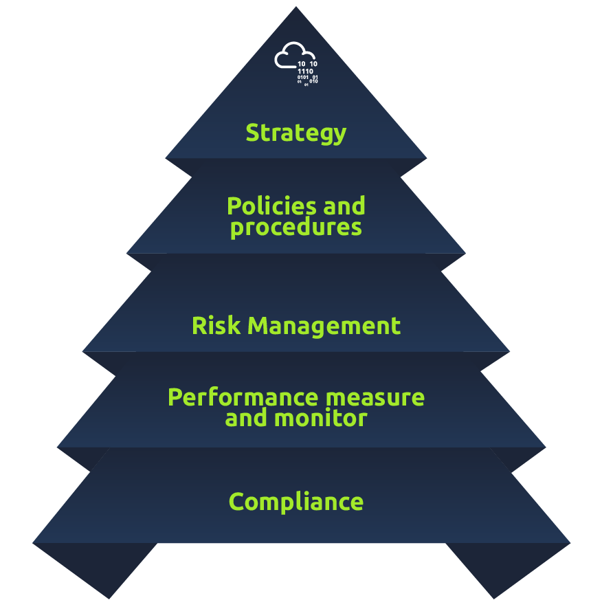
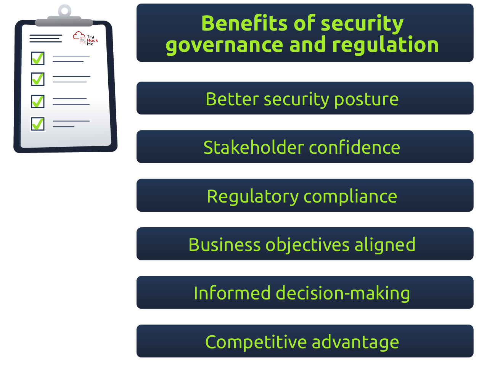
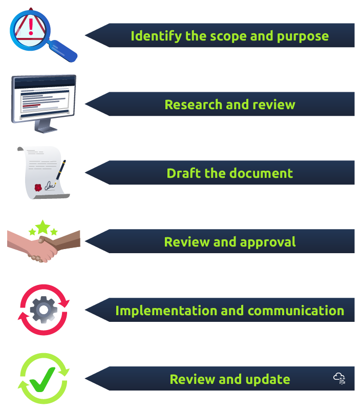
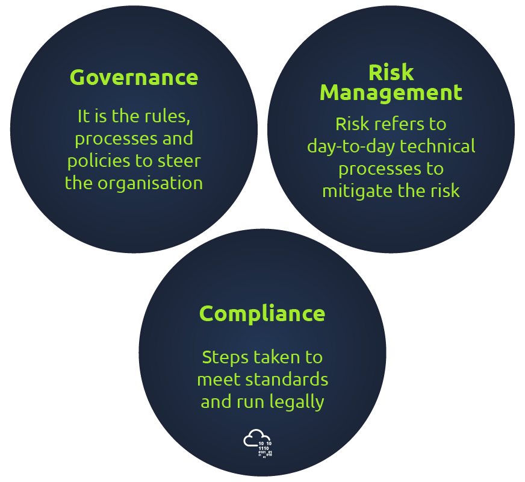
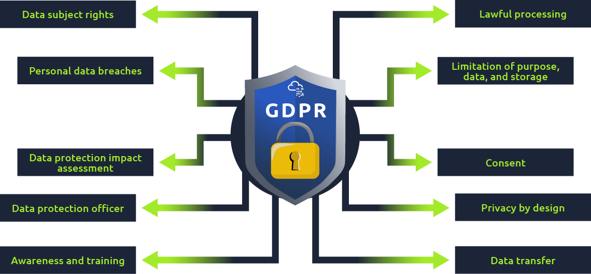
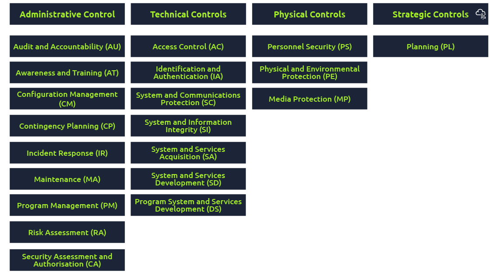
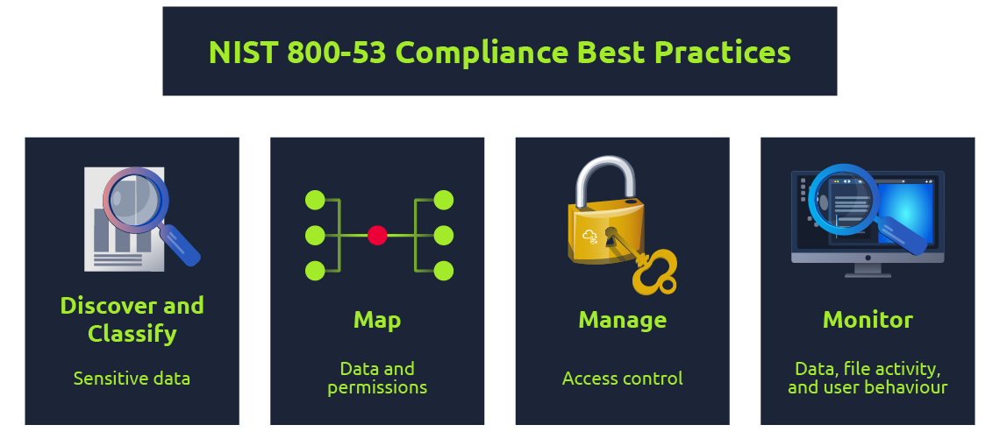
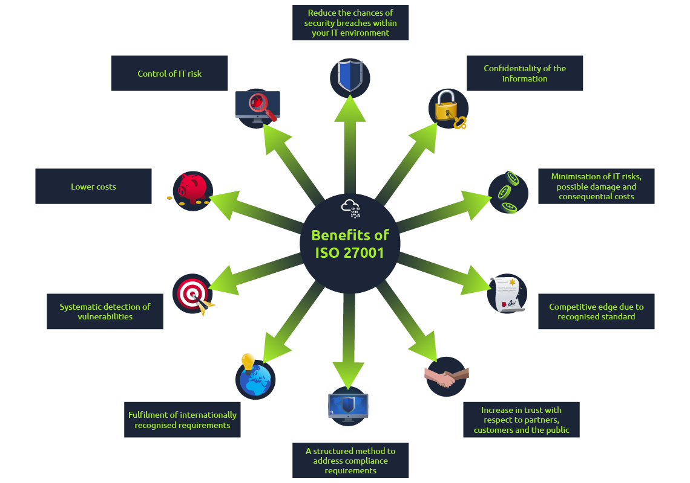
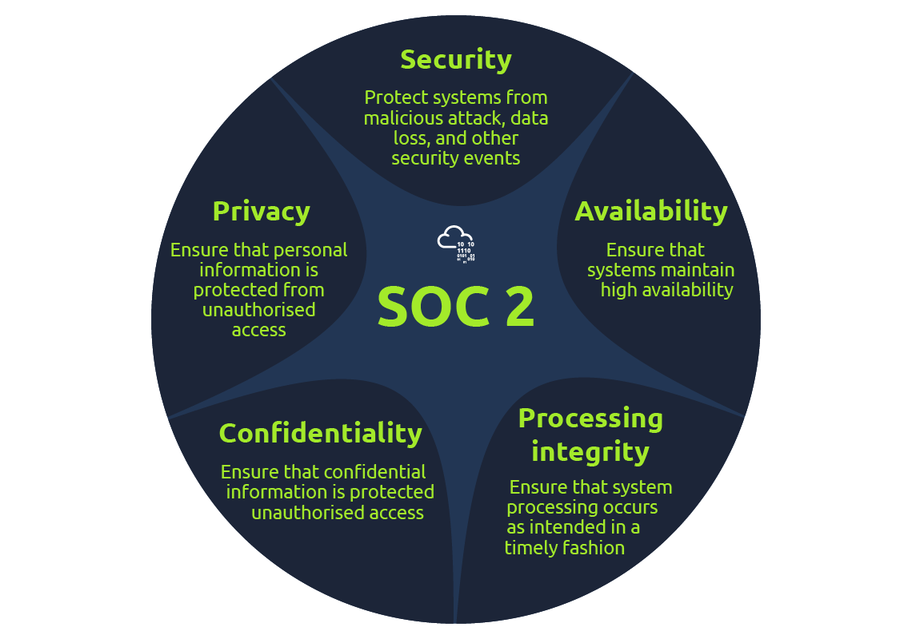

# Governance & Regulation
## Task 1: Introduction
* **Overview:** Introduces the foundational importance of information security governance and regulation in combating evolving cyber threats and safeguarding sensitive corporate assets.
* **Key Learning Objectives:**
    * Understanding the role and importance of cybersecurity governance and regulation.
    * Gaining familiarity with international laws, regulations, policies, standards, and guidelines.
    * Exploring Governance, Risk Management, and Compliance (GRC) frameworks.
    * Raising organizational security postures using international standards such as ISO 27001 and NIST SP 800-53.
* **Prerequisites:** Recommends a basic understanding of the Principles of Security and Web Application Security rooms.

## Task 2: Why is it important?
* **Overview:** Explores why cyber governance and regulation are critical business functions rather than merely technical checkboxes.

* **Key Concepts & Benefits:**
    * **Risk Mitigation:** Establishes structured guardrails to protect organizations from financial loss, reputational damage, and operational disruption caused by data breaches.
    * **Legal and Regulatory Compliance:** Ensures adherence to mandated regional and global privacy laws, avoiding severe regulatory fines and legal liabilities.
    * **Consistent Decision-Making:** Provides leadership and employees with clear guidelines, policies, and frameworks to handle security incidents and data protection uniformly.

## Task 3: Information Security Frameworks
* **Overview:** Explores information security frameworks—structured collections of guidelines, standards, and best practices that organizations use to build, implement, and maintain comprehensive security programs.

* **Key Components:**
    * **Standards vs. Frameworks:** While standards (like ISO 27001) offer rigid, auditable specifications for compliance, frameworks provide flexible, customizable structures (like NIST CSF) that organizations can adapt to their unique operational needs.
    * **Core Benefits:** Help organizations map out risk assessments, streamline security controls, and demonstrate due diligence to internal and external stakeholders.

## Task 4: Governance Risk and Compliance (GRC)
* **Overview:** Explores the holistic GRC framework, which integrates an organization's overall governance, enterprise risk management, and regulatory compliance into a unified structure aligned with business objectives.

* **The Three Core GRC Components:**
    * **Governance:** Setting organizational direction through information security strategies, policies, standards, frameworks, and performance monitoring.
    * **Risk Management:** Identifying, assessing, and prioritizing risks while implementing controls and mitigation strategies.
    * **Compliance:** Ensuring adherence to legal, regulatory, and industry obligations through audits, compliance programs, and stakeholder reporting.
* **Developing a GRC Program (Steps):** Involves defining the scope and objectives, conducting risk assessments, developing policies and procedures, establishing governance processes, implementing technical/non-technical controls, monitoring performance, and driving continuous improvement.
* **Financial Sector Example:** Highlights how banking and financial industries apply GRC activities (such as anti-money laundering policies, fraud risk mitigation, PCI-DSS compliance, and TLS encryption to prevent MitM attacks).

## Task 5: Privacy and Data Protection
* **Overview:** Explores data privacy and protection regulations designed to safeguard personal identifiable information (PII) and ensure individuals retain control over their digital data.

* **Key Regulations & Principles:**
    * **GDPR (General Data Protection Regulation):** A comprehensive European Union framework enforcing strict rules on data collection, processing, user consent, and heavy penalties for non-compliance.
    * **Key Data Rights:** Highlights fundamental user rights, including the right to access data, the right to rectification, and the "right to be forgotten" (data deletion).
    * **Data Minimization & Confidentiality:** Enforces that organizations only collect data strictly necessary for their stated purpose and protect it adequately throughout its lifecycle.

## Task 6: NIST Special Publications
* **Overview:** Examines the role of NIST (National Institute of Standards and Technology) Special Publications, which provide world-class guidelines, standards, and security frameworks used globally by government agencies and private enterprises.

* **Key Publications & Frameworks:**
    * **NIST SP 800-53:** A comprehensive catalog of security and privacy controls for federal information systems and organizations.
    * **NIST Cybersecurity Framework (CSF):** A widely adopted, flexible framework structured around core functions: Identify, Protect, Detect, Respond, and Recover.
    * **Purpose:** Helps organizations benchmark their security posture, manage cyber risks systematically, and align technical controls with national and international standards.
    

## Task 7: Information Security Management and Compliance
* **Overview:** Focuses on practical information security management systems (ISMS) and maintaining continuous regulatory compliance within an enterprise.

* **Key Concepts & Standards:**
    * **ISO/IEC 27001:** The leading international standard for establishing, implementing, maintaining, and continually improving an Information Security Management System (ISMS).
    * **Audit & Assessment:** Explains how internal and external audits verify whether security controls match documented policies and regulatory requirements.
    * **Continuous Compliance:** Stresses that compliance is not a one-time event, but an ongoing operational commitment requiring regular vulnerability tracking, incident response updates, and security awareness training.
    