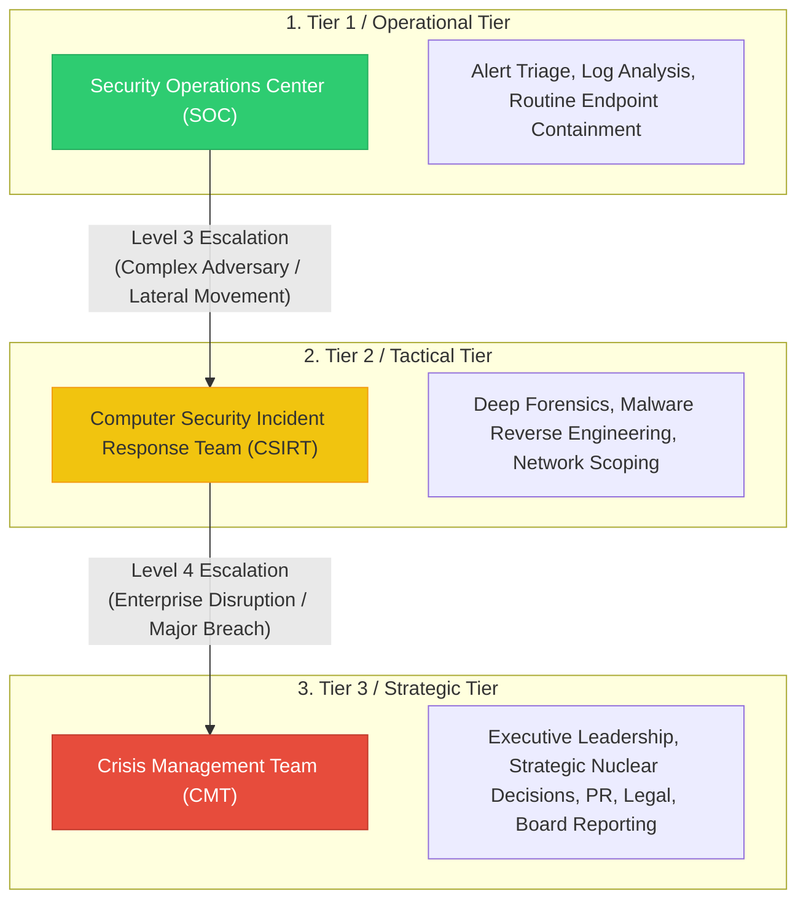
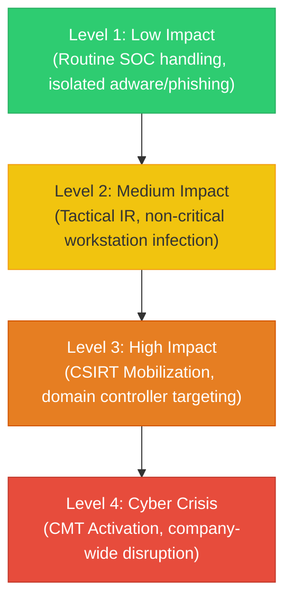
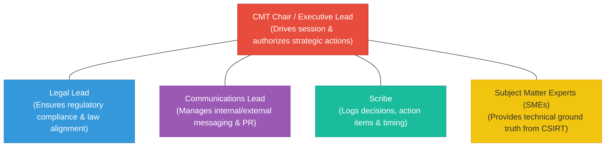
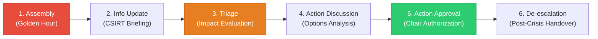
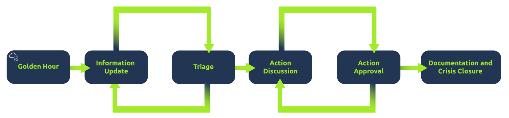
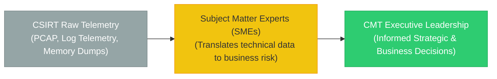
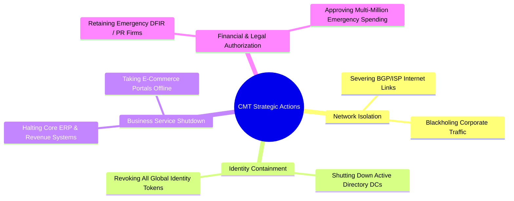

# Cyber Crisis Management (TryHackMe) - Walkthrough

| Room Details | Information |
| :--- | :--- |
| **Room Name** | [Cyber Crisis Management](https://tryhackme.com/room/cybercrisismanagement) |
| **Learning Path** | [Security Engineer](./0-README.md) |
| **Module** | Module 05: Managing Incidents |
| **Difficulty** | Easy / Info |
| **Topics Covered** | Cyber Crisis Definition, Severity Matrix & Escalation Tiers, Crisis Management Team (CMT) Roles & Responsibilities, The Golden Hour Protocols, CMT Operational Process (Triage to De-escalation), Technical SMEs Integration, Strategic & "Nuclear" Incident Actions |

---

## 📌 Overview & Core Concepts

When a security incident breaches perimeter defenses, standard technical containment procedures executed by a Security Operations Center (SOC) or Computer Security Incident Response Team (CSIRT) may prove insufficient. When an attack threatens core business operations, revenue generation, enterprise reputation, or legal compliance, the incident escalates into a **Cyber Crisis**.

Managing a cyber crisis requires a distinct organizational structure known as the **Crisis Management Team (CMT)**. While the technical IR team focuses on stopping the threat actor and preserving forensic artifacts, the CMT focuses on high-level strategic decisions, stakeholder communications, regulatory compliance, and business continuity.

### The Incident Escalation Hierarchy

Organizations structure incident handling across three distinct escalation tiers based on operational impact and severity:

### Key Differences: CSIRT vs. CMT

| Metric | Technical Incident Response (CSIRT) | Strategic Crisis Management (CMT) |
| :--- | :--- | :--- |
| **Primary Question** | *"How was the system breached and how do we contain the attacker?"* | *"How do we protect the enterprise's viability, legal standing, and reputation?"* |
| **Target Audience** | Network logs, endpoint telemetry, host memory, domain controllers | C-suite, Board of Directors, Legal Counsel, Regulators, Media, Customers |
| **Lead Role** | Incident Commander / IR Lead | CMT Chair (or CEO / Executive Sponsor) |
| **Output / Artifacts** | Indicators of Compromise (IoCs), forensic timelines, isolation rules | Public press releases, regulatory breach disclosures, emergency budget approvals |

---

## Task 1: Introduction

Task 1 introduces the concept of cyber crisis management and the necessity of establishing a Crisis Management Team (CMT) before a catastrophic event occurs.

### Key Takeaways
* Technical incident response capabilities must be complemented by strategic executive leadership.
* A cyber crisis involves complex trade-offs between technical remediation, business disruption, legal exposure, and public perception.
* Pre-defined workflows prevent panic and disorganization when critical infrastructure is compromised.

> [!NOTE]
> **Question:** Read the above and click Completed.  
> **Answer:** *No answer needed.*

---

## Task 2: What is a Cyber Crisis?

Task 2 details how organizations define a cyber crisis using structured incident severity matrices and operational metrics.

### 1. Incident Severity Escalation Tiers

Not every security event justifies invoking executive leadership. Organizations categorize incidents into four standard tiers:

### 2. The Cyber Crisis Severity Matrix

Organizations determine whether an incident crosses the threshold into a Level 4 Cyber Crisis by cross-referencing the **blast radius (affected scope)** against the **operational impact**:

| Scope / Blast Radius | Low Impact | Medium Impact | High Impact |
| :--- | :---: | :---: | :---: |
| **Single User / Endpoint** | Low | Low | Moderate |
| **Multiple Users / Subnet** | Low | **Moderate** | High |
| **Entire Business Unit / Enterprise** | Moderate | High | **Critical (Cyber Crisis)** |

* **Low:** Routine security events handled via automated playbooks or Tier 1 SOC analysts.
* **Moderate:** Escalated to Tier 2/3 security engineers with localized containment procedures.
* **High:** Mobilizes the full CSIRT; executive stakeholders receive periodic status briefings.
* **Critical:** Declared a **Cyber Crisis**; invokes the Crisis Management Team (CMT) immediately.

---

### Questions & Answers

> [!NOTE]
> **Question:** What would the severity rating of an incident be where multiple users are affected and the impact is medium?  
> **Answer:** `Moderate`

> [!NOTE]
> **Question:** What would the severity rating of an incident be where multiple users are affected and the impact is low?  
> **Answer:** `Low`

> [!IMPORTANT]
> **Question:** What would the severity rating of an incident be where an entire business unit is affected and the impact is high?  
> **Answer:** `Critical`

---

## Task 3: The Roles and Responsibilities in a CMT

Managing a crisis requires strict role clarity so executive decisions are made rapidly without chaos or conflicting mandates. Task 3 defines the primary roles within a Crisis Management Team.

### Key CMT Roles & Responsibilities

1. **CMT Chair:** Leads the CMT session, coordinates executive input, enforces operational cadence, and holds authority for decisive crisis actions.
2. **Legal Counsel / Legal Lead:** Evaluates legal risks, ensures statutory compliance (e.g., GDPR 72-hour notification, SEC 8-K filings), and manages interactions with law enforcement and regulatory bodies.
3. **Communications Lead:** Controls public relations (PR), crafts press statements, prepares internal employee broadcasts, and mitigates reputational damage.
4. **Scribe:** Maintains a detailed, real-time log of all CMT discussions, decisions, timestamped updates, and assigned action owners.
5. **Subject Matter Experts (SMEs):** Technical leads (e.g., Lead IR Engineer, CISO, Infrastructure Architect) who translate complex forensic findings into clear business risk context for non-technical executives.

---

### Questions & Answers

> [!NOTE]
> **Question:** Who is responsible for note-taking in the CMT?  
> **Answer:** `Scribe`

> [!NOTE]
> **Question:** Who is responsible for leading the CMT session?  
> **Answer:** `Chair`

> [!NOTE]
> **Question:** Who is responsible for ensuring that the actions taken by the CMT do not break the law?  
> **Answer:** `Legal`

> [!NOTE]
> **Question:** Who is responsible for making sure that the stakeholders are informed during the CMT?  
> **Answer:** `Communication`

> [!IMPORTANT]
> **Question:** Who is responsible for providing more technical information to the CMT to ensure that they can take the appropriate actions?  
> **Answer:** `Subject Matter Experts`

---

## Task 4: The Golden Hour

The **Golden Hour** refers to the critical first 60 minutes after an incident is declared a cyber crisis. Decisions made during this hour dictate whether the breach remains contained or escalates into catastrophic loss.

```mermaid
gantt
    title The Cyber Crisis Golden Hour (0 - 60 Minutes)
    dateFormat  m
    axisFormat %M min

    section Assembly
    Activate CMT Call Tree & Assemble Chair/Roles : 0, 15
    section Briefing
    CSIRT Situation Report & Technical Assessment : 15, 30
    section Triage
    Evaluate Business Impact & Legal Exposure : 30, 45
    section Decision
    Authorize Strategic Actions & Comms Plan : 45, 60
```

### Key Objectives During the Golden Hour
* **Rapid Assembly:** Convene the key CMT members within 15–30 minutes using dedicated, out-of-band communication channels.
* **CSIRT Situation Report:** Receive the initial technical briefing from the CSIRT lead to establish ground-truth facts.
* **Initial Triage:** Assess potential damage to critical business services, regulatory exposure, and customer impact.
* **Command & Control:** Establish a periodic operational rhythm (e.g., 30-minute situation updates) to maintain momentum.

---

### Questions & Answers

> [!NOTE]
> **Question:** What is the first step that has to be performed during the CMT golden hour?  
> **Answer:** `Assembly`

> [!NOTE]
> **Question:** In the event of a cyber crisis, who provides the update to the CMT?  
> **Answer:** `CSIRT`

---

## Task 5: The CMT Process

Task 5 outlines the operational lifecycle of a CMT session from initial activation through resolution and de-escalation.

### The Six-Step CMT Operational Lifecycle

1. **Assembly:** Invoking the CMT via secure call trees following threshold breach on the severity matrix.
2. **Information Update:** CSIRT delivers a structured update covering confirmed facts, unknown variables, and active threat actor actions.
3. **Triage:** Systematically assessing the incident's impact on business operations, data integrity, and compliance.
4. **Action Discussion:** Weighing technical, business, and public relations options (e.g., isolating active directory vs. maintaining uptime).
5. **Action Approval:** CMT Chair formally approves chosen containment and communication strategies.
6. **Documentation & De-escalation:** Maintaining official records throughout and transitioning back to normal operations once stabilized.

### Governance & Accountability
* **CMT Chair:** Responsible for driving execution and approving high-stakes containment decisions.
* **Chief Executive Officer (CEO):** Ultimately held accountable by shareholders, regulators, the board of directors, and the public for the organization's crisis outcome.

---

### Questions & Answers

> [!NOTE]
> **Question:** What is the term used to describe the process by which the CMT determines the severity of the crisis?  
> **Answer:** `Triage`

> [!NOTE]
> **Question:** Who is ultimately responsible for ensuring that the CMT takes action?  
> **Answer:** `CMT Chair`

> [!IMPORTANT]
> **Question:** Who will ultimately be held accountable for the crisis?  
> **Answer:** `CEO`

---

## Task 6: The Importance of SMEs

Task 6 emphasizes why technical Subject Matter Experts (SMEs) are essential members of the Crisis Management Team.

### Bridging the Technical-Executive Divide

Executives make strategic business decisions based on risk, finance, and reputation. However, in a cyber crisis, those decisions depend on technical reality. Without SMEs, executive leadership risks making uninformed or counterproductive choices:

### Key SME Roles in Crisis Management
* **Accurate Scope Estimation:** Preventing executives from overreacting (shutting down unharmed systems) or underreacting (ignoring active persistence).
* **Feasibility Checks:** Advising whether proposed technical actions (e.g., restoring 50TB of data from backups) can be completed in hours or days.
* **Threat Actor Context:** Providing intelligence on adversary tactics, techniques, and procedures (TTPs) to anticipate next moves.

---

### Questions & Answers

> [!IMPORTANT]
> **Question:** Who is responsible for providing the CMT with technical and in-depth information to allow them to make an informed decision during the crisis?  
> **Answer:** `Subject Matter Experts`

---

## Task 7: The Actions Available to the CMT

While technical IR teams handle individual endpoint isolations or IP blocks, the Crisis Management Team holds authority over **strategic and "nuclear" actions** that incur major business or operational costs.

### Strategic CMT Nuclear Actions

* **Severing Core Internet Connectivity:** Disconnecting primary WAN/ISP links to prevent active exfiltration during a ransomware outbreak.
* **Shutting Down Identity Infrastructure:** Taking Active Directory Domain Controllers offline to halt domain-wide lateral movement.
* **Halting Core Revenue Applications:** Taking production e-commerce or financial systems offline to protect data integrity.
* **Engaging Retainers & External Support:** Authorizing emergency expenditure for external incident response retainers, forensic firms, and crisis PR agencies.

---

### Interactive Crisis Management Challenge

Executing the crisis response scenario within the room by taking appropriate triage, escalation, and strategic actions awards the completion flag:

> [!IMPORTANT]
> **Question:** What is the value of the flag you receive after successfully dealing with the cyber crisis?  
> **Answer:** `THM{The.Crisis.has.been.managed!}`

---

## Task 8: Conclusion

Task 8 highlights that successful cyber crisis management relies on pre-established workflows, clear role delegation, robust executive governance, and seamless communication between technical responders and business leaders.

### Core Summary Principles
1. **Prepare Before the Crisis:** Rehearse CMT processes through regular tabletop exercises (TTX) before an incident strikes.
2. **Clear Role Delegation:** Ensure every CMT member knows their exact authority, responsibilities, and deliverables.
3. **SME Ground Truth:** Keep technical experts central to executive decision-making to maintain realistic containment strategies.

> [!NOTE]
> **Question:** Read the above and click Completed.  
> **Answer:** *No answer needed.*

---

## 📋 Questions & Answers Summary

| # | Task | Question | Answer / Flag |
| :-: | :--- | :--- | :--- |
| **1** | Task 1: Introduction | Complete the introductory reading | *No answer needed* |
| **2** | Task 2: What is a Cyber Crisis? | What would the severity rating of an incident be where multiple users are affected and the impact is medium? | `Moderate` |
| **3** | Task 2: What is a Cyber Crisis? | What would the severity rating of an incident be where multiple users are affected and the impact is low? | `Low` |
| **4** | Task 2: What is a Cyber Crisis? | What would the severity rating of an incident be where an entire business unit is affected and the impact is high? | `Critical` |
| **5** | Task 3: Roles & Responsibilities | Who is responsible for note-taking in the CMT? | `Scribe` |
| **6** | Task 3: Roles & Responsibilities | Who is responsible for leading the CMT session? | `Chair` |
| **7** | Task 3: Roles & Responsibilities | Who is responsible for ensuring that the actions taken by the CMT do not break the law? | `Legal` |
| **8** | Task 3: Roles & Responsibilities | Who is responsible for making sure that the stakeholders are informed during the CMT? | `Communication` |
| **9** | Task 3: Roles & Responsibilities | Who is responsible for providing more technical information to the CMT to ensure that they can take the appropriate actions? | `Subject Matter Experts` |
| **10** | Task 4: The Golden Hour | What is the first step that has to be performed during the CMT golden hour? | `Assembly` |
| **11** | Task 4: The Golden Hour | In the event of a cyber crisis, who provides the update to the CMT? | `CSIRT` |
| **12** | Task 5: The CMT Process | What is the term used to describe the process by which the CMT determines the severity of the crisis? | `Triage` |
| **13** | Task 5: The CMT Process | Who is ultimately responsible for ensuring that the CMT takes action? | `CMT Chair` |
| **14** | Task 5: The CMT Process | Who will ultimately be held accountable for the crisis? | `CEO` |
| **15** | Task 6: Importance of SMEs | Who is responsible for providing the CMT with technical and in-depth information to allow them to make an informed decision during the crisis? | `Subject Matter Experts` |
| **16** | Task 7: Actions Available | What is the value of the flag you receive after successfully dealing with the cyber crisis? | `THM{The.Crisis.has.been.managed!}` |
| **17** | Task 8: Conclusion | Complete the concluding review | *No answer needed* |

---

## 🛡️ Security Engineering & Defensive Best Practices

As a Security Engineer, building infrastructure that supports crisis management requires technical readiness, operational resilience, and automated out-of-band communication:

### 1. Out-of-Band (OOB) Command & Control
* **Isolated Crisis Communications:** Provision out-of-band communication channels (e.g., encrypted Signal groups, separate cloud-hosted mail tenants) so the CMT can communicate safely if corporate Active Directory or Office 365 is compromised.
* **External Document Repository:** Store crisis management playbooks, contact rosters, and regulatory notification templates in an out-of-band, immutable cloud storage location accessible even during complete corporate network outages.

### 2. Pre-Authorized Technical "Emergency Brakes"
* **Software-Defined Isolation:** Pre-configure 1-click network micro-segmentation playbooks within firewall/SDN managers to sever WAN interfaces or isolate domain controllers without requiring physical access.
* **Identity Break-Glass Accounts:** Maintain hardware token-backed, offline break-glass administrator accounts to preserve identity access if primary identity providers (IdPs) or domain controllers are encrypted.

### 3. Regulatory & Compliance Engineering
* **Automated Breach Telemetry:** Design SIEM/SOAR pipelines that automatically tag data sources containing Personally Identifiable Information (PII) or Protected Health Information (PHI), enabling fast scoping for GDPR 72-hour or SEC 8-K disclosures.
* **Forensic Evidence Vaults:** Pre-architect Write-Once-Read-Many (WORM) storage buckets for immediate ingestion of memory captures and forensic logs during a crisis.

### 4. Continuous Crisis Rehearsal (Tabletop Exercises)
* **Joint Technical-Executive Simulations:** Conduct bi-annual tabletop exercises (TTX) featuring real-world scenarios (e.g., double-extortion ransomware, supply chain compromise) involving both technical responders (CSIRT) and executive leadership (CMT).