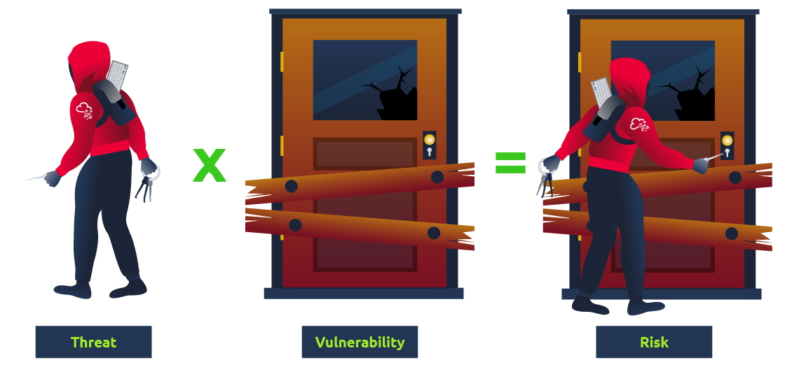
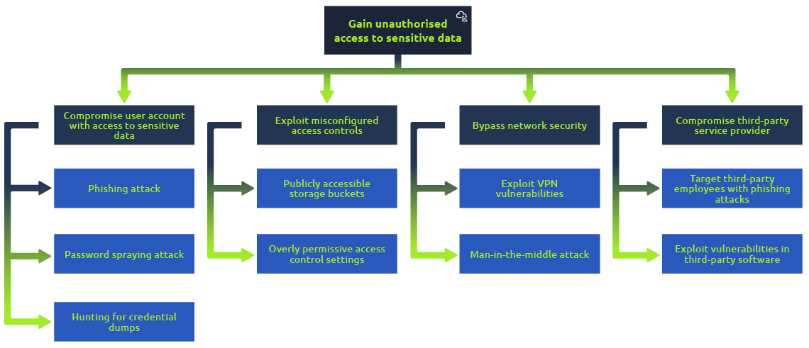
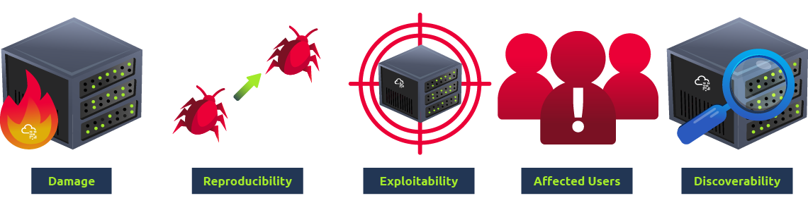
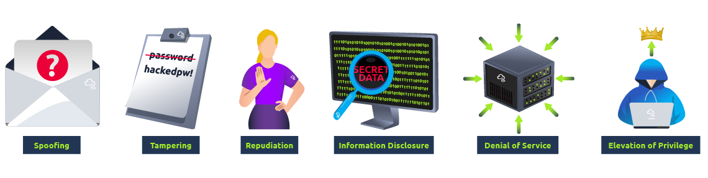
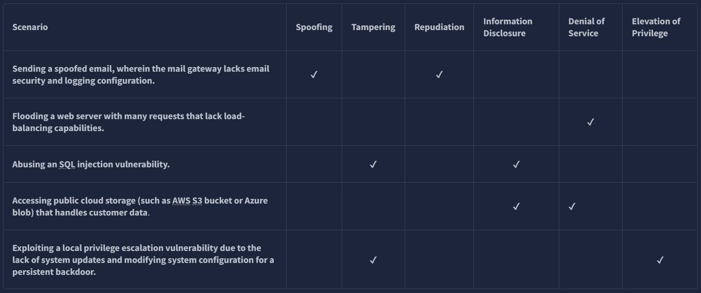
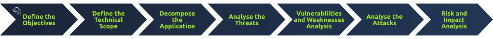

# Threat Modelling
## Task 1: Introduction
* **Overview:** Introduces the Threat Modelling room on TryHackMe, which focuses on building cyber resiliency and emulation capabilities through structured threat identification and risk mitigation.
* **Key Learning Objectives:**
* Understanding the fundamental concepts and goals of threat modelling.
* Exploring industry-standard threat modelling frameworks and methodologies (including STRIDE, DREAD, PASTA, and MITRE ATT&CK).
* Learning how to map adversary techniques and prioritize risks systematically to secure organizational architectures.

## Task 2: Threat Modelling Overview
* **Overview:** Explores what threat modelling is—a proactive, structured process of identifying, quantifying, and addressing security risks and vulnerabilities in an application, network, or system before attackers can exploit them.

* **Core Objectives & Benefits:**
* Helps security teams understand a system from an attacker's perspective ("putting yourself in the attacker's shoes").
* Enables early identification of architectural design flaws during the development phase rather than post-deployment.
* Prioritizes remediation efforts by matching potential threats against real-world impact and likelihood.

## Task 3: Modelling with MITRE ATT&CK
* **Overview:** Explores how to leverage the MITRE ATT&CK framework for threat modelling, using a globally accessible knowledge base of common adversary tactics, techniques, and procedures (TTPs) based on real-world observations.
* **Key Concepts:**
* **Tactics:** The adversary's technical goals or "the why" at each phase of an attack (e.g., Initial Access, Persistence, Exfiltration).
* **Techniques:** "The how" or the specific method an adversary uses to achieve a tactical goal.
* **Threat Emulation:** Helps organizations map out how real threat actor groups operate so security engineers can test, detect, and harden their infrastructure against those exact behaviors.

## Task 4: Mapping with ATT&CK Navigator
* **Overview:** Explores the practical use of the ATT&CK Navigator, a web-based tool designed to navigate, visualize, and annotate MITRE ATT&CK matrix data.
* **Key Functions:**
* Allows security analysts to create customized matrices, color-code specific techniques, and track defensive coverage or adversary behaviors.
* Helps organizations map their current security controls against known adversary campaigns to easily spot detection gaps and prioritize defensive hardening efforts.

## Task 5: DREAD Framework
* **Overview:** Explores the DREAD risk-assessment model, traditionally developed by Microsoft, which helps security teams evaluate, quantify, and prioritize risks or vulnerabilities based on six distinct categories.

* **The Six DREAD Categories:**
* **Damage Potential:** How severe is the harm if the vulnerability is exploited?
* **Reproducibility:** How easy is it to reproduce the exploit attack?
* **Exploitability:** What level of effort or specialized skill is required to launch the attack?
* **Affected Users:** How many users or critical systems will be impacted?
* **Discoverability:** How easy is it for an attacker to discover the vulnerability?
* **Scoring & Prioritization:** Each category is typically rated on a scale (e.g., from 1 to 10), and the resulting aggregate score helps security engineers decide which security flaws need immediate remediation.

## Task 6: STRIDE Framework
* **Overview:** Explores the STRIDE methodology, a threat-modeling framework created by Microsoft to categorize computer security threats against architectural components.

* **The Six STRIDE Categories & Security Violations:**
* **Spoofing Identity:** Illegally accessing and using someone else's credentials (violates Authentication).
* **Tampering:** Unauthorized modification or corruption of data or code (violates Integrity).
* **Repudiation:** Denying having performed an action while others cannot prove otherwise (violates Non-repudiation).
* **Information Disclosure:** Exposing sensitive data to unauthorized individuals (violates Confidentiality).
* **Denial of Service (DoS):** Disrupting or degrading services for legitimate users (violates Availability).
* **Elevation of Privilege:** Gaining unauthorized high-level access permissions from a low-privileged account (violates Authorization).

| Scenario	| Spoofing	| Tampering	| Repudiation	| Information Disclosure	| Denial of Service	| Elevation of Privilege
|--------------|:---------------:|:--------------:|:---------------:|:---------------:|:---------------:|:---------------:|
| Sending a spoofed email, wherein the mail gateway lacks email security and logging configuration.	| ✔	 |   | ✔	 | 	  | 	 	 	 
Flooding a web server with many requests that lack load-balancing capabilities.	|   	| | |  	 | 	✔	 | 
Abusing an SQL injection vulnerability. |	| 	✔	 |  	| ✔	 |  	 
Accessing public cloud storage (such as AWS S3 bucket or Azure blob) that handles customer data.	| 	 	 |   |  	 | ✔  |	✔	 |
Exploiting a local privilege escalation vulnerability due to the lack of system updates and modifying system configuration for a persistent backdoor.	| 	| ✔	 |  	|   |  	| 	✔ |

## Task 7: PASTA Framework
* **Overview:** Explores PASTA (Process for Attack Simulation and Threat Analysis), a seven-step, risk-centric threat-modeling methodology that aligns technical security requirements with business objectives.

* **The Seven Stages of PASTA:**
* **Step 1:** Define Objectives (business goals and security requirements).
* **Step 2:** Define Technical Scope (mapping out application components, boundaries, and dependencies).
* **Step 3:** Application Decomposition (breaking down data flows, trust zones, and entry points using diagrams).
* **Step 4:** Threat Analysis (identifying potential threat actors and known attack vectors).
* **Step 5:** Vulnerability and Weakness Analysis (mapping system weaknesses to identified threats).
* **Step 6:** Attack Modeling (simulating real-world attack patterns to see how they affect the architecture).
* **Step 7:** Risk and Impact Analysis (calculating financial and operational impacts to prioritize mitigation strategies).