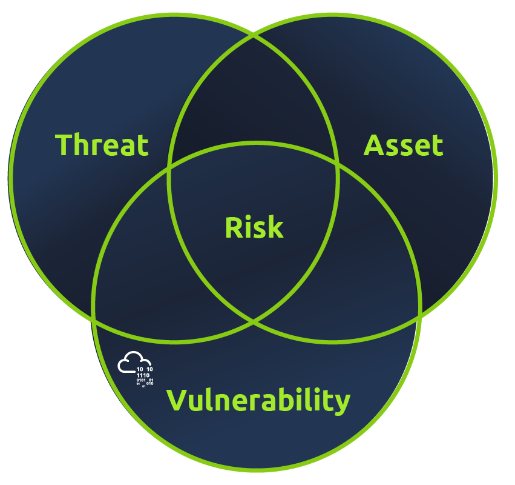
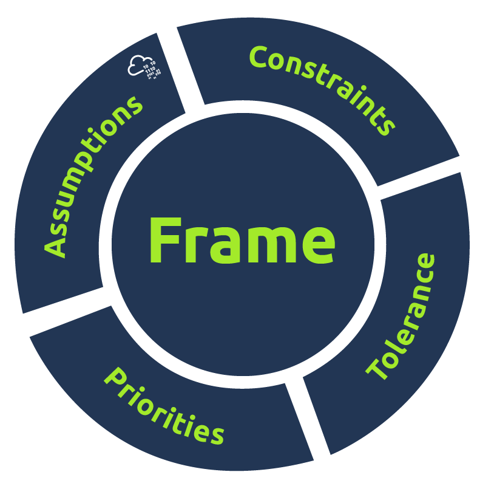
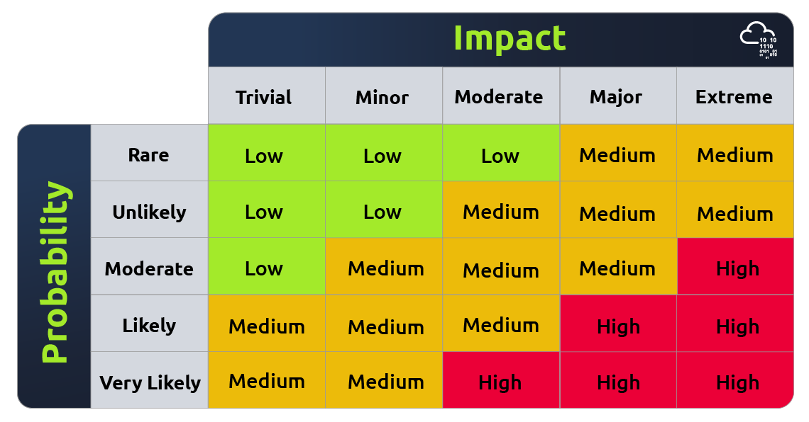
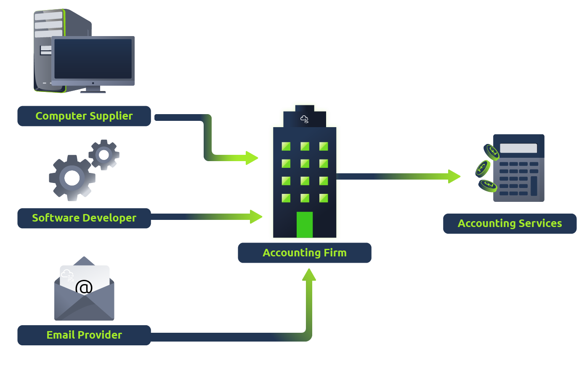

# Risk Management
## Task 1: Introduction
* **Overview:** Introduces the fundamental concept of risk management using everyday scenarios (such as avoiding, accepting, or reducing the risk of spilling coffee on a keyboard or dealing with laptop failure).
* **Key Concepts & Responses to Risk:**
* **Risk Avoidance:** Eliminating the activity or exposure entirely to prevent the risk.
* **Risk Acceptance:** Acknowledging the existence of a risk and choosing to take no extra mitigation actions because the likelihood or impact is low.
* **Risk Reduction (Mitigation):** Taking proactive measures or using safeguards (like a backup laptop or keyboard protector) to lower the likelihood or impact of a potential failure.
* **Core Definition:** Information Systems risk management is the systematic process of identifying, assessing, and responding to threats targeting computer systems and resources.

## Task 2: Basic Terminology
* **Overview:** Explores foundational terms used throughout information risk management to distinguish between system weaknesses, external dangers, and overall exposure.

* **Key Definitions:**
* **Asset:** Anything of value to an organization that requires protection (hardware, data, software, personnel).
* **Vulnerability:** A flaw, weakness, or gap in a system's design, implementation, or controls that an attacker can exploit.
* **Threat:** Any circumstance or event with the potential to adversely impact an asset by exploiting a vulnerability.
* **Risk:** The measure of the probability that a threat will exploit a vulnerability and cause specific, quantifiable damage.

## Task 3: Risk Assessment Methodologies
Overview: Examines the structured approaches organizations use to evaluate, measure, and analyze risks.
* **Key Methodologies:**
* **Qualitative Assessment:** Relies on descriptive scales (e.g., Low, Medium, High) based on judgment, expert experience, and intuition to prioritize risks.
* **Quantitative Assessment:** Uses numerical values, hard data, and financial formulas—such as Single Loss Expectancy (SLE), Annualized Rate of Occurrence (ARO), and Annualized Loss Expectancy (ALE)—to measure risk in monetary terms.
* **Hybrid Approaches:** Combining both qualitative speed and quantitative precision to suit specific organizational needs.

## Task 4: Frame Risk
Overview: Focuses on the first phase of the Risk Management process (Frame Risk), which establishes the context, boundaries, and assumptions under which risk management activities will occur.

* **Key Objectives:**
* Defining the risk tolerance, appetite, and governance structure of the organization.
* Identifying legal, regulatory, and organizational constraints that influence how risks are viewed.
* Ensuring that all stakeholders across different business tiers share a unified understanding of what constitutes acceptable risk before diving into detailed assessments.

## Task 5: Assess Risk
Overview: Explores the Assess Risk phase, which involves identifying, estimating, and prioritizing risks to organizational operations, assets, and individuals.
* **Key Focus Areas:**
* Gathering data regarding current vulnerabilities, active threat intelligence, and existing system controls.
* Evaluating the likelihood of threat exploitation against the severity of potential impacts.
* Creating structured risk registers and profiles to document findings for leadership and operational teams.

## Task 6: Risk Analysis
* **Overview:** Focuses on Risk Analysis, diving deeper into how organizations inspect the components of identified risks to understand their true scope and consequences.

* **Key Concepts:**
* **Inherent Risk:** The natural level of risk present in a process or system before any specific security controls or mitigations are applied.
* **Residual Risk:** The remaining amount of risk that stays after all security controls, safeguards, and countermeasures have been implemented.
* Evaluating threat sources, event frequencies, and potential business disruptions quantitatively or qualitatively.

## Task 7: Respond to Risk
* **Overview:** Explores the various strategies organizations use to Respond to Risk once it has been assessed and analyzed.
* **The Four Key Risk Response Strategies:**
* **Risk Mitigation (Reduction):** Implementing technical or administrative controls to lower the likelihood or impact.
* **Risk Transfer:** Shifting the financial burden or impact of risk to a third party (e.g., through cybersecurity insurance or outsourcing).
* **Risk Avoidance:** Ceasing the high-risk activity entirely to eliminate the exposure.
* **Risk Acceptance:** Choosing to absorb the risk because the cost of mitigation outweighs the potential impact.

## Task 8: Monitor Risk
* **Overview:** Focuses on Monitor Risk, emphasizing that risk management is an ongoing, continuous lifecycle rather than a one-time project.
* **Key Objectives:**
* Tracking changes in the threat landscape, regulatory requirements, and internal infrastructure.
* Evaluating the ongoing effectiveness of deployed security controls.
* Ensuring that residual risks do not drift outside the organization's defined risk tolerance limits over time.

## Task 9: Supply Chain Risk Management
* **Overview:** Explores Supply Chain Risk Management (SCRM), focusing on risks introduced by external vendors, third-party software components, cloud providers, and hardware suppliers.

* **Key Focus Areas:**
* Recognizing that an organization is only as secure as its weakest third-party vendor or integrated software dependency.
* Evaluating vendor security postures, compliance certificates, and service-level agreements (SLAs).
* Implementing continuous monitoring and strict contractual security requirements for external partners.

## Quantitative Risk Analysis formulas
**Value of Safeguard** = ALEbeforeSafeguard - ALEafterSafeguard - AnnualCostSafeguard

**ALE** = Annualized Loss Expectancy (SLE * ARO)

**SLE** = Single Loss Expectancy (Asset Value * Exposure Factor)

**ARO** = Annualized Rate of Occurrence (Frequency of Threat per Year)