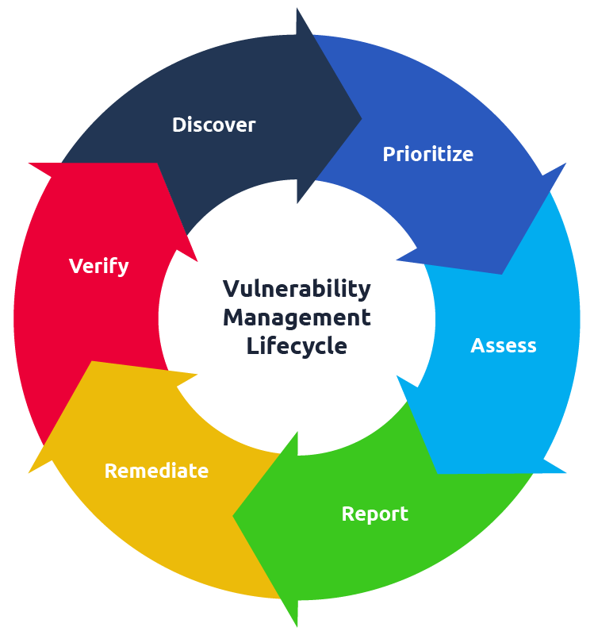
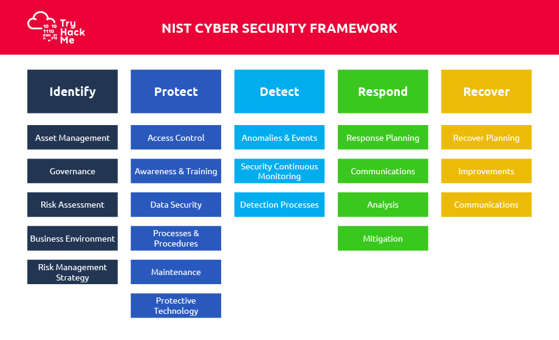

# Vulnerability Management
## Task 1: Introduction
* **Overview:** Introduces the fundamental concepts of vulnerability management, emphasizing that it is an ongoing, proactive, and structured process designed to identify, detect, mitigate, and report security vulnerabilities across systems and networks.
* **Key Learning Objectives:**
* Understanding the complete lifecycle of vulnerability management.
* Differentiating between vulnerability management and standard vulnerability scanning.
* Exploring standardized vulnerability classification and frameworks (SCAP, CVE, CVSS).

## Task 2: Vulnerability Management vs. Vulnerability Scanning
* **Overview:** Explores the critical operational differences between vulnerability management and vulnerability scanning.
* **Key Concepts & Distinctions:**
    * **Vulnerability Scanning:** An automated, point-in-time technical tool or assessment that discovers potential flaws, misconfigurations, and outdated software versions on assets.
    * **Vulnerability Management:** A comprehensive, continuous program that encompasses vulnerability scanning alongside triage, risk assessment, context evaluation, remediation prioritization, and verification.
* **Core Objective:** While a scan simply generates a raw list of findings, management takes those results and aligns them with business risk and resource allocation.

## Task 3: Vulnerability Classification
* **Overview:** Explores the Security Content Automation Protocol (SCAP) standards used globally to categorize, describe, and score software flaws consistently.
* **Core Components of SCAP:**
    * **CVE (Common Vulnerabilities and Exposures):** A standardized, publicly accessible repository of common security flaws maintained by MITRE, using unique identifiers consisting of a prefix, year, and sequence number.
    * **CCE (Common Configuration Enumeration):** Provides unique identifiers for system configuration issues to align checklist results with security best practices.
    * **CPE (Common Platform Enumeration):** A structured method for naming and identifying operating systems, hardware devices, and applications.
    * **CVSS (Common Vulnerability Scoring System):** A numerical framework (ranging from 0 to 10) that rates the severity of vulnerabilities (categorized from None to Critical) to help organizations prioritize remediation.
    * **NVD (National Vulnerability Database):** NIST’s comprehensive, synchronized database that builds on CVE entries by appending detailed impact metrics and CVSS severity scores.

## Task 4: Vulnerability Management Life Cycle - Discover & Prioritise
* **Overview:** Explores the initial stages of the vulnerability management life cycle, focusing on asset discovery and how organizations rank vulnerabilities based on risk.

* **Key Concepts:**
    * **Asset Discovery:** You cannot protect what you do not know you have. This phase involves creating a comprehensive inventory of all hardware, software, IP addresses, and cloud resources.
    * **Scanning & Detection:** Utilizing vulnerability scanners to actively probe assets for missing patches, open ports, and misconfigurations.
    * **Prioritization:** Since organizations often face thousands of vulnerabilities simultaneously, teams must prioritize which flaws to fix first by looking beyond raw CVSS scores to factor in threat intelligence, asset criticality, and exploit availability.

## Task 5: Vulnerability Management Life Cycle - Assess & Report
* **Overview:** Focuses on evaluating the context of discovered vulnerabilities and communicating risks effectively to technical and executive stakeholders.
* **Key Concepts:**
    * **Contextual Assessment:** Determining whether a vulnerability is actually exploitable in the environment (e.g., checking if a vulnerable service is exposed to the public internet or firewalled internally).
    * **False Positive Analysis:** Validating scan results to filter out incorrect flags, ensuring security teams waste zero time on phantom issues.
    * **Reporting:** Tailoring reports for different audiences—providing detailed technical remediation guides for system administrators while delivering high-level risk metrics and business impacts to executive leadership.

## Task 6: Vulnerability Management Life Cycle - Remediate & Verify
* **Overview:** Covers the final phases of the vulnerability management lifecycle, where identified flaws are fixed, patched, or mitigated, and their resolution is confirmed.
* **Key Concepts & Remediation Strategies:**
    * **Remediation:** Applying official software patches, updating firmware, changing secure configurations, or removing insecure code.
    * **Mitigation:** Implementing temporary workarounds (such as disabling a vulnerable service or putting up a Web Application Firewall rule) if a patch is not immediately available.
    * **Verification:** Running follow-up scans or manual testing to ensure the remediation was successful and that the vulnerability has been completely eliminated without breaking underlying system functionality.

## Task 7: Vulnerability Management Framework
* **Overview:** Explores how organizations leverage the NIST Cybersecurity Framework (CSF) to structure, govern, and optimize their vulnerability management programs across five core functions.

* **The Five Core NIST CSF Functions in Vulnerability Management:**
    * **Identify:** Defining what assets exist, establishing real-time discovery methodologies, and ascertaining business criticality to prioritize defenses properly.
    * **Protect:** Deploying security safeguards (such as proactive security, preventative measures, IAM, and SIEM) and vulnerability management software to reduce potential incident impact.
    * **Detect:** Implementing tools and scanners to continuously discover vulnerabilities, quantify associated risks, and monitor environments for change.
    * **Respond:** Defining ownership, establishing stakeholder reporting, setting up risk-acceptance thresholds, and releasing rapid patches or mitigations against exploited flaws.
    * **Recover:** Implementing sophisticated asset search capabilities, extending visibility to unmanaged cloud/IoT assets using solutions like CAASM (Cyber Asset Attack Surface Management), and recording lessons learned.