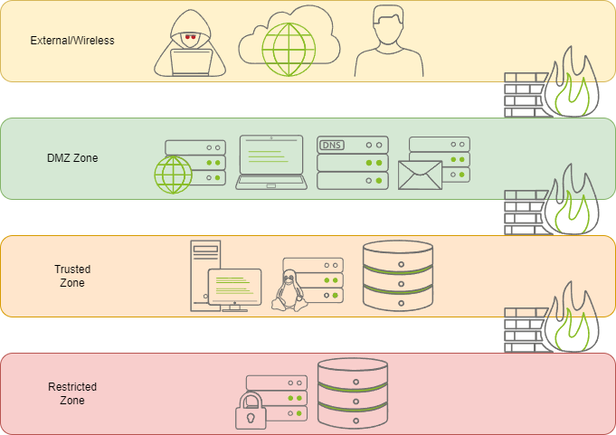

# Secure Network Architecture
## Task 1: Introduction
* **Overview:** Introduces the fundamental design principles of secure network architecture, highlighting that a truly well-designed network goes beyond basic functionality to ensure high availability, fault tolerance, and rigorous security.
* **Key Principles Covered:**
    * **Redundancy:** Ensuring alternative paths exist (e.g., if a switch fails, traffic reroutes automatically without uptime loss).
    * **Containment / Segmentation:** Ensuring that if an edge asset like a web server is compromised, attackers cannot easily traverse the network to reach core internal systems.
    * **Device Isolation:** Ensuring unverified devices joining the network are automatically segmented and restricted from sensitive corporate assets.
* **Prerequisites:** A foundational understanding of general networking concepts and terminology.

## Task 2: Network Segmentation
* **Overview:** Explores Network Segmentation, the practice of splitting a larger computer network into smaller, isolated subnetworks or segments to restrict lateral movement during an attack.
* **Key Concepts & Benefits:**
    * **Blast Radius Reduction:** Confines a security breach or malware infection to a single isolated segment, preventing it from spreading unhindered across the corporate enterprise.
    * **VLANs (Virtual Local Area Networks):** Logical grouping of network devices regardless of their physical location, allowing administrators to separate departments (e.g., guest Wi-Fi vs. finance servers).
    * **Micro-segmentation:** Advanced security practice that applies fine-grained, workload-level security policies down to individual virtual machines or containers.

## Task 3: Common Secure Network Architecture
* **Overview:** Explores traditional and modern network architecture topologies designed to protect enterprise environments from external and internal threats.

* **Key Architectural Zones:**
    * **Demilitarized Zone (DMZ):** A physical or logical subnetwork that exposes an organization's external-facing services (like public web or mail servers) to an untrusted network (the internet) while shielding the internal LAN.
    * **Internal Network / Trusted Zone:** Houses critical databases, corporate workstations, and internal applications behind strict firewalls and internal access controls.
    * **Management Network:** A heavily restricted, out-of-band or tightly controlled network segment strictly used by system administrators to manage network devices securely.

## Task 4: Network Security Policies and Controls
* **Overview:** Focuses on establishing the administrative rules, technical controls, and structural guidelines that govern how traffic flows and how network devices operate.
* **Key Concepts:**
    * **Least Privilege in Networking:** Ensuring that network links, switch ports, and firewalls only permit traffic that is strictly required for business operations ("deny by default").
    * **Security Baselines:** Standardizing hardware and software configurations to eliminate default passwords, close unnecessary ports, and disable insecure routing protocols.
    * **Policy Enforcement:** Bridging high-level organizational security policies with physical or software-defined network (SDN) configurations.

## Task 5: Zone-Pair Policies and Filtering
* **Overview:** Explores how traffic is managed, controlled, and filtered between different security zones using firewalls and stateful inspection policies.
* **Key Concepts:**
    * **Zone-Based Firewalls (ZBFW):** Assigns router or firewall interfaces to specific zones (e.g., Inside, Outside, DMZ) and applies inspection policies based on the direction of travel between a source zone and a destination zone.
    * **Inter-Zone Traffic Control:** Enforces granular traffic rules (e.g., allowing Trusted zones to communicate outward, but blocking External zones from initiating arbitrary connections into Restricted or Trusted zones).
    * **Stateful Inspection:** Tracking the state of active connections to ensure return traffic for legitimate requests is automatically permitted while unauthorized incoming packets are dropped.

## Task 6: Validating Network Traffic
* **Overview:** Focuses on the importance of inspecting, analyzing, and validating network traffic passing through security checkpoints to detect malicious payloads or protocol anomalies.
* **Key Concepts:**
    * **Deep Packet Inspection (DPI):** Looking beyond standard Layer 3 (IP) and Layer 4 (Port/Protocol) headers to analyze the actual application-layer data payload.
    * **Intrusion Detection & Prevention Systems (IDS/IPS):** Inspecting traffic in real time against known attack signatures and anomalous behavioral heuristics to block active threats.
    * **Traffic Logging & Telemetry:** Capturing packet metadata and connection summaries to aid security analysts during incident investigations.

## Task 7: Addressing Common Attacks
* **Overview:** Examines how secure network architectures and technical controls mitigate widespread network-based attacks.
* **Key Mitigations:**
    * **VLAN Hopping & Spoofing:** Mitigated by disabling dynamic trunking protocols (DTP), setting unused switch ports to access mode, and locking ports to specific MAC addresses.
    * **Man-in-the-Middle (MitM) & ARP Spoofing:** Prevented using Dynamic ARP Inspection (DAI), DHCP snooping, and secure encrypted routing protocols.
    * **Denial of Service (DoS):** Managed using rate-limiting, traffic shaping, DDoS mitigation appliances, and proper firewall resource allocations.

## Task 8: Conclusion
* **Overview:** Wraps up the core concepts of the Secure Network Architecture room, reinforcing that secure design is an iterative process.
* **Key Takeaways:**
    * Combining segmentation, strict security zones, zone-pair filtering, and continuous traffic validation builds a resilient defense-in-depth posture.
    * Network security must constantly adapt to emerging infrastructure changes, cloud migrations, and evolving adversary tactics.